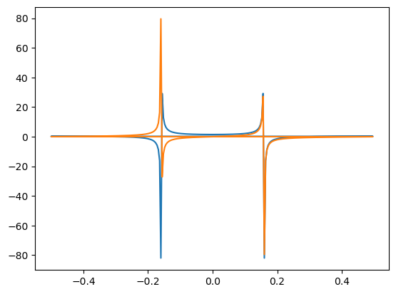
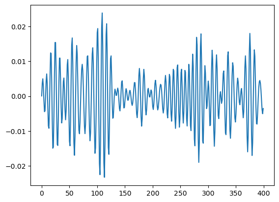
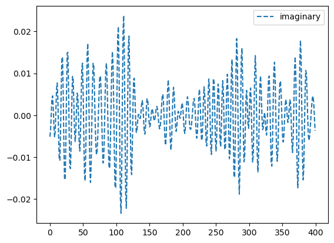
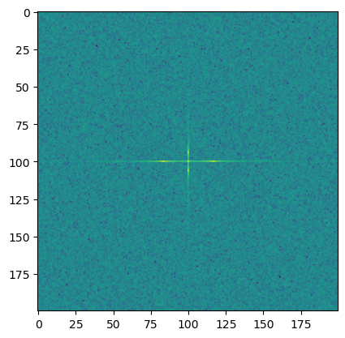
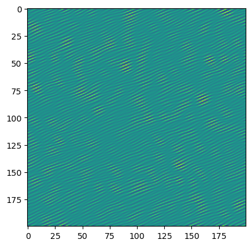

# Numpy

Numpy

Author

Benedict Thekkel

## Import Numpy

``` python
!pip list | grep numpy
```

    numpy                         1.23.5

``` python
import numpy as np
```

## Creating Numpy Arrays

### Python sequences to NumPy Arrays

``` python
a1D = np.array([1, 2, 3, 4])

a2D = np.array([[1, 2], [3, 4]])

a3D = np.array([[[1, 2], [3, 4]], [[5, 6], [7, 8]]])

a1D, a2D, a3D
```

    (array([1, 2, 3, 4]),
     array([[1, 2],
            [3, 4]]),
     array([[[1, 2],
             [3, 4]],
     
            [[5, 6],
             [7, 8]]]))

``` python
a = np.array([127, 128, 129], dtype=np.int8)
a
```

    array([ 127, -128, -127], dtype=int8)

### Intrinsic NumPy array creation functions

``` python
np.arange(10)
```

    array([0, 1, 2, 3, 4, 5, 6, 7, 8, 9])

``` python
np.arange(2, 10, dtype=float)
```

    array([2., 3., 4., 5., 6., 7., 8., 9.])

``` python
np.arange(2, 3, 0.1)
```

    array([2. , 2.1, 2.2, 2.3, 2.4, 2.5, 2.6, 2.7, 2.8, 2.9])

``` python
np.linspace(1., 4., 6)
```

    array([1. , 1.6, 2.2, 2.8, 3.4, 4. ])

``` python
np.eye(3)
```

    array([[1., 0., 0.],
           [0., 1., 0.],
           [0., 0., 1.]])

``` python
np.eye(3, 5)
```

    array([[1., 0., 0., 0., 0.],
           [0., 1., 0., 0., 0.],
           [0., 0., 1., 0., 0.]])

``` python
np.diag([1, 2, 3])
```

    array([[1, 0, 0],
           [0, 2, 0],
           [0, 0, 3]])

``` python
np.diag([1, 2, 3], 1)
```

    array([[0, 1, 0, 0],
           [0, 0, 2, 0],
           [0, 0, 0, 3],
           [0, 0, 0, 0]])

``` python
np.vander(np.linspace(0, 2, 5), 3)
```

    array([[0.  , 0.  , 1.  ],
           [0.25, 0.5 , 1.  ],
           [1.  , 1.  , 1.  ],
           [2.25, 1.5 , 1.  ],
           [4.  , 2.  , 1.  ]])

``` python
np.zeros((2, 3))
```

    array([[0., 0., 0.],
           [0., 0., 0.]])

``` python
np.ones((2, 3, 2))
```

    array([[[1., 1.],
            [1., 1.],
            [1., 1.]],

           [[1., 1.],
            [1., 1.],
            [1., 1.]]])

``` python
from numpy.random import default_rng
default_rng(42).random((2,3))
```

    array([[0.77395605, 0.43887844, 0.85859792],
           [0.69736803, 0.09417735, 0.97562235]])

``` python
np.indices((3,3))
```

    array([[[0, 0, 0],
            [1, 1, 1],
            [2, 2, 2]],

           [[0, 1, 2],
            [0, 1, 2],
            [0, 1, 2]]])

### Replicating, joining, or mutating existing arrays

``` python
a = np.array([1, 2, 3, 4, 5, 6])

b = a[:2]

b += 1

print('a =', a, '; b =', b)
```

    a = [2 3 3 4 5 6] ; b = [2 3]

``` python
a = np.array([1, 2, 3, 4])

b = a[:2].copy()

b += 1

print('a = ', a, 'b = ', b)
```

    a =  [1 2 3 4] b =  [2 3]

``` python
A = np.ones((2, 2))

B = np.eye(2, 2)

C = np.zeros((2, 2))

D = np.diag((-3, -4))

np.block([[A, B], [C, D]])
```

    array([[ 1.,  1.,  1.,  0.],
           [ 1.,  1.,  0.,  1.],
           [ 0.,  0., -3.,  0.],
           [ 0.,  0.,  0., -4.]])

## Indexing

### Basic indexing

``` python
x = np.arange(10)
x,x[2]
```

    (array([0, 1, 2, 3, 4, 5, 6, 7, 8, 9]), 2)

``` python
x[-2]
```

    8

``` python
x.shape = (2, 5)  # now x is 2-dimensional

x, x[1, 3]
```

    (array([[0, 1, 2, 3, 4],
            [5, 6, 7, 8, 9]]),
     8)

``` python
x[0], x[0][2]
```

    (array([0, 1, 2, 3, 4]), 2)

#### Slicing and striding

``` python
x = np.array([0, 1, 2, 3, 4, 5, 6, 7, 8, 9])

x[1:7:2]
```

    array([1, 3, 5])

``` python
x[-2:10]
```

    array([8, 9])

``` python
x[-3:3:-1]
```

    array([7, 6, 5, 4])

``` python
x[5:]
```

    array([5, 6, 7, 8, 9])

``` python
x = np.array([[[1],[2],[3]], [[4],[5],[6]]])

x.shape, x[1:2]
```

    ((2, 3, 1),
     array([[[4],
             [5],
             [6]]]))

#### Dimensional indexing tools

``` python
x[..., 0]
```

    array([[1, 2, 3],
           [4, 5, 6]])

``` python
x[:, :, 0]
```

    array([[1, 2, 3],
           [4, 5, 6]])

``` python
x[:, np.newaxis, :, :].shape
```

    (2, 1, 3, 1)

``` python
x[:, None, :, :].shape
```

    (2, 1, 3, 1)

``` python
x = np.arange(5)
x
```

    array([0, 1, 2, 3, 4])

``` python
x[:, np.newaxis] + x[np.newaxis, :]
```

    array([[0, 1, 2, 3, 4],
           [1, 2, 3, 4, 5],
           [2, 3, 4, 5, 6],
           [3, 4, 5, 6, 7],
           [4, 5, 6, 7, 8]])

### Advanced indexing

``` python
x = np.arange(10, 1, -1)
```

``` python
x[np.array([3, 3, 1, 8])]
```

    array([7, 7, 9, 2])

``` python
x = np.array([[1, 2], [3, 4], [5, 6]])
```

``` python
y = np.arange(35).reshape(5, 7)

y
```

    array([[ 0,  1,  2,  3,  4,  5,  6],
           [ 7,  8,  9, 10, 11, 12, 13],
           [14, 15, 16, 17, 18, 19, 20],
           [21, 22, 23, 24, 25, 26, 27],
           [28, 29, 30, 31, 32, 33, 34]])

``` python
y[np.array([0, 2, 4]), np.array([0, 1, 2])]
```

    array([ 0, 15, 30])

``` python
y[np.array([0, 2, 4]), 1]
```

    array([ 1, 15, 29])

``` python
y[np.array([0, 2, 4])]
```

    array([[ 0,  1,  2,  3,  4,  5,  6],
           [14, 15, 16, 17, 18, 19, 20],
           [28, 29, 30, 31, 32, 33, 34]])

``` python
x = np.array([[1, 2], [3, 4], [5, 6]])

x[[0, 1, 2], [0, 1, 0]]
```

    array([1, 4, 5])

``` python
x = np.array([[ 0,  1,  2],

              [ 3,  4,  5],

              [ 6,  7,  8],

              [ 9, 10, 11]])

rows = np.array([[0, 0],

                 [3, 3]], dtype=np.intp)

columns = np.array([[0, 2],

                    [0, 2]], dtype=np.intp)

x[rows, columns]
```

    array([[ 0,  2],
           [ 9, 11]])

``` python
rows = np.array([0, 3], dtype=np.intp)

columns = np.array([0, 2], dtype=np.intp)

rows[:, np.newaxis]
```

    array([[0],
           [3]])

``` python
x[rows[:, np.newaxis], columns]
```

    array([[ 0,  2],
           [ 9, 11]])

``` python
x[np.ix_(rows, columns)]
```

    array([[ 0,  2],
           [ 9, 11]])

``` python
x = np.array([[1., 2.], [np.nan, 3.], [np.nan, np.nan]])

x[~np.isnan(x)]
```

    array([1., 2., 3.])

``` python
x = np.array([1., -1., -2., 3])

x[x < 0] += 20

x
```

    array([ 1., 19., 18.,  3.])

``` python
x = np.arange(35).reshape(5, 7)

b = x > 20
b
```

    array([[False, False, False, False, False, False, False],
           [False, False, False, False, False, False, False],
           [False, False, False, False, False, False, False],
           [ True,  True,  True,  True,  True,  True,  True],
           [ True,  True,  True,  True,  True,  True,  True]])

``` python
b[:, 5]
```

    array([False, False, False,  True,  True])

``` python
x[b[:, 5]]
```

    array([[21, 22, 23, 24, 25, 26, 27],
           [28, 29, 30, 31, 32, 33, 34]])

``` python
x = np.array([[ 0,  1,  2],

              [ 3,  4,  5],

              [ 6,  7,  8],

              [ 9, 10, 11]])

rows = (x.sum(-1) % 2) == 0

rows
```

    array([False,  True, False,  True])

``` python
columns = [0, 2]

x[np.ix_(rows, columns)]
```

    array([[ 3,  5],
           [ 9, 11]])

``` python
rows = rows.nonzero()[0]

x[rows[:, np.newaxis], columns]
```

    array([[ 3,  5],
           [ 9, 11]])

``` python
x = np.arange(30).reshape(2, 3, 5)

x
```

    array([[[ 0,  1,  2,  3,  4],
            [ 5,  6,  7,  8,  9],
            [10, 11, 12, 13, 14]],

           [[15, 16, 17, 18, 19],
            [20, 21, 22, 23, 24],
            [25, 26, 27, 28, 29]]])

``` python
b = np.array([[True, True, False], [False, True, True]])

x[b]
```

    array([[ 0,  1,  2,  3,  4],
           [ 5,  6,  7,  8,  9],
           [20, 21, 22, 23, 24],
           [25, 26, 27, 28, 29]])

``` python
y = np.arange(35).reshape(5,7)

y[np.array([0, 2, 4]), 1:3]
```

    array([[ 1,  2],
           [15, 16],
           [29, 30]])

``` python
y[:, 1:3][np.array([0, 2, 4]), :]
```

    array([[ 1,  2],
           [15, 16],
           [29, 30]])

``` python
x = np.array([[ 0,  1,  2],

              [ 3,  4,  5],

              [ 6,  7,  8],

              [ 9, 10, 11]])

x[1:2, 1:3]
```

    array([[4, 5]])

``` python
x[1:2, [1, 2]]
```

    array([[4, 5]])

``` python
x = np.arange(35).reshape(5, 7)

b = x > 20

b
```

    array([[False, False, False, False, False, False, False],
           [False, False, False, False, False, False, False],
           [False, False, False, False, False, False, False],
           [ True,  True,  True,  True,  True,  True,  True],
           [ True,  True,  True,  True,  True,  True,  True]])

``` python
x[b[:, 5], 1:3]
```

    array([[22, 23],
           [29, 30]])

### Field Access

``` python
x = np.zeros((2, 2), dtype=[('a', np.int32), ('b', np.float64, (3, 3))])
x
```

    array([[(0, [[0., 0., 0.], [0., 0., 0.], [0., 0., 0.]]),
            (0, [[0., 0., 0.], [0., 0., 0.], [0., 0., 0.]])],
           [(0, [[0., 0., 0.], [0., 0., 0.], [0., 0., 0.]]),
            (0, [[0., 0., 0.], [0., 0., 0.], [0., 0., 0.]])]],
          dtype=[('a', '<i4'), ('b', '<f8', (3, 3))])

``` python
x['a'].shape, x['b'].shape
```

    ((2, 2), (2, 2, 3, 3))

``` python
x['a'].dtype, x['b'].dtype
```

    (dtype('int32'), dtype('float64'))

### Assigning values to indexed arrays

``` python
x = np.arange(10)

x[2:7] = 1
```

``` python
x[2:7] = np.arange(5)
```

``` python
x[1] = 1.2

x[1]
```

    1

``` python
x = np.arange(0, 50, 10)
x
```

    array([ 0, 10, 20, 30, 40])

``` python
x[np.array([1, 1, 3, 1])] += 1

x
```

    array([ 0, 11, 20, 31, 40])

### Dealing with variable numbers of indices within programs

``` python
z = np.arange(81).reshape(3, 3, 3, 3)

indices = (1, 1, 1, 1)

z[indices]
```

    40

``` python
indices = (1, 1, 1, slice(0, 2))  # same as [1, 1, 1, 0:2]

z[indices]
```

    array([39, 40])

``` python
indices = (1, Ellipsis, 1)  # same as [1, ..., 1]

z[indices]
```

    array([[28, 31, 34],
           [37, 40, 43],
           [46, 49, 52]])

``` python
z[[1, 1, 1, 1]]  # produces a large array
```

    array([[[[27, 28, 29],
             [30, 31, 32],
             [33, 34, 35]],

            [[36, 37, 38],
             [39, 40, 41],
             [42, 43, 44]],

            [[45, 46, 47],
             [48, 49, 50],
             [51, 52, 53]]],


           [[[27, 28, 29],
             [30, 31, 32],
             [33, 34, 35]],

            [[36, 37, 38],
             [39, 40, 41],
             [42, 43, 44]],

            [[45, 46, 47],
             [48, 49, 50],
             [51, 52, 53]]],


           [[[27, 28, 29],
             [30, 31, 32],
             [33, 34, 35]],

            [[36, 37, 38],
             [39, 40, 41],
             [42, 43, 44]],

            [[45, 46, 47],
             [48, 49, 50],
             [51, 52, 53]]],


           [[[27, 28, 29],
             [30, 31, 32],
             [33, 34, 35]],

            [[36, 37, 38],
             [39, 40, 41],
             [42, 43, 44]],

            [[45, 46, 47],
             [48, 49, 50],
             [51, 52, 53]]]])

``` python
z[(1, 1, 1, 1)]  # returns a single value
```

    40

## I/O with Numpy

### Splitting the lines into columns

``` python
import numpy as np

from io import StringIO
```

``` python
data = u"1, 2, 3\n4, 5, 6"

np.genfromtxt(StringIO(data), delimiter=",")
```

    array([[1., 2., 3.],
           [4., 5., 6.]])

``` python
data = u"  1  2  3\n  4  5 67\n890123  4"

np.genfromtxt(StringIO(data), delimiter=3)
```

    array([[  1.,   2.,   3.],
           [  4.,   5.,  67.],
           [890., 123.,   4.]])

``` python
data = u"123456789\n   4  7 9\n   4567 9"

np.genfromtxt(StringIO(data), delimiter=(4, 3, 2))
```

    array([[1234.,  567.,   89.],
           [   4.,    7.,    9.],
           [   4.,  567.,    9.]])

``` python
data = u"1, abc , 2\n 3, xxx, 4"

# Without autostrip

np.genfromtxt(StringIO(data), delimiter=",", dtype="|U5")
```

    array([['1', ' abc ', ' 2'],
           ['3', ' xxx', ' 4']], dtype='<U5')

``` python
np.genfromtxt(StringIO(data), delimiter=",", dtype="|U5", autostrip=True)
```

    array([['1', 'abc', '2'],
           ['3', 'xxx', '4']], dtype='<U5')

``` python
data = u"""#

# Skip me !

# Skip me too !

1, 2

3, 4

5, 6 #This is the third line of the data

7, 8

# And here comes the last line

9, 0

"""

np.genfromtxt(StringIO(data), comments="#", delimiter=",")
```

    array([[1., 2.],
           [3., 4.],
           [5., 6.],
           [7., 8.],
           [9., 0.]])

### Skipping lines and choosing columns

``` python
data = u"\n".join(str(i) for i in range(10))

np.genfromtxt(StringIO(data),)
```

    array([0., 1., 2., 3., 4., 5., 6., 7., 8., 9.])

``` python
np.genfromtxt(StringIO(data),
              skip_header=3, skip_footer=5)
```

    array([3., 4.])

``` python
data = u"1 2 3\n4 5 6"

np.genfromtxt(StringIO(data), usecols=(0, -1))
```

    array([[1., 3.],
           [4., 6.]])

``` python
data = u"1 2 3\n4 5 6"

np.genfromtxt(StringIO(data),
              names="a, b, c", usecols=("a", "c"))
```

    array([(1., 3.), (4., 6.)], dtype=[('a', '<f8'), ('c', '<f8')])

``` python
np.genfromtxt(StringIO(data),
              names="a, b, c", usecols=("a, c"))
```

    array([(1., 3.), (4., 6.)], dtype=[('a', '<f8'), ('c', '<f8')])

### Choosing the data type

The main way to control how the sequences of strings we have read from the file are converted to other types is to set the dtype argument. Acceptable values for this argument are:

- a single type, such as dtype=float. The output will be 2D with the given dtype, unless a name has been associated with each column with the use of the names argument (see below). Note that dtype=float is the default for genfromtxt.

- a sequence of types, such as dtype=(int, float, float).

- a comma-separated string, such as dtype=“i4,f8,\|U3”.

- a dictionary with two keys ‘names’ and ‘formats’.

- a sequence of tuples (name, type), such as dtype=\[(‘A’, int), (‘B’, float)\].

- an existing numpy.dtype object.

- the special value None. In that case, the type of the columns will be determined from the data itself (see below).

In all the cases but the first one, the output will be a 1D array with a structured dtype. This dtype has as many fields as items in the sequence. The field names are defined with the names keyword.

When dtype=None, the type of each column is determined iteratively from its data. We start by checking whether a string can be converted to a boolean (that is, if the string matches true or false in lower cases); then whether it can be converted to an integer, then to a float, then to a complex and eventually to a string.

The option dtype=None is provided for convenience. However, it is significantly slower than setting the dtype explicitly.

### Setting the names

``` python
data = StringIO("1 2 3\n 4 5 6")

a = np.genfromtxt(data, dtype=[(_, int) for _ in "abc"])
a
```

    array([(1, 2, 3), (4, 5, 6)],
          dtype=[('a', '<i8'), ('b', '<i8'), ('c', '<i8')])

``` python
a['a']
```

    array([1, 4])

``` python
data = StringIO("1 2 3\n 4 5 6")

np.genfromtxt(data, names="A, B, C")
```

    array([(1., 2., 3.), (4., 5., 6.)],
          dtype=[('A', '<f8'), ('B', '<f8'), ('C', '<f8')])

``` python
data = StringIO("So it goes\n#a b c\n1 2 3\n 4 5 6")

np.genfromtxt(data, skip_header=1, names=True)
```

    array([(1., 2., 3.), (4., 5., 6.)],
          dtype=[('a', '<f8'), ('b', '<f8'), ('c', '<f8')])

``` python
data = StringIO("1 2 3\n 4 5 6")

ndtype=[('a',int), ('b', float), ('c', int)]

names = ["A", "B", "C"]

np.genfromtxt(data, names=names, dtype=ndtype)
```

    array([(1, 2., 3), (4, 5., 6)],
          dtype=[('A', '<i8'), ('B', '<f8'), ('C', '<i8')])

``` python
data = StringIO("1 2 3\n 4 5 6")

np.genfromtxt(data, dtype=(int, float, int))
```

    array([(1, 2., 3), (4, 5., 6)],
          dtype=[('f0', '<i8'), ('f1', '<f8'), ('f2', '<i8')])

``` python
data = StringIO("1 2 3\n 4 5 6")

np.genfromtxt(data, dtype=(int, float, int), names="a")
```

    array([(1, 2., 3), (4, 5., 6)],
          dtype=[('a', '<i8'), ('f0', '<f8'), ('f1', '<i8')])

``` python
data = StringIO("1 2 3\n 4 5 6")

np.genfromtxt(data, dtype=(int, float, int), defaultfmt="var_%02i")
```

    array([(1, 2., 3), (4, 5., 6)],
          dtype=[('var_00', '<i8'), ('var_01', '<f8'), ('var_02', '<i8')])

### Tweaking the conversion

``` python
convertfunc = lambda x: float(x.strip(b"%"))/100.

data = u"1, 2.3%, 45.\n6, 78.9%, 0"

names = ("i", "p", "n")

# General case .....
np.genfromtxt(StringIO(data), delimiter=",", names=names)
```

    array([(1., nan, 45.), (6., nan,  0.)],
          dtype=[('i', '<f8'), ('p', '<f8'), ('n', '<f8')])

``` python
# Converted case ...
np.genfromtxt(StringIO(data), delimiter=",", names=names,
              converters={1: convertfunc})
```

    array([(1., 0.023, 45.), (6., 0.789,  0.)],
          dtype=[('i', '<f8'), ('p', '<f8'), ('n', '<f8')])

``` python
# Using a name for the converter ...

np.genfromtxt(StringIO(data), delimiter=",", names=names,
              converters={"p": convertfunc})
```

    array([(1., 0.023, 45.), (6., 0.789,  0.)],
          dtype=[('i', '<f8'), ('p', '<f8'), ('n', '<f8')])

``` python
data = u"1, , 3\n 4, 5, 6"

convert = lambda x: float(x.strip() or -999)

np.genfromtxt(StringIO(data), delimiter=",",

              converters={1: convert})
```

    array([[   1., -999.,    3.],
           [   4.,    5.,    6.]])

``` python
data = u"N/A, 2, 3\n4, ,???"

kwargs = dict(delimiter=",",

              dtype=int,

              names="a,b,c",

              missing_values={0:"N/A", 'b':" ", 2:"???"},

              filling_values={0:0, 'b':0, 2:-999})

np.genfromtxt(StringIO(data), **kwargs)
```

    array([(0, 2,    3), (4, 0, -999)],
          dtype=[('a', '<i8'), ('b', '<i8'), ('c', '<i8')])

## Data types

### Array types and conversions between types

| Numpy type | C type | Description |
|----|----|:---|
| numpy.bool\_ | bool | Boolean (True or False) stored as a byte |
| numpy.byte | signed char | Platform-defined |
| numpy.ubyte | unsigned char | Platform-defined |
| numpy.short | short | Platform-defined |
| numpy.ushort | unsigned short | Platform-defined |
| numpy.intc | int | Platform-defined |
| numpy.uintc | unsigned int | Platform-defined |
| numpy.int\_ | long | Platform-defined |
| numpy.uint | unsigned long | Platform-defined |
| numpy.longlong | long long | Platform-defined |
| numpy.ulonglong | unsigned long long | Platform-defined |
| numpy.half / numpy.float16 |  | Half precision float: sign bit, 5 bits exponent, 10 bits mantissa |
| numpy.single | float | Platform-defined single precision float: typically sign bit, 8 bits exponent, 23 bits mantissa |
| numpy.double | double | Platform-defined double precision float: typically sign bit, 11 bits exponent, 52 bits mantissa. |
| numpy.longdouble | long double | Platform-defined extended-precision float |
| numpy.csingle | float complex | Complex number, represented by two single-precision floats (real and imaginary components) |
| numpy.cdouble | double complex | Complex number, represented by two double-precision floats (real and imaginary components). |
| numpy.clongdouble | long double complex | Complex number, represented by two extended-precision floats (real and imaginary components). |

``` python
x = np.float32(1.0)

x
```

    1.0

``` python
y = np.int_([1,2,4])

y
```

    array([1, 2, 4])

``` python
z = np.arange(3, dtype=np.uint8)

z
```

    array([0, 1, 2], dtype=uint8)

``` python
np.array([1, 2, 3], dtype='f')
```

    array([1., 2., 3.], dtype=float32)

``` python
z.astype(float)
```

    array([0., 1., 2.])

``` python
np.int8(z)
```

    array([0, 1, 2], dtype=int8)

``` python
z.dtype
```

    dtype('uint8')

``` python
d = np.dtype(int)

d
```

    dtype('int64')

``` python
np.issubdtype(d, np.integer)
```

    True

``` python
np.issubdtype(d, np.floating)
```

    False

``` python
np.power(100, 8, dtype=np.int64)
```

    10000000000000000

``` python
np.power(100, 8, dtype=np.int32)
```

    1874919424

``` python
np.iinfo(int) # Bounds of the default integer on this system.
```

    iinfo(min=-9223372036854775808, max=9223372036854775807, dtype=int64)

``` python
np.iinfo(np.int32) # Bounds of a 32-bit integer
```

    iinfo(min=-2147483648, max=2147483647, dtype=int32)

``` python
np.iinfo(np.int64) # Bounds of a 64-bit integer
```

    iinfo(min=-9223372036854775808, max=9223372036854775807, dtype=int64)

``` python
np.power(100, 100, dtype=np.int64) # Incorrect even with 64-bit int
```

    0

``` python
np.power(100, 100, dtype=np.float64)
```

    1e+200

## Broadcastable arrays

``` python
a = np.array([1.0, 2.0, 3.0])

b = np.array([2.0, 2.0, 2.0])

a * b
```

    array([2., 4., 6.])

``` python
a = np.array([1.0, 2.0, 3.0])

b = 2.0

a * b
```

    array([2., 4., 6.])

``` python
a = np.array([[ 0.0,  0.0,  0.0],

              [10.0, 10.0, 10.0],

              [20.0, 20.0, 20.0],

              [30.0, 30.0, 30.0]])

b = np.array([1.0, 2.0, 3.0])

a + b
```

    array([[ 1.,  2.,  3.],
           [11., 12., 13.],
           [21., 22., 23.],
           [31., 32., 33.]])

``` python
a = np.array([0.0, 10.0, 20.0, 30.0])

b = np.array([1.0, 2.0, 3.0])

a[:, np.newaxis] + b
```

    array([[ 1.,  2.,  3.],
           [11., 12., 13.],
           [21., 22., 23.],
           [31., 32., 33.]])

``` python
from numpy import array, argmin, sqrt, sum
observation = array([111.0, 188.0])

codes = array([[102.0, 203.0],

               [132.0, 193.0],

               [45.0, 155.0],

               [57.0, 173.0]])

diff = codes - observation    # the broadcast happens here

dist = sqrt(sum(diff**2,axis=-1))

argmin(dist)
```

    0

## Copies and views

### Indexing operations

``` python
x = np.arange(10)

x
```

    array([0, 1, 2, 3, 4, 5, 6, 7, 8, 9])

``` python
y = x[1:3]  # creates a view

y
```

    array([1, 2])

``` python
x[1:3] = [10, 11]
x
```

    array([ 0, 10, 11,  3,  4,  5,  6,  7,  8,  9])

``` python
y
```

    array([10, 11])

``` python
x = np.arange(9).reshape(3, 3)
x
```

    array([[0, 1, 2],
           [3, 4, 5],
           [6, 7, 8]])

``` python
y = x[[1, 2]]
y
```

    array([[3, 4, 5],
           [6, 7, 8]])

``` python
y.base is None
```

    True

``` python
x[[1, 2]] = [[10, 11, 12], [13, 14, 15]]
x
```

    array([[ 0,  1,  2],
           [10, 11, 12],
           [13, 14, 15]])

``` python
y
```

    array([[3, 4, 5],
           [6, 7, 8]])

``` python
x = np.ones((2, 3))

y = x.T  # makes the array non-contiguous

y
```

    array([[1., 1.],
           [1., 1.],
           [1., 1.]])

#### How to tell if the array is a view or a copy

``` python
x = np.arange(9)

x
```

    array([0, 1, 2, 3, 4, 5, 6, 7, 8])

``` python
y = x.reshape(3, 3)

y
```

    array([[0, 1, 2],
           [3, 4, 5],
           [6, 7, 8]])

``` python
y.base  # .reshape() creates a view
```

    array([0, 1, 2, 3, 4, 5, 6, 7, 8])

``` python
z = y[[2, 1]]
z
```

    array([[6, 7, 8],
           [3, 4, 5]])

``` python
z.base is None  # advanced indexing creates a copy
```

    True

## Structured arrays

``` python
x = np.array([('Rex', 9, 81.0), ('Fido', 3, 27.0)],
             dtype=[('name', 'U10'), ('age', 'i4'), ('weight', 'f4')])
x
```

    array([('Rex', 9, 81.), ('Fido', 3, 27.)],
          dtype=[('name', '<U10'), ('age', '<i4'), ('weight', '<f4')])

``` python
x[1]
```

    ('Fido', 3, 27.)

``` python
x['age']
```

    array([9, 3], dtype=int32)

``` python
x['age'] = 5
```

``` python
x
```

    array([('Rex', 5, 81.), ('Fido', 5, 27.)],
          dtype=[('name', '<U10'), ('age', '<i4'), ('weight', '<f4')])

``` python
np.dtype([('x', 'f4'), ('y', np.float32), ('z', 'f4', (2, 2))])
```

    dtype([('x', '<f4'), ('y', '<f4'), ('z', '<f4', (2, 2))])

``` python
np.dtype([('x', 'f4'), ('', 'i4'), ('z', 'i8')])
```

    dtype([('x', '<f4'), ('f1', '<i4'), ('z', '<i8')])

``` python
np.dtype('i8, f4, S3')
```

    dtype([('f0', '<i8'), ('f1', '<f4'), ('f2', 'S3')])

``` python
np.dtype('3int8, float32, (2, 3)float64')
```

    dtype([('f0', 'i1', (3,)), ('f1', '<f4'), ('f2', '<f8', (2, 3))])

``` python
np.dtype({'names': ['col1', 'col2'], 'formats': ['i4', 'f4']})
```

    dtype([('col1', '<i4'), ('col2', '<f4')])

``` python
np.dtype({'names': ['col1', 'col2'],
          'formats': ['i4', 'f4'],
          'offsets': [0, 4],
          'itemsize': 12})
```

    dtype({'names': ['col1', 'col2'], 'formats': ['<i4', '<f4'], 'offsets': [0, 4], 'itemsize': 12})

``` python
np.dtype({'col1': ('i1', 0), 'col2': ('f4', 1)})
```

    dtype([('col1', 'i1'), ('col2', '<f4')])

#### Manipulating and Displaying Structured Datatypes

``` python
d = np.dtype([('x', 'i8'), ('y', 'f4')])

d.names
```

    ('x', 'y')

``` python
d['x']
```

    dtype('int64')

``` python
d.fields
```

    mappingproxy({'x': (dtype('int64'), 0), 'y': (dtype('float32'), 8)})

``` python
def print_offsets(d):

    print("offsets:", [d.fields[name][1] for name in d.names])

    print("itemsize:", d.itemsize)
```

``` python
print_offsets(np.dtype('u1, u1, i4, u1, i8, u2'))
```

    offsets: [0, 1, 2, 6, 7, 15]
    itemsize: 17

``` python
print_offsets(np.dtype('u1, u1, i4, u1, i8, u2', align=True))
```

    offsets: [0, 1, 4, 8, 16, 24]
    itemsize: 32

``` python
np.dtype([(('my title', 'name'), 'f4')])
```

    dtype([(('my title', 'name'), '<f4')])

``` python
np.dtype({'name': ('i4', 0, 'my title')})
```

    dtype([(('my title', 'name'), '<i4')])

``` python
for name in d.names:
    print(d.fields[name][:2])
```

    (dtype('int64'), 0)
    (dtype('float32'), 8)

### Indexing and Assignment to Structured arrays

``` python
x = np.array([(1, 2, 3), (4, 5, 6)], dtype='i8, f4, f8')
x
```

    array([(1, 2., 3.), (4, 5., 6.)],
          dtype=[('f0', '<i8'), ('f1', '<f4'), ('f2', '<f8')])

``` python
x[1] = (7, 8, 9)
```

``` python
x
```

    array([(1, 2., 3.), (7, 8., 9.)],
          dtype=[('f0', '<i8'), ('f1', '<f4'), ('f2', '<f8')])

``` python
x = np.zeros(2, dtype='i8, f4, ?, S1')
x[:] = 3
x
```

    array([(3, 3.,  True, b'3'), (3, 3.,  True, b'3')],
          dtype=[('f0', '<i8'), ('f1', '<f4'), ('f2', '?'), ('f3', 'S1')])

``` python
x[:] = np.arange(2)
x
```

    array([(0, 0., False, b'0'), (1, 1.,  True, b'1')],
          dtype=[('f0', '<i8'), ('f1', '<f4'), ('f2', '?'), ('f3', 'S1')])

``` python
a = np.zeros(3, dtype=[('a', 'i8'), ('b', 'f4'), ('c', 'S3')])
b = np.ones(3, dtype=[('x', 'f4'), ('y', 'S3'), ('z', 'O')])
b[:] = a
b
```

    array([(0., b'0.0', b''), (0., b'0.0', b''), (0., b'0.0', b'')],
          dtype=[('x', '<f4'), ('y', 'S3'), ('z', 'O')])

``` python
x = np.array([(1, 2), (3, 4)], dtype=[('foo', 'i8'), ('bar', 'f4')])

x['foo']
```

    array([1, 3])

``` python
x['foo'] = 10

x
```

    array([(10, 2.), (10, 4.)], dtype=[('foo', '<i8'), ('bar', '<f4')])

``` python
y = x['bar']

y[:] = 11

x
```

    array([(10, 11.), (10, 11.)], dtype=[('foo', '<i8'), ('bar', '<f4')])

``` python
y.dtype, y.shape, y.strides
```

    (dtype('float32'), (2,), (12,))

``` python
x = np.zeros((2, 2), dtype=[('a', np.int32), ('b', np.float64, (3, 3))])

x['a'].shape
```

    (2, 2)

``` python
x['b'].shape
```

    (2, 2, 3, 3)

``` python
a = np.zeros(3, dtype=[('a', 'i4'), ('b', 'i4'), ('c', 'f4')])

a[['a', 'c']]
```

    array([(0, 0.), (0, 0.), (0, 0.)],
          dtype={'names': ['a', 'c'], 'formats': ['<i4', '<f4'], 'offsets': [0, 8], 'itemsize': 12})

``` python
from numpy.lib.recfunctions import repack_fields

repack_fields(a[['a', 'c']]).view('i8')  # supported in 1.16
```

    array([0, 0, 0])

``` python
b = np.zeros(3, dtype=[('x', 'f4'), ('y', 'f4'), ('z', 'f4')])

b[['x', 'z']].view('f4')
```

    array([0., 0., 0., 0., 0., 0., 0., 0., 0.], dtype=float32)

``` python
from numpy.lib.recfunctions import structured_to_unstructured

structured_to_unstructured(b[['x', 'z']])
```

    array([[0., 0.],
           [0., 0.],
           [0., 0.]], dtype=float32)

``` python
a[['a', 'c']] = (2, 3)

a
```

    array([(2, 0, 3.), (2, 0, 3.), (2, 0, 3.)],
          dtype=[('a', '<i4'), ('b', '<i4'), ('c', '<f4')])

``` python
a[['a', 'c']] = a[['c', 'a']]
```

``` python
x = np.array([(1, 2., 3.)], dtype='i, f, f')

scalar = x[0]

scalar
```

    (1, 2., 3.)

``` python
type(scalar)
```

    numpy.void

``` python
x = np.array([(1, 2), (3, 4)], dtype=[('foo', 'i8'), ('bar', 'f4')])
s = x[0]
s['bar'] = 100
x
```

    array([(1, 100.), (3,   4.)], dtype=[('foo', '<i8'), ('bar', '<f4')])

``` python
scalar = np.array([(1, 2., 3.)], dtype='i, f, f')[0]
scalar[0]
```

    1

``` python
scalar[1] = 4
```

``` python
scalar.item(), type(scalar.item())
```

    ((1, 4.0, 3.0), tuple)

#### Structure Comparison and Promotiona

``` python
a = np.array([(1, 1), (2, 2)], dtype=[('a', 'i4'), ('b', 'i4')])

b = np.array([(1, 1), (2, 3)], dtype=[('a', 'i4'), ('b', 'i4')])

a == b
```

    array([ True, False])

``` python
a = np.array([(1, 1), (2, 2)], dtype=[('a', 'i4'), ('b', 'i4')])

b = np.array([(1, 1), (2, 3)], dtype=[('a', 'i4'), ('b', 'i4')])

a == b
```

    array([ True, False])

``` python
b = np.array([(1.0, 1), (2.5, 2)], dtype=[("a", "f4"), ("b", "i4")])

a == b
```

    array([ True, False])

``` python
np.result_type(np.dtype("i,>i"))
```

    dtype([('f0', '<i4'), ('f1', '<i4')])

``` python
np.result_type(np.dtype("i,>i"), np.dtype("i,i"))
```

    dtype([('f0', '<i4'), ('f1', '<i4')])

``` python
dt = np.dtype("i1,V3,i4,V1")[["f0", "f2"]]
dt
```

    dtype({'names': ['f0', 'f2'], 'formats': ['i1', '<i4'], 'offsets': [0, 4], 'itemsize': 9})

``` python
np.result_type(dt)
```

    dtype([('f0', 'i1'), ('f2', '<i4')])

``` python
dt = np.dtype("i1,V3,i4,V1", align=True)[["f0", "f2"]]

dt
```

    dtype({'names': ['f0', 'f2'], 'formats': ['i1', '<i4'], 'offsets': [0, 4], 'itemsize': 12}, align=True)

``` python
np.result_type(dt)
```

    dtype([('f0', 'i1'), ('f2', '<i4')], align=True)

``` python
np.result_type(dt).isalignedstruct
```

    True

``` python
np.result_type(np.dtype("i,i"), np.dtype("i,i", align=True))
```

    dtype([('f0', '<i4'), ('f1', '<i4')], align=True)

#### Record Arrays

``` python
recordarr = np.rec.array([(1, 2., 'Hello'), (2, 3., "World")],

                   dtype=[('foo', 'i4'),('bar', 'f4'), ('baz', 'S10')])
```

``` python
recordarr.bar
```

    array([2., 3.], dtype=float32)

``` python
recordarr[1:2]
```

    rec.array([(2, 3., b'World')],
              dtype=[('foo', '<i4'), ('bar', '<f4'), ('baz', 'S10')])

``` python
recordarr[1:2].foo
```

    array([2], dtype=int32)

``` python
recordarr.foo[1:2]
```

    array([2], dtype=int32)

``` python
recordarr[1].baz
```

    b'World'

``` python
arr = np.array([(1, 2., 'Hello'), (2, 3., "World")],

            dtype=[('foo', 'i4'), ('bar', 'f4'), ('baz', 'S10')])
```

``` python
recordarr = np.rec.array(arr)
```

``` python
arr = np.array([(1, 2., 'Hello'), (2, 3., "World")],

               dtype=[('foo', 'i4'),('bar', 'f4'), ('baz', 'a10')])
```

``` python
recordarr = arr.view(dtype=np.dtype((np.record, arr.dtype)),

                     type=np.recarray)
```

``` python
recordarr = arr.view(np.recarray)

recordarr.dtype
```

    dtype((numpy.record, [('foo', '<i4'), ('bar', '<f4'), ('baz', 'S10')]))

``` python
arr2 = recordarr.view(recordarr.dtype.fields or recordarr.dtype, np.ndarray)
```

``` python
recordarr = np.rec.array([('Hello', (1, 2)), ("World", (3, 4))],

                dtype=[('foo', 'S6'),('bar', [('A', int), ('B', int)])])
```

``` python
type(recordarr.foo)
```

    numpy.ndarray

``` python
type(recordarr.bar)
```

    numpy.recarray

``` python
from numpy.lib import recfunctions as rfn

b = np.array([(1, 2, 5), (4, 5, 7), (7, 8 ,11), (10, 11, 12)],

             dtype=[('x', 'i4'), ('y', 'f4'), ('z', 'f8')])
```

``` python
rfn.apply_along_fields(np.mean, b)
```

    array([ 2.66666667,  5.33333333,  8.66666667, 11.        ])

``` python
rfn.apply_along_fields(np.mean, b[['x', 'z']])
```

    array([ 3. ,  5.5,  9. , 11. ])

``` python
from numpy.lib import recfunctions as rfn

a = np.array([(1, (2, 3.0)), (4, (5, 6.0))],

  dtype=[('a', np.int64), ('b', [('ba', np.double), ('bb', np.int64)])])
```

``` python
rfn.drop_fields(a, 'a')
```

    array([((2., 3),), ((5., 6),)],
          dtype=[('b', [('ba', '<f8'), ('bb', '<i8')])])

``` python
rfn.drop_fields(a, 'ba')
```

    array([(1, (3,)), (4, (6,))], dtype=[('a', '<i8'), ('b', [('bb', '<i8')])])

``` python
rfn.drop_fields(a, ['ba', 'bb'])
```

    array([(1,), (4,)], dtype=[('a', '<i8')])

``` python
from numpy.lib import recfunctions as rfn

ndtype = [('a', int)]

a = np.ma.array([1, 1, 1, 2, 2, 3, 3],

        mask=[0, 0, 1, 0, 0, 0, 1]).view(ndtype)
```

``` python
rfn.find_duplicates(a, ignoremask=True, return_index=True)
```

    (masked_array(data=[(1,), (1,), (2,), (2,)],
                  mask=[(False,), (False,), (False,), (False,)],
            fill_value=(999999,),
                 dtype=[('a', '<i8')]),
     array([0, 1, 3, 4]))

``` python
from numpy.lib import recfunctions as rfn

ndtype = np.dtype([('a', '<i4'), ('b', [('ba', '<f8'), ('bb', '<i4')])])

rfn.flatten_descr(ndtype)
```

    (('a', dtype('int32')), ('ba', dtype('float64')), ('bb', dtype('int32')))

``` python
from numpy.lib import recfunctions as rfn

ndtype =  np.dtype([('A', int),

                    ('B', [('BA', int),

                           ('BB', [('BBA', int), ('BBB', int)])])])

rfn.get_fieldstructure(ndtype)
```

    {'A': [],
     'B': [],
     'BA': ['B'],
     'BB': ['B'],
     'BBA': ['B', 'BB'],
     'BBB': ['B', 'BB']}

``` python
from numpy.lib import recfunctions as rfn

rfn.get_names(np.empty((1,), dtype=[('A', int)]).dtype)
```

    ('A',)

``` python
rfn.get_names(np.empty((1,), dtype=[('A',int), ('B', float)]).dtype)
```

    ('A', 'B')

``` python
adtype = np.dtype([('a', int), ('b', [('ba', int), ('bb', int)])])

rfn.get_names(adtype)
```

    ('a', ('b', ('ba', 'bb')))

``` python
from numpy.lib import recfunctions as rfn

rfn.get_names_flat(np.empty((1,), dtype=[('A', int)]).dtype) is None
```

    False

``` python
rfn.get_names_flat(np.empty((1,), dtype=[('A',int), ('B', str)]).dtype)
```

    ('A', 'B')

``` python
adtype = np.dtype([('a', int), ('b', [('ba', int), ('bb', int)])])

rfn.get_names_flat(adtype)
```

    ('a', 'b', 'ba', 'bb')

``` python
from numpy.lib import recfunctions as rfn

rfn.merge_arrays((np.array([1, 2]), np.array([10., 20., 30.])))
```

    array([( 1, 10.), ( 2, 20.), (-1, 30.)],
          dtype=[('f0', '<i8'), ('f1', '<f8')])

``` python
rfn.merge_arrays((np.array([1, 2], dtype=np.int64),

        np.array([10., 20., 30.])), usemask=False)
```

    array([( 1, 10.), ( 2, 20.), (-1, 30.)],
          dtype=[('f0', '<i8'), ('f1', '<f8')])

``` python
rfn.merge_arrays((np.array([1, 2]).view([('a', np.int64)]),

              np.array([10., 20., 30.])),

             usemask=False, asrecarray=True)
```

    rec.array([( 1, 10.), ( 2, 20.), (-1, 30.)],
              dtype=[('a', '<i8'), ('f1', '<f8')])

``` python
from numpy.lib import recfunctions as rfn

a = np.array([(1, 10.), (2, 20.)], dtype=[('A', np.int64), ('B', np.float64)])

b = np.zeros((3,), dtype=a.dtype)

rfn.recursive_fill_fields(a, b)
```

    array([(1, 10.), (2, 20.), (0,  0.)], dtype=[('A', '<i8'), ('B', '<f8')])

``` python
from numpy.lib import recfunctions as rfn

a = np.array([(1, (2, [3.0, 30.])), (4, (5, [6.0, 60.]))],

  dtype=[('a', int),('b', [('ba', float), ('bb', (float, 2))])])
```

``` python
rfn.rename_fields(a, {'a':'A', 'bb':'BB'})
```

    array([(1, (2., [ 3., 30.])), (4, (5., [ 6., 60.]))],
          dtype=[('A', '<i8'), ('b', [('ba', '<f8'), ('BB', '<f8', (2,))])])

``` python
from numpy.lib import recfunctions as rfn

def print_offsets(d):

    print("offsets:", [d.fields[name][1] for name in d.names])

    print("itemsize:", d.itemsize)
```

``` python
dt = np.dtype('u1, <i8, <f8', align=True)

dt
```

    dtype([('f0', 'u1'), ('f1', '<i8'), ('f2', '<f8')], align=True)

``` python
print_offsets(dt)
```

    offsets: [0, 8, 16]
    itemsize: 24

``` python
packed_dt = rfn.repack_fields(dt)

packed_dt
```

    dtype([('f0', 'u1'), ('f1', '<i8'), ('f2', '<f8')])

``` python
print_offsets(packed_dt)
```

    offsets: [0, 1, 9]
    itemsize: 17

``` python
from numpy.lib import recfunctions as rfn

a = np.ones(4, dtype=[('a', 'i4'), ('b', 'f8'), ('c', 'u1')])

rfn.require_fields(a, [('b', 'f4'), ('c', 'u1')])
```

    array([(1., 1), (1., 1), (1., 1), (1., 1)],
          dtype=[('b', '<f4'), ('c', 'u1')])

``` python
rfn.require_fields(a, [('b', 'f4'), ('newf', 'u1')])
```

    array([(1., 0), (1., 0), (1., 0), (1., 0)],
          dtype=[('b', '<f4'), ('newf', 'u1')])

``` python
from numpy.lib import recfunctions as rfn

x = np.array([1, 2,])

rfn.stack_arrays(x) is x
```

    True

``` python
z = np.array([('A', 1), ('B', 2)], dtype=[('A', '|S3'), ('B', float)])

zz = np.array([('a', 10., 100.), ('b', 20., 200.), ('c', 30., 300.)],

  dtype=[('A', '|S3'), ('B', np.double), ('C', np.double)])

test = rfn.stack_arrays((z,zz))

test
```

    masked_array(data=[(b'A', 1.0, --), (b'B', 2.0, --), (b'a', 10.0, 100.0),
                       (b'b', 20.0, 200.0), (b'c', 30.0, 300.0)],
                 mask=[(False, False,  True), (False, False,  True),
                       (False, False, False), (False, False, False),
                       (False, False, False)],
           fill_value=(b'N/A', 1.e+20, 1.e+20),
                dtype=[('A', 'S3'), ('B', '<f8'), ('C', '<f8')])

``` python
from numpy.lib import recfunctions as rfn

a = np.zeros(4, dtype=[('a', 'i4'), ('b', 'f4,u2'), ('c', 'f4', 2)])

a
```

    array([(0, (0., 0), [0., 0.]), (0, (0., 0), [0., 0.]),
           (0, (0., 0), [0., 0.]), (0, (0., 0), [0., 0.])],
          dtype=[('a', '<i4'), ('b', [('f0', '<f4'), ('f1', '<u2')]), ('c', '<f4', (2,))])

``` python
rfn.structured_to_unstructured(a)
```

    array([[0., 0., 0., 0., 0.],
           [0., 0., 0., 0., 0.],
           [0., 0., 0., 0., 0.],
           [0., 0., 0., 0., 0.]])

``` python
b = np.array([(1, 2, 5), (4, 5, 7), (7, 8 ,11), (10, 11, 12)],

             dtype=[('x', 'i4'), ('y', 'f4'), ('z', 'f8')])
```

``` python
np.mean(rfn.structured_to_unstructured(b[['x', 'z']]), axis=-1)
```

    array([ 3. ,  5.5,  9. , 11. ])

``` python
from numpy.lib import recfunctions as rfn

dt = np.dtype([('a', 'i4'), ('b', 'f4,u2'), ('c', 'f4', 2)])

a = np.arange(20).reshape((4,5))

a
```

    array([[ 0,  1,  2,  3,  4],
           [ 5,  6,  7,  8,  9],
           [10, 11, 12, 13, 14],
           [15, 16, 17, 18, 19]])

``` python
rfn.unstructured_to_structured(a, dt)
```

    array([( 0, ( 1.,  2), [ 3.,  4.]), ( 5, ( 6.,  7), [ 8.,  9.]),
           (10, (11., 12), [13., 14.]), (15, (16., 17), [18., 19.])],
          dtype=[('a', '<i4'), ('b', [('f0', '<f4'), ('f1', '<u2')]), ('c', '<f4', (2,))])

## Universal functions

``` python
np.array([0,2,3,4]) + np.array([1,1,-1,2])
```

    array([1, 3, 2, 6])

``` python
x = np.arange(9).reshape(3,3)

x
```

    array([[0, 1, 2],
           [3, 4, 5],
           [6, 7, 8]])

``` python
np.add.reduce(x, 1)
```

    array([ 3, 12, 21])

``` python
np.add.reduce(x, (0, 1))
```

    36

``` python
x.dtype
```

    dtype('int64')

``` python
np.multiply.reduce(x, dtype=float)
```

    array([ 0., 28., 80.])

``` python
y = np.zeros(3, dtype=int)

y
```

    array([0, 0, 0])

``` python
np.multiply.reduce(x, dtype=float, out=y)
```

    array([ 0, 28, 80])

``` python
mark = {False: ' -', True: ' Y'}

def print_table(ntypes):

    print('X ' + ' '.join(ntypes))

    for row in ntypes:

        print(row, end='')

        for col in ntypes:

            print(mark[np.can_cast(row, col)], end='')

        print()


print_table(np.typecodes['All'])
```

    X ? b h i l q p B H I L Q P e f d g F D G S U V O M m
    ? Y Y Y Y Y Y Y Y Y Y Y Y Y Y Y Y Y Y Y Y Y Y Y Y - Y
    b - Y Y Y Y Y Y - - - - - - Y Y Y Y Y Y Y Y Y Y Y - Y
    h - - Y Y Y Y Y - - - - - - - Y Y Y Y Y Y Y Y Y Y - Y
    i - - - Y Y Y Y - - - - - - - - Y Y - Y Y Y Y Y Y - Y
    l - - - - Y Y Y - - - - - - - - Y Y - Y Y Y Y Y Y - Y
    q - - - - Y Y Y - - - - - - - - Y Y - Y Y Y Y Y Y - Y
    p - - - - Y Y Y - - - - - - - - Y Y - Y Y Y Y Y Y - Y
    B - - Y Y Y Y Y Y Y Y Y Y Y Y Y Y Y Y Y Y Y Y Y Y - Y
    H - - - Y Y Y Y - Y Y Y Y Y - Y Y Y Y Y Y Y Y Y Y - Y
    I - - - - Y Y Y - - Y Y Y Y - - Y Y - Y Y Y Y Y Y - Y
    L - - - - - - - - - - Y Y Y - - Y Y - Y Y Y Y Y Y - -
    Q - - - - - - - - - - Y Y Y - - Y Y - Y Y Y Y Y Y - -
    P - - - - - - - - - - Y Y Y - - Y Y - Y Y Y Y Y Y - -
    e - - - - - - - - - - - - - Y Y Y Y Y Y Y Y Y Y Y - -
    f - - - - - - - - - - - - - - Y Y Y Y Y Y Y Y Y Y - -
    d - - - - - - - - - - - - - - - Y Y - Y Y Y Y Y Y - -
    g - - - - - - - - - - - - - - - - Y - - Y Y Y Y Y - -
    F - - - - - - - - - - - - - - - - - Y Y Y Y Y Y Y - -
    D - - - - - - - - - - - - - - - - - - Y Y Y Y Y Y - -
    G - - - - - - - - - - - - - - - - - - - Y Y Y Y Y - -
    S - - - - - - - - - - - - - - - - - - - - Y Y Y Y - -
    U - - - - - - - - - - - - - - - - - - - - - Y Y Y - -
    V - - - - - - - - - - - - - - - - - - - - - - Y Y - -
    O - - - - - - - - - - - - - - - - - - - - - - - Y - -
    M - - - - - - - - - - - - - - - - - - - - - - Y Y Y -
    m - - - - - - - - - - - - - - - - - - - - - - Y Y - Y

## np.fft

``` python
import matplotlib.pyplot as plt

t = np.arange(256)

sp = np.fft.fft(np.sin(t))

freq = np.fft.fftfreq(t.shape[-1])

plt.plot(freq, sp.real, freq, sp.imag)
```



``` python
plt.show()
```

``` python
import matplotlib.pyplot as plt

t = np.arange(400)

n = np.zeros((400,), dtype=complex)

n[40:60] = np.exp(1j*np.random.uniform(0, 2*np.pi, (20,)))

s = np.fft.ifft(n)

plt.plot(t, s.real, label='real')
```



``` python
plt.plot(t, s.imag, '--', label='imaginary')
plt.legend()

plt.show()
```



``` python
a = np.mgrid[:5, :5][0]

np.fft.fft2(a)
```

    array([[ 50.  +0.j        ,   0.  +0.j        ,   0.  +0.j        ,
              0.  +0.j        ,   0.  +0.j        ],
           [-12.5+17.20477401j,   0.  +0.j        ,   0.  +0.j        ,
              0.  +0.j        ,   0.  +0.j        ],
           [-12.5 +4.0614962j ,   0.  +0.j        ,   0.  +0.j        ,
              0.  +0.j        ,   0.  +0.j        ],
           [-12.5 -4.0614962j ,   0.  +0.j        ,   0.  +0.j        ,
              0.  +0.j        ,   0.  +0.j        ],
           [-12.5-17.20477401j,   0.  +0.j        ,   0.  +0.j        ,
              0.  +0.j        ,   0.  +0.j        ]])

``` python
a = 4 * np.eye(4)

np.fft.ifft2(a)
```

    array([[1.+0.j, 0.+0.j, 0.+0.j, 0.+0.j],
           [0.+0.j, 0.+0.j, 0.+0.j, 1.+0.j],
           [0.+0.j, 0.+0.j, 1.+0.j, 0.+0.j],
           [0.+0.j, 1.+0.j, 0.+0.j, 0.+0.j]])

``` python
import matplotlib.pyplot as plt

[X, Y] = np.meshgrid(2 * np.pi * np.arange(200) / 12,

                     2 * np.pi * np.arange(200) / 34)

S = np.sin(X) + np.cos(Y) + np.random.uniform(0, 1, X.shape)

FS = np.fft.fftn(S)

plt.imshow(np.log(np.abs(np.fft.fftshift(FS))**2))

plt.show()
```



``` python
import matplotlib.pyplot as plt

n = np.zeros((200,200), dtype=complex)

n[60:80, 20:40] = np.exp(1j*np.random.uniform(0, 2*np.pi, (20, 20)))

im = np.fft.ifftn(n).real

plt.imshow(im)

plt.show()
```



``` python
np.fft.fft([0, 1, 0, 0])

np.fft.rfft([0, 1, 0, 0])
```

    array([ 1.+0.j,  0.-1.j, -1.+0.j])

``` python
np.fft.ifft([1, -1j, -1, 1j])

np.fft.irfft([1, -1j, -1])
```

    array([0., 1., 0., 0.])

``` python
a = np.mgrid[:5, :5][0]

np.fft.rfft2(a)
```

    array([[ 50.  +0.j        ,   0.  +0.j        ,   0.  +0.j        ],
           [-12.5+17.20477401j,   0.  +0.j        ,   0.  +0.j        ],
           [-12.5 +4.0614962j ,   0.  +0.j        ,   0.  +0.j        ],
           [-12.5 -4.0614962j ,   0.  +0.j        ,   0.  +0.j        ],
           [-12.5-17.20477401j,   0.  +0.j        ,   0.  +0.j        ]])

``` python
a = np.mgrid[:5, :5][0]

A = np.fft.rfft2(a)

np.fft.irfft2(A, s=a.shape)
```

    array([[0., 0., 0., 0., 0.],
           [1., 1., 1., 1., 1.],
           [2., 2., 2., 2., 2.],
           [3., 3., 3., 3., 3.],
           [4., 4., 4., 4., 4.]])

``` python
a = np.ones((2, 2, 2))

np.fft.rfftn(a)
```

    array([[[8.+0.j, 0.+0.j],
            [0.+0.j, 0.+0.j]],

           [[0.+0.j, 0.+0.j],
            [0.+0.j, 0.+0.j]]])

``` python
np.fft.rfftn(a, axes=(2, 0))
```

    array([[[4.+0.j, 0.+0.j],
            [4.+0.j, 0.+0.j]],

           [[0.+0.j, 0.+0.j],
            [0.+0.j, 0.+0.j]]])

``` python
a = np.zeros((3, 2, 2))

a[0, 0, 0] = 3 * 2 * 2

np.fft.irfftn(a)
```

    array([[[1., 1.],
            [1., 1.]],

           [[1., 1.],
            [1., 1.]],

           [[1., 1.],
            [1., 1.]]])

``` python
signal = np.array([1, 2, 3, 4, 3, 2])

np.fft.fft(signal)
```

    array([15.+0.j, -4.+0.j,  0.+0.j, -1.+0.j,  0.+0.j, -4.+0.j])

``` python
np.fft.hfft(signal[:4]) # Input first half of signal
```

    array([15., -4.,  0., -1.,  0., -4.])

``` python
np.fft.hfft(signal, 6)  # Input entire signal and truncate
```

    array([15., -4.,  0., -1.,  0., -4.])

``` python
signal = np.array([[1, 1.j], [-1.j, 2]])

np.conj(signal.T) - signal   # check Hermitian symmetry
```

    array([[ 0.-0.j, -0.+0.j],
           [ 0.+0.j,  0.-0.j]])

``` python
freq_spectrum = np.fft.hfft(signal)

freq_spectrum
```

    array([[ 1.,  1.],
           [ 2., -2.]])

``` python
spectrum = np.array([ 15, -4, 0, -1, 0, -4])

np.fft.ifft(spectrum)
```

    array([1.+0.j, 2.+0.j, 3.+0.j, 4.+0.j, 3.+0.j, 2.+0.j])

``` python
np.fft.ihfft(spectrum)
```

    array([1.-0.00000000e+00j, 2.-3.70074342e-17j, 3.-3.70074342e-17j,
           4.-0.00000000e+00j])

``` python
signal = np.array([-2, 8, 6, 4, 1, 0, 3, 5], dtype=float)

fourier = np.fft.fft(signal)

n = signal.size

timestep = 0.1

freq = np.fft.fftfreq(n, d=timestep)

freq
```

    array([ 0.  ,  1.25,  2.5 ,  3.75, -5.  , -3.75, -2.5 , -1.25])

``` python
signal = np.array([-2, 8, 6, 4, 1, 0, 3, 5, -3, 4], dtype=float)

fourier = np.fft.rfft(signal)

n = signal.size

sample_rate = 100

freq = np.fft.fftfreq(n, d=1./sample_rate)

freq
```

    array([  0.,  10.,  20.,  30.,  40., -50., -40., -30., -20., -10.])

``` python
freq = np.fft.rfftfreq(n, d=1./sample_rate)

freq
```

    array([ 0., 10., 20., 30., 40., 50.])

``` python
freqs = np.fft.fftfreq(10, 0.1)

freqs
```

    array([ 0.,  1.,  2.,  3.,  4., -5., -4., -3., -2., -1.])

``` python
np.fft.fftshift(freqs)
```

    array([-5., -4., -3., -2., -1.,  0.,  1.,  2.,  3.,  4.])

``` python
freqs = np.fft.fftfreq(9, d=1./9).reshape(3, 3)

freqs
```

    array([[ 0.,  1.,  2.],
           [ 3.,  4., -4.],
           [-3., -2., -1.]])

``` python
np.fft.fftshift(freqs, axes=(1,))
```

    array([[ 2.,  0.,  1.],
           [-4.,  3.,  4.],
           [-1., -3., -2.]])

``` python
freqs = np.fft.fftfreq(9, d=1./9).reshape(3, 3)

freqs
```

    array([[ 0.,  1.,  2.],
           [ 3.,  4., -4.],
           [-3., -2., -1.]])

``` python
np.fft.ifftshift(np.fft.fftshift(freqs))
```

    array([[ 0.,  1.,  2.],
           [ 3.,  4., -4.],
           [-3., -2., -1.]])

Back to top
