# Scipy

Scipy

Author

Benedict Thekkel

``` python
!pip list | grep scipy
```

    scipy                         1.12.0

## Interpolation

### 1-D Interpolation

#### linear interpolation

``` python
import numpy as np

x = np.linspace(0, 10, num=11)

y = np.cos(-x**2 / 9.0)
```

``` python
xnew = np.linspace(0, 10, num=1001)

ynew = np.interp(xnew, x, y)
```

``` python
import matplotlib.pyplot as plt

plt.plot(xnew, ynew, '-', label='linear interp')

plt.plot(x, y, 'o', label='data')

plt.legend(loc='best')

plt.show()
```

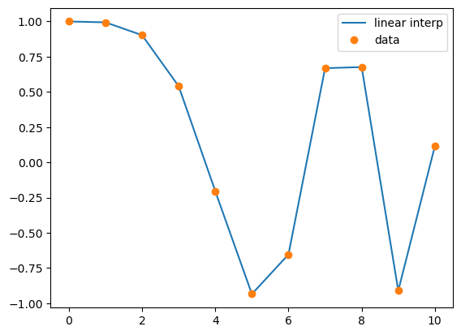

#### Cubic splines

``` python
from scipy.interpolate import CubicSpline

spl = CubicSpline([1, 2, 3, 4, 5, 6], [1, 4, 8, 16, 25, 36])

spl(2.5)
```

    array(5.57083333)

``` python
from scipy.interpolate import CubicSpline

x = np.linspace(0, 10, num=11)

y = np.cos(-x**2 / 9.)

spl = CubicSpline(x, y)
```

``` python
import matplotlib.pyplot as plt

fig, ax = plt.subplots(4, 1, figsize=(5, 7))

xnew = np.linspace(0, 10, num=1001)

ax[0].plot(xnew, spl(xnew))

ax[0].plot(x, y, 'o', label='data')

ax[1].plot(xnew, spl(xnew, nu=1), '--', label='1st derivative')

ax[2].plot(xnew, spl(xnew, nu=2), '--', label='2nd derivative')

ax[3].plot(xnew, spl(xnew, nu=3), '--', label='3rd derivative')

for j in range(4):

    ax[j].legend(loc='best')

plt.tight_layout()

plt.show()
```

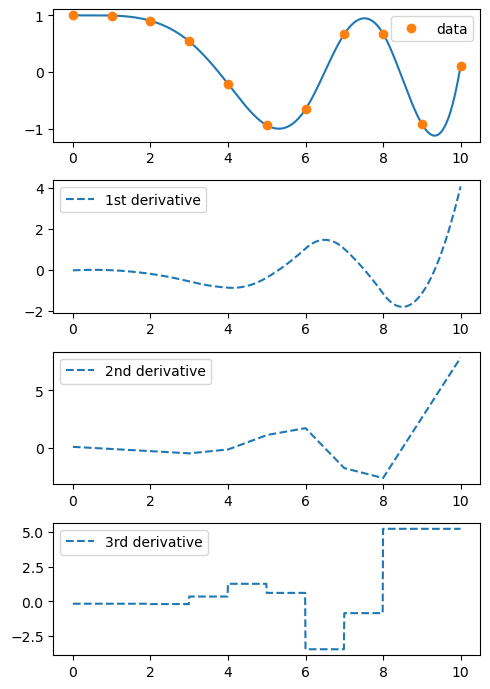

#### Monotone interpolants

``` python
from scipy.interpolate import CubicSpline, PchipInterpolator, Akima1DInterpolator

x = np.array([1., 2., 3., 4., 4.5, 5., 6., 7., 8])

y = x**2

y[4] += 101
```

``` python
import matplotlib.pyplot as plt

xx = np.linspace(1, 8, 51)

plt.plot(xx, CubicSpline(x, y)(xx), '--', label='spline')

plt.plot(xx, Akima1DInterpolator(x, y)(xx), '-', label='Akima1D')

plt.plot(xx, PchipInterpolator(x, y)(xx), '-', label='pchip')

plt.plot(x, y, 'o')

plt.legend()

plt.show()
```

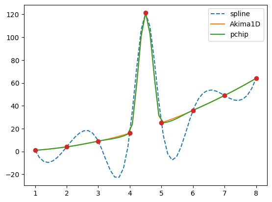

#### Interpolation with B-splines

``` python
x = np.linspace(0, 3/2, 7)

y = np.sin(np.pi*x)
```

``` python
from scipy.interpolate import make_interp_spline

bspl = make_interp_spline(x, y, k=3)
```

``` python
der = bspl.derivative()      # a BSpline representing the derivative

import matplotlib.pyplot as plt

xx = np.linspace(0, 3/2, 51)

plt.plot(xx, bspl(xx), '--', label=r'$\sin(\pi x)$ approx')

plt.plot(x, y, 'o', label='data')

plt.plot(xx, der(xx)/np.pi, '--', label='$d \sin(\pi x)/dx / \pi$ approx')

plt.legend()

plt.show()
```

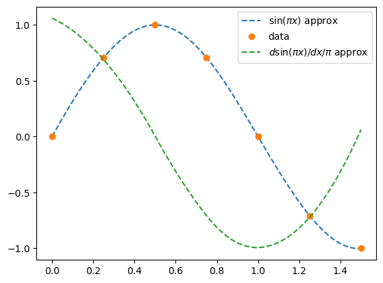

``` python
bspl.k, der.k
```

    (3, 2)

#### Parametric spline curves

``` python
x = [0, 1, 2, 3, 4, 5, 6]

y = [0, 0, 0, 9, 0, 0, 0]

p = np.stack((x, y))

p
```

    array([[0, 1, 2, 3, 4, 5, 6],
           [0, 0, 0, 9, 0, 0, 0]])

``` python
u_unif = x
```

``` python
dp = p[:, 1:] - p[:, :-1]      # 2-vector distances between points

l = (dp**2).sum(axis=0)        # squares of lengths of 2-vectors between points

u_cord = np.sqrt(l).cumsum()   # cumulative sums of 2-norms

u_cord = np.r_[0, u_cord]      # the first point is parameterized at zero
```

``` python
u_c = np.r_[0, np.cumsum((dp**2).sum(axis=0)**0.25)]
```

``` python
from scipy.interpolate import make_interp_spline

import matplotlib.pyplot as plt

fig, ax = plt.subplots(1, 3, figsize=(8, 3))

parametrizations = ['uniform', 'cord length', 'centripetal']


for j, u in enumerate([u_unif, u_cord, u_c]):
    spl = make_interp_spline(u, p, axis=1)    # note p is a 2D array
    uu = np.linspace(u[0], u[-1], 51)
    xx, yy = spl(uu)
    ax[j].plot(xx, yy, '--')
    ax[j].plot(p[0, :], p[1, :], 'o')
    ax[j].set_title(parametrizations[j])

plt.show()
```

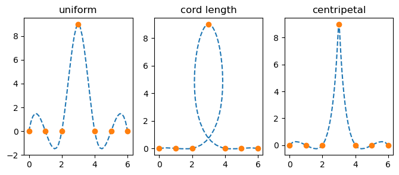

### Piecewise polynomials Manipulating PPoly objectsand splines

#### Manipulating PPoly objects

``` python
from scipy.interpolate import CubicSpline

x = np.linspace(0, 10, 71)

y = np.sin(x)

spl = CubicSpline(x, y)
```

``` python
dspl = spl.derivative()
```

``` python
dspl(1.1), spl(1.1, nu=1)
```

    (array(0.45361436), array(0.45361436))

``` python
dspl.roots() / np.pi
```

    array([-0.45480801,  0.50000034,  1.50000099,  2.5000016 ,  3.46249993])

``` python
dspl.roots(extrapolate=False) / np.pi
```

    array([0.50000034, 1.50000099, 2.5000016 ])

``` python
dspl.solve(0.5, extrapolate=False) / np.pi
```

    array([0.33332755, 1.66667195, 2.3333271 ])

``` python
from scipy.special import ellipk

m = 0.5

ellipk(m)
```

    1.8540746773013719

``` python
from scipy.interpolate import PchipInterpolator

x = np.linspace(0, np.pi/2, 70)

y = (1 - m*np.sin(x)**2)**(-1/2)

spl = PchipInterpolator(x, y)
```

``` python
spl.integrate(0, np.pi/2)
```

    array(1.85407467)

``` python
from scipy.interpolate import PchipInterpolator

m = np.linspace(0, 0.9, 11)

x = np.linspace(0, np.pi/2, 70)

y = 1 / np.sqrt(1 - m[:, None]*np.sin(x)**2)
```

``` python
spl = PchipInterpolator(x, y, axis=1)  # the default is axis=0

import matplotlib.pyplot as plt

plt.plot(m, spl.integrate(0, np.pi/2), '--')
```

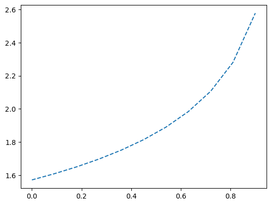

``` python
from scipy.special import ellipk

plt.plot(m, ellipk(m), 'o')

plt.legend(['`ellipk`', 'integrated piecewise polynomial'])

plt.show()
```

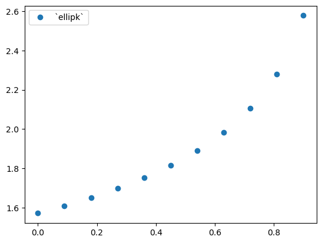

#### B-splines: knots and coefficients

``` python
x = np.linspace(0, 3/2, 7)

y = np.sin(np.pi*x)

from scipy.interpolate import make_interp_spline

bspl = make_interp_spline(x, y, k=3)

print(bspl.t)
```

    [0.   0.   0.   0.   0.5  0.75 1.   1.5  1.5  1.5  1.5 ]

``` python
print(x)
```

    [0.   0.25 0.5  0.75 1.   1.25 1.5 ]

``` python
len(bspl.c)
```

    7

``` python
k = 3      # cubic splines

t = [0., 1.4, 2., 3.1, 5.]   # internal knots

t = np.r_[[0]*k, t, [5]*k]   # add boundary knots
```

``` python
from scipy.interpolate import BSpline

import matplotlib.pyplot as plt

for j in [-2, -1, 0, 1, 2]:

    a, b = t[k+j], t[-k+j-1]

    xx = np.linspace(a, b, 101)

    bspl = BSpline.basis_element(t[k+j:-k+j])

    plt.plot(xx, bspl(xx), label=f'j = {j}')

plt.legend(loc='best')

plt.show()
```

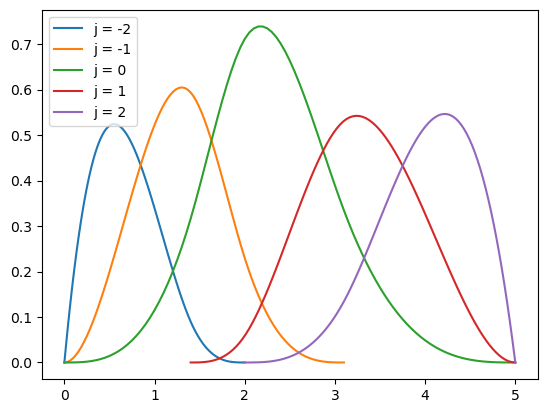

``` python
c = np.zeros(t.size - k - 1)

c[-2] = 1

b = BSpline(t, c, k)

np.allclose(b(xx), bspl(xx))
```

    True

``` python
t = [0., 0., 0., 0., 2., 3., 4., 6., 6., 6., 6.]
```

``` python
xnew = [1, 2, 3]
```

``` python
from scipy.interpolate import BSpline

mat = BSpline.design_matrix(xnew, t, k=3)

mat
```

    <3x7 sparse array of type '<class 'numpy.float64'>'
        with 12 stored elements in Compressed Sparse Row format>

``` python
with np.printoptions(precision=3):

    print(mat.toarray())
```

    [[0.125 0.514 0.319 0.042 0.    0.    0.   ]
     [0.    0.111 0.556 0.333 0.    0.    0.   ]
     [0.    0.    0.125 0.75  0.125 0.    0.   ]]

### Smoothing splines

#### Spline smoothing in 1-D

``` python
import numpy as np

from scipy.interpolate import splrep, BSpline
```

``` python
x = np.arange(0, 2*np.pi+np.pi/4, 2*np.pi/16)

rng = np.random.default_rng()

y =  np.sin(x) + 0.4*rng.standard_normal(size=len(x))
```

``` python
tck = splrep(x, y, s=0)

tck_s = splrep(x, y, s=len(x))
```

``` python
import matplotlib.pyplot as plt

xnew = np.arange(0, 9/4, 1/50) * np.pi

plt.plot(xnew, np.sin(xnew), '-.', label='sin(x)')

plt.plot(xnew, BSpline(*tck)(xnew), '-', label='s=0')

plt.plot(xnew, BSpline(*tck_s)(xnew), '-', label=f's={len(x)}')

plt.plot(x, y, 'o')

plt.legend()

plt.show()
```

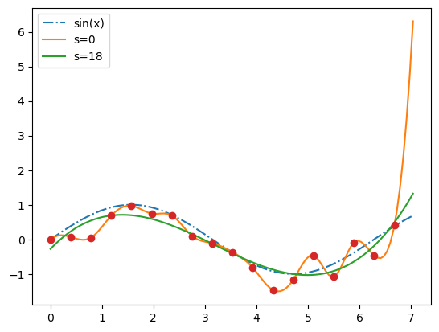

``` python
import numpy as np

import matplotlib.pyplot as plt

from scipy import interpolate
```

``` python
x = np.arange(0, 2*np.pi+np.pi/4, 2*np.pi/8)

y = np.sin(x)

tck = interpolate.splrep(x, y, s=0)

xnew = np.arange(0, 2*np.pi, np.pi/50)

ynew = interpolate.splev(xnew, tck, der=0)
```

``` python
plt.figure()

plt.plot(x, y, 'x', xnew, ynew, xnew, np.sin(xnew), x, y, 'b')

plt.legend(['Linear', 'Cubic Spline', 'True'])

plt.axis([-0.05, 6.33, -1.05, 1.05])

plt.title('Cubic-spline interpolation')

plt.show()
```

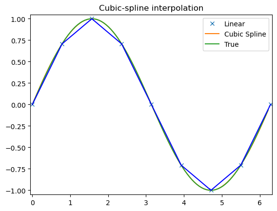

``` python
yder = interpolate.splev(xnew, tck, der=1)   # or BSpline(*tck)(xnew, 1)

plt.figure()

plt.plot(xnew, yder, xnew, np.cos(xnew),'--')

plt.legend(['Cubic Spline', 'True'])

plt.axis([-0.05, 6.33, -1.05, 1.05])

plt.title('Derivative estimation from spline')

plt.show()
```

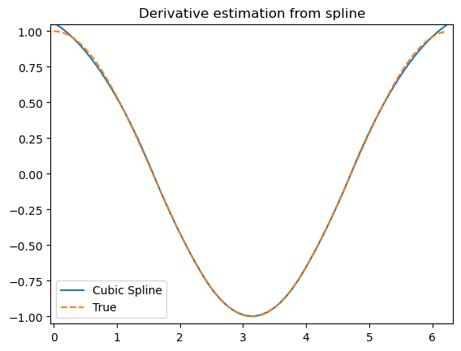

``` python
yders = interpolate.spalde(xnew, tck)

plt.figure()

for i in range(len(yders[0])):

   plt.plot(xnew, [d[i] for d in yders], '--', label=f"{i} derivative")

plt.legend()

plt.axis([-0.05, 6.33, -1.05, 1.05])

plt.title('All derivatives of a B-spline')

plt.show()
```

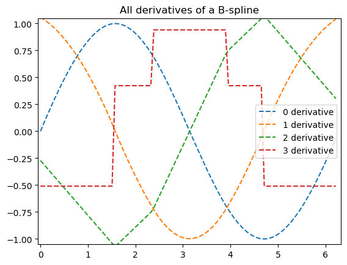

``` python
def integ(x, tck, constant=-1):

    x = np.atleast_1d(x)

    out = np.zeros(x.shape, dtype=x.dtype)

    for n in range(len(out)):

        out[n] = interpolate.splint(0, x[n], tck)

    out += constant

    return out
```

``` python
yint = integ(xnew, tck)

plt.figure()

plt.plot(xnew, yint, xnew, -np.cos(xnew), '--')

plt.legend(['Cubic Spline', 'True'])

plt.axis([-0.05, 6.33, -1.05, 1.05])

plt.title('Integral estimation from spline')

plt.show()
```

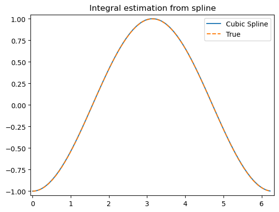

``` python
interpolate.sproot(tck)
```

    array([3.14159265])

``` python
x = np.linspace(-np.pi/4, 2.*np.pi + np.pi/4, 21)

y = np.sin(x)

tck = interpolate.splrep(x, y, s=0)

interpolate.sproot(tck)
```

    array([-2.22044605e-16,  3.14159265e+00,  6.28318531e+00])

``` python
t = np.arange(0, 1.1, .1)

x = np.sin(2*np.pi*t)

y = np.cos(2*np.pi*t)

tck, u = interpolate.splprep([x, y], s=0)

unew = np.arange(0, 1.01, 0.01)

out = interpolate.splev(unew, tck)

plt.figure()

plt.plot(x, y, 'x', out[0], out[1], np.sin(2*np.pi*unew), np.cos(2*np.pi*unew), x, y, 'b')

plt.legend(['Linear', 'Cubic Spline', 'True'])

plt.axis([-1.05, 1.05, -1.05, 1.05])

plt.title('Spline of parametrically-defined curve')

plt.show()
```

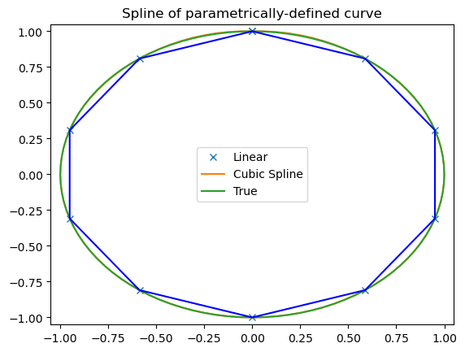

``` python
tt, cc, k = tck

cc = np.array(cc)

bspl = BSpline(tt, cc.T, k)    # note the transpose

xy = bspl(u)

xx, yy = xy.T   # transpose to unpack into a pair of arrays

np.allclose(x, xx)
```

    True

``` python
np.allclose(y, yy)
```

    True

``` python
import numpy as np

import matplotlib.pyplot as plt

from scipy import interpolate
```

``` python
x = np.arange(0, 2*np.pi+np.pi/4, 2*np.pi/8)

y = np.sin(x)

s = interpolate.InterpolatedUnivariateSpline(x, y)

xnew = np.arange(0, 2*np.pi, np.pi/50)

ynew = s(xnew)
```

``` python
plt.figure()

plt.plot(x, y, 'x', xnew, ynew, xnew, np.sin(xnew), x, y, 'b')

plt.legend(['Linear', 'InterpolatedUnivariateSpline', 'True'])

plt.axis([-0.05, 6.33, -1.05, 1.05])

plt.title('InterpolatedUnivariateSpline')

plt.show()
```

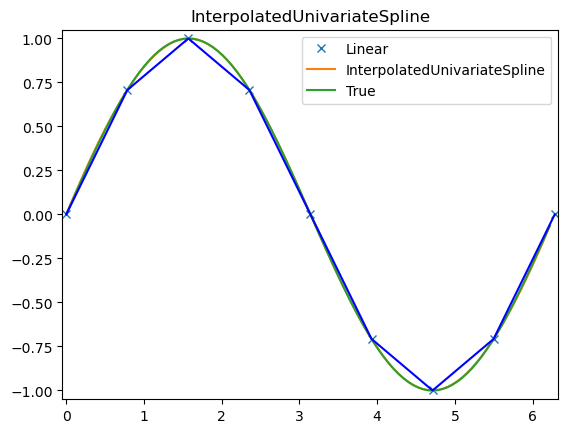

``` python
t = [np.pi/2-.1, np.pi/2+.1, 3*np.pi/2-.1, 3*np.pi/2+.1]

s = interpolate.LSQUnivariateSpline(x, y, t, k=2)

ynew = s(xnew)
```

``` python
plt.figure()

plt.plot(x, y, 'x', xnew, ynew, xnew, np.sin(xnew), x, y, 'b')

plt.legend(['Linear', 'LSQUnivariateSpline', 'True'])

plt.axis([-0.05, 6.33, -1.05, 1.05])

plt.title('Spline with Specified Interior Knots')

plt.show()
```

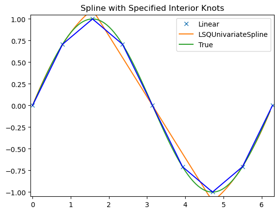

#### 2-D smoothing splines

``` python
x_edges, y_edges = np.mgrid[-1:1:21j, -1:1:21j]

x = x_edges[:-1, :-1] + np.diff(x_edges[:2, 0])[0] / 2.

y = y_edges[:-1, :-1] + np.diff(y_edges[0, :2])[0] / 2.

z = (x+y) * np.exp(-6.0*(x*x+y*y))
```

``` python
plt.figure()

lims = dict(cmap='RdBu_r', vmin=-0.25, vmax=0.25)

plt.pcolormesh(x_edges, y_edges, z, shading='flat', **lims)

plt.colorbar()

plt.title("Sparsely sampled function.")

plt.show()
```

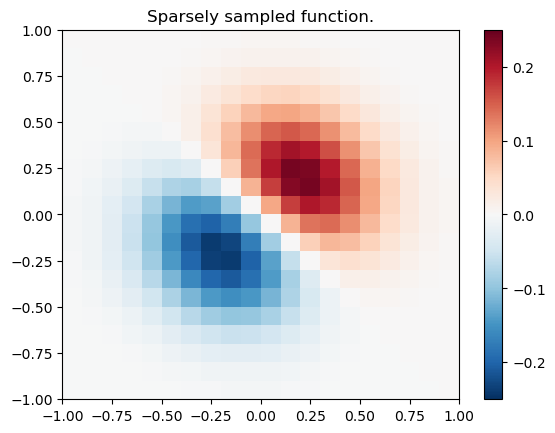

``` python
xnew_edges, ynew_edges = np.mgrid[-1:1:71j, -1:1:71j]

xnew = xnew_edges[:-1, :-1] + np.diff(xnew_edges[:2, 0])[0] / 2.

ynew = ynew_edges[:-1, :-1] + np.diff(ynew_edges[0, :2])[0] / 2.

tck = interpolate.bisplrep(x, y, z, s=0)

znew = interpolate.bisplev(xnew[:,0], ynew[0,:], tck)
```

``` python
plt.figure()

plt.pcolormesh(xnew_edges, ynew_edges, znew, shading='flat', **lims)

plt.colorbar()

plt.title("Interpolated function.")

plt.show()
```

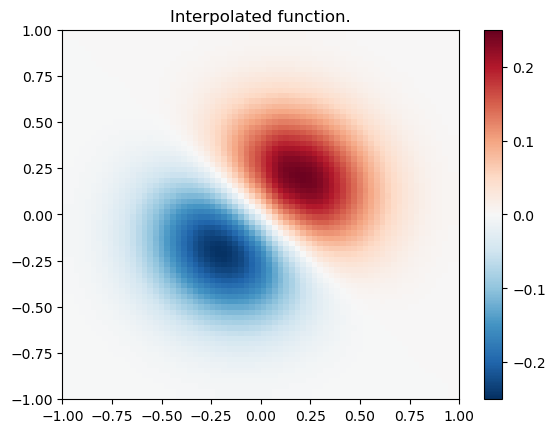

``` python
import numpy as np
import matplotlib.pyplot as plt
from scipy.interpolate import SmoothBivariateSpline

import warnings
warnings.simplefilter('ignore')

train_x, train_y = np.meshgrid(np.arange(-5, 5, 0.5), np.arange(-5, 5, 0.5))
train_x = train_x.flatten()
train_y = train_y.flatten()

def z_func(x, y):
    return np.cos(x) + np.sin(y) ** 2 + 0.05 * x + 0.1 * y

train_z = z_func(train_x, train_y)
interp_func = SmoothBivariateSpline(train_x, train_y, train_z, s=0.0)
smth_func = SmoothBivariateSpline(train_x, train_y, train_z)

test_x = np.arange(-9, 9, 0.01)
test_y = np.arange(-9, 9, 0.01)
grid_x, grid_y = np.meshgrid(test_x, test_y)

interp_result = interp_func(test_x, test_y).T
smth_result = smth_func(test_x, test_y).T
perfect_result = z_func(grid_x, grid_y)

fig, axes = plt.subplots(1, 3, figsize=(16, 8))
extent = [test_x[0], test_x[-1], test_y[0], test_y[-1]]
opts = dict(aspect='equal', cmap='nipy_spectral', extent=extent, vmin=-1.5, vmax=2.5)

im = axes[0].imshow(perfect_result, **opts)
fig.colorbar(im, ax=axes[0], orientation='horizontal')
axes[0].plot(train_x, train_y, 'w.')
axes[0].set_title('Perfect result, sampled function', fontsize=21)

im = axes[1].imshow(smth_result, **opts)
axes[1].plot(train_x, train_y, 'w.')
fig.colorbar(im, ax=axes[1], orientation='horizontal')
axes[1].set_title('s=default', fontsize=21)

im = axes[2].imshow(interp_result, **opts)
fig.colorbar(im, ax=axes[2], orientation='horizontal')
axes[2].plot(train_x, train_y, 'w.')
axes[2].set_title('s=0', fontsize=21)

plt.tight_layout()
plt.show()
```

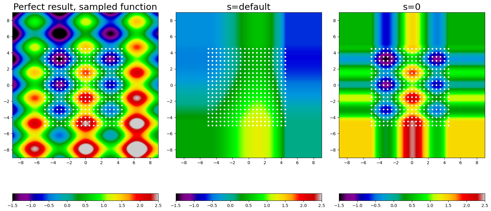

``` python
import numpy as np
import matplotlib.pyplot as plt
from scipy.interpolate import RectBivariateSpline

x = np.arange(-5.01, 5.01, 0.25)        # the grid is an outer product
y = np.arange(-5.01, 7.51, 0.25)        # of x and y arrays

xx, yy = np.meshgrid(x, y, indexing='ij')
z = np.sin(xx**2 + 2.*yy**2)            # z array needs to be 2-D

func = RectBivariateSpline(x, y, z, s=0)

xnew = np.arange(-5.01, 5.01, 1e-2)
ynew = np.arange(-5.01, 7.51, 1e-2)
znew = func(xnew, ynew)

plt.imshow(znew)
plt.colorbar()
plt.show()
```

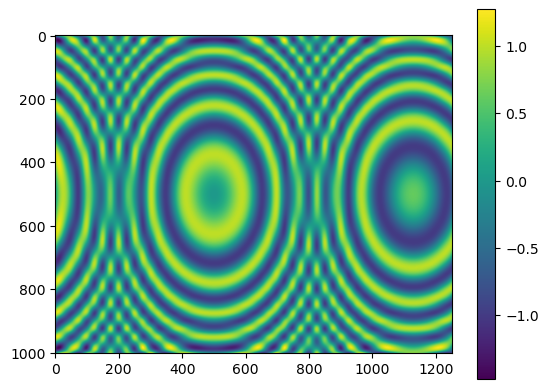

### Multivariate data interpolation on a regular grid (RegularGridInterpolator)

``` python
import matplotlib.pyplot as plt

from scipy.interpolate import RegularGridInterpolator
```

``` python
def F(u, v):

    return u * np.cos(u * v) + v * np.sin(u * v)
```

``` python
fit_points = [np.linspace(0, 3, 8), np.linspace(0, 3, 11)]

values = F(*np.meshgrid(*fit_points, indexing='ij'))
```

``` python
ut, vt = np.meshgrid(np.linspace(0, 3, 80), np.linspace(0, 3, 80), indexing='ij')

true_values = F(ut, vt)

test_points = np.array([ut.ravel(), vt.ravel()]).T
```

``` python
interp = RegularGridInterpolator(fit_points, values)

fig, axes = plt.subplots(2, 3, figsize=(10, 6))

axes = axes.ravel()

fig_index = 0

for method in ['linear', 'nearest', 'slinear', 'cubic', 'quintic']:

    im = interp(test_points, method=method).reshape(80, 80)

    axes[fig_index].imshow(im)

    axes[fig_index].set_title(method)

    axes[fig_index].axis("off")

    fig_index += 1

axes[fig_index].imshow(true_values)

axes[fig_index].set_title("True values")

fig.tight_layout()

fig.show()
```

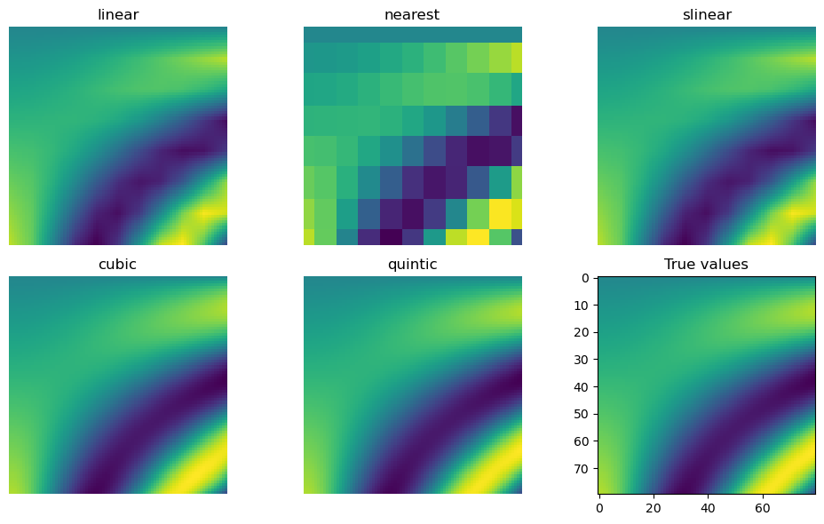

``` python
from scipy.interpolate import interpn

rgi = RegularGridInterpolator(fit_points, values)

result_rgi = rgi(test_points)
```

``` python
result_interpn = interpn(fit_points, values, test_points)

np.allclose(result_rgi, result_interpn, atol=1e-15)
```

    True

``` python
x = np.array([0, 5, 10])

y = np.array([0])

data = np.array([[0], [5], [10]])

rgi = RegularGridInterpolator((x, y), data,

                              bounds_error=False, fill_value=None)

rgi([(2, 0), (2, 1), (2, -1)])
```

    array([2., 2., 2.])

``` python
rgi.fill_value = -101

rgi([(2, 0), (2, 1), (2, -1)])
```

    array([   2., -101., -101.])

``` python
class CartesianGridInterpolator:
    def __init__(self, points, values, method='linear'):
        self.limits = np.array([[min(x), max(x)] for x in points])
        self.values = np.asarray(values, dtype=float)
        self.order = {'linear': 1, 'cubic': 3, 'quintic': 5}[method]

    def __call__(self, xi):
        """
        `xi` here is an array-like (an array or a list) of points.

        Each "point" is an ndim-dimensional array_like, representing
        the coordinates of a point in ndim-dimensional space.
        """
        # transpose the xi array into the ``map_coordinates`` convention
        # which takes coordinates of a point along columns of a 2D array.
        xi = np.asarray(xi).T

        # convert from data coordinates to pixel coordinates
        ns = self.values.shape
        coords = [(n-1)*(val - lo) / (hi - lo)
                  for val, n, (lo, hi) in zip(xi, ns, self.limits)]

        # interpolate
        return map_coordinates(self.values, coords,
                               order=self.order,
                               cval=np.nan)  # fill_value
```

``` python
x, y = np.arange(5), np.arange(6)

xx, yy = np.meshgrid(x, y, indexing='ij')

values = xx**3 + yy**3

rgi = RegularGridInterpolator((x, y), values, method='linear')

rgi([[1.5, 1.5], [3.5, 2.6]])
```

    array([ 9. , 64.9])

``` python
cgi = CartesianGridInterpolator((x, y), values, method='linear')
```

### Scattered data interpolation (griddata)

``` python
def func(x, y):

    return x*(1-x)*np.cos(4*np.pi*x) * np.sin(4*np.pi*y**2)**2
```

``` python
grid_x, grid_y = np.meshgrid(np.linspace(0, 1, 100),

                             np.linspace(0, 1, 200), indexing='ij')
```

``` python
rng = np.random.default_rng()

points = rng.random((1000, 2))

values = func(points[:,0], points[:,1])
```

``` python
from scipy.interpolate import griddata

grid_z0 = griddata(points, values, (grid_x, grid_y), method='nearest')

grid_z1 = griddata(points, values, (grid_x, grid_y), method='linear')

grid_z2 = griddata(points, values, (grid_x, grid_y), method='cubic')
```

``` python
import matplotlib.pyplot as plt

plt.subplot(221)

plt.imshow(func(grid_x, grid_y).T, extent=(0, 1, 0, 1), origin='lower')

plt.plot(points[:, 0], points[:, 1], 'k.', ms=1)   # data

plt.title('Original')

plt.subplot(222)

plt.imshow(grid_z0.T, extent=(0, 1, 0, 1), origin='lower')

plt.title('Nearest')

plt.subplot(223)

plt.imshow(grid_z1.T, extent=(0, 1, 0, 1), origin='lower')

plt.title('Linear')

plt.subplot(224)

plt.imshow(grid_z2.T, extent=(0, 1, 0, 1), origin='lower')

plt.title('Cubic')

plt.gcf().set_size_inches(6, 6)

plt.show()
```

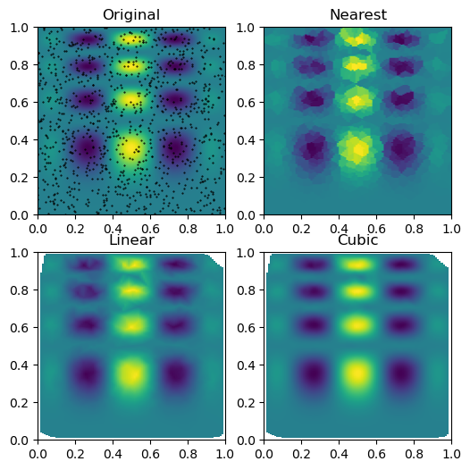

#### Using radial basis functions for smoothing/interpolation

``` python
import numpy as np

from scipy.interpolate import RBFInterpolator, InterpolatedUnivariateSpline

import matplotlib.pyplot as plt
```

``` python
# setup data

x = np.linspace(0, 10, 9).reshape(-1, 1)

y = np.sin(x)

xi = np.linspace(0, 10, 101).reshape(-1, 1)

# use fitpack2 method

ius = InterpolatedUnivariateSpline(x, y)

yi = ius(xi)

plt.subplot(2, 1, 1)

plt.plot(x, y, 'bo')

plt.plot(xi, yi, 'g')

plt.plot(xi, np.sin(xi), 'r')

plt.title('Interpolation using univariate spline')

# use RBF method

rbf = RBFInterpolator(x, y)

fi = rbf(xi)

plt.subplot(2, 1, 2)

plt.plot(x, y, 'bo')

plt.plot(xi, fi, 'g')

plt.plot(xi, np.sin(xi), 'r')

plt.title('Interpolation using RBF - multiquadrics')

plt.show()
```

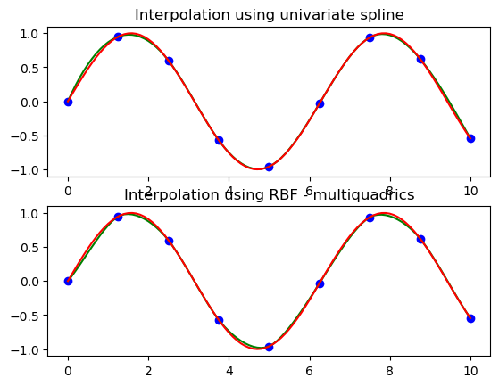

``` python
import numpy as np

from scipy.interpolate import RBFInterpolator

import matplotlib.pyplot as plt

# 2-d tests - setup scattered data

rng = np.random.default_rng()

xy = rng.random((100, 2))*4.0-2.0

z = xy[:, 0]*np.exp(-xy[:, 0]**2-xy[:, 1]**2)

edges = np.linspace(-2.0, 2.0, 101)

centers = edges[:-1] + np.diff(edges[:2])[0] / 2.

x_i, y_i = np.meshgrid(centers, centers)

x_i = x_i.reshape(-1, 1)

y_i = y_i.reshape(-1, 1)

xy_i = np.concatenate([x_i, y_i], axis=1)

# use RBF

rbf = RBFInterpolator(xy, z, epsilon=2)

z_i = rbf(xy_i)

# plot the result

fig, ax = plt.subplots()

X_edges, Y_edges = np.meshgrid(edges, edges)

lims = dict(cmap='RdBu_r', vmin=-0.4, vmax=0.4)

mapping = ax.pcolormesh(

    X_edges, Y_edges, z_i.reshape(100, 100),

    shading='flat', **lims

)

ax.scatter(xy[:, 0], xy[:, 1], 100, z, edgecolor='w', lw=0.1, **lims)

ax.set(

    title='RBF interpolation - multiquadrics',

    xlim=(-2, 2),

    ylim=(-2, 2),

)

fig.colorbar(mapping)
```

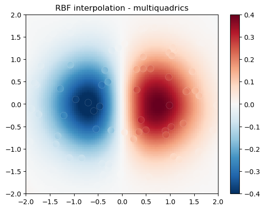

### Extrapolation tips and tricks

``` python
import numpy as np
import matplotlib.pyplot as plt
from scipy.interpolate import interp1d

x = np.linspace(0, 1.5*np.pi, 11)
y = np.column_stack((np.cos(x), np.sin(x)))   # y.shape is (11, 2)

func = interp1d(x, y,
                axis=0,  # interpolate along columns
                bounds_error=False,
                kind='linear',
                fill_value=(y[0], y[-1]))
xnew = np.linspace(-np.pi, 2.5*np.pi, 51)
ynew = func(xnew)

fix, (ax1, ax2) = plt.subplots(1, 2, figsize=(8, 4))
ax1.plot(xnew, ynew[:, 0])
ax1.plot(x, y[:, 0], 'o')

ax2.plot(xnew, ynew[:, 1])
ax2.plot(x, y[:, 1], 'o')
plt.tight_layout()
```

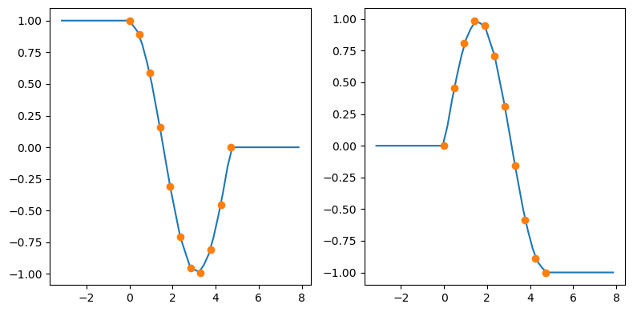

``` python
import numpy as np
import matplotlib.pyplot as plt
from scipy.interpolate import CubicSpline

xs = [1, 2, 3, 4, 5, 6, 7, 8]
ys = [4.5, 3.6, 1.6, 0.0, -3.3, -3.1, -1.8, -1.7]

notaknot = CubicSpline(xs, ys, bc_type='not-a-knot')
natural = CubicSpline(xs, ys, bc_type='natural')
clamped = CubicSpline(xs, ys, bc_type='clamped')
xnew = np.linspace(min(xs) - 4, max(xs) + 4, 101)

splines = [notaknot, natural, clamped]
titles = ['not-a-knot', 'natural', 'clamped']

fig, axs = plt.subplots(3, 3, figsize=(12, 12))
for i in [0, 1, 2]:
    for j, spline, title in zip(range(3), splines, titles):
        axs[i, j].plot(xs, spline(xs, nu=i),'o')
        axs[i, j].plot(xnew, spline(xnew, nu=i),'-')
        axs[i, j].set_title(f'{title}, deriv={i}')

plt.tight_layout()
plt.show()
```

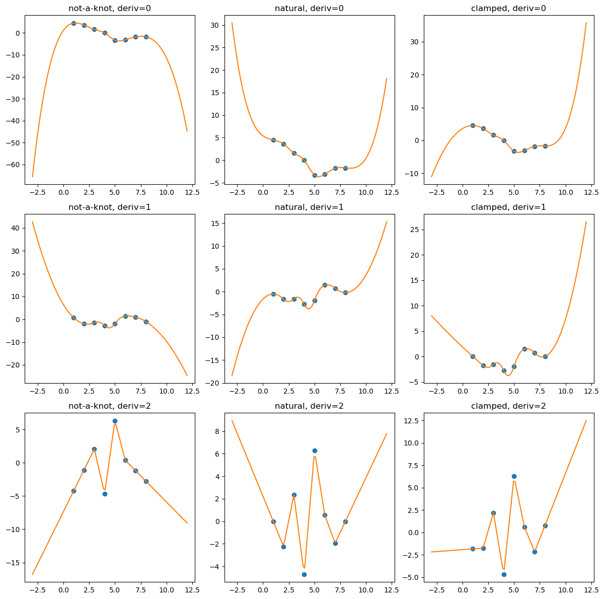

``` python
import numpy as np
import matplotlib.pyplot as plt
from scipy.interpolate import CubicSpline

def add_boundary_knots(spline):
    """
    Add knots infinitesimally to the left and right.

    Additional intervals are added to have zero 2nd and 3rd derivatives,
    and to maintain the first derivative from whatever boundary condition
    was selected. The spline is modified in place.
    """
    # determine the slope at the left edge
    leftx = spline.x[0]
    lefty = spline(leftx)
    leftslope = spline(leftx, nu=1)

    # add a new breakpoint just to the left and use the
    # known slope to construct the PPoly coefficients.
    leftxnext = np.nextafter(leftx, leftx - 1)
    leftynext = lefty + leftslope*(leftxnext - leftx)
    leftcoeffs = np.array([0, 0, leftslope, leftynext])
    spline.extend(leftcoeffs[..., None], np.r_[leftxnext])

    # repeat with additional knots to the right
    rightx = spline.x[-1]
    righty = spline(rightx)
    rightslope = spline(rightx,nu=1)
    rightxnext = np.nextafter(rightx, rightx + 1)
    rightynext = righty + rightslope * (rightxnext - rightx)
    rightcoeffs = np.array([0, 0, rightslope, rightynext])
    spline.extend(rightcoeffs[..., None], np.r_[rightxnext])

xs = [1, 2, 3, 4, 5, 6, 7, 8]
ys = [4.5, 3.6, 1.6, 0.0, -3.3, -3.1, -1.8, -1.7]

notaknot = CubicSpline(xs,ys, bc_type='not-a-knot')
# not-a-knot does not require additional intervals

natural = CubicSpline(xs,ys, bc_type='natural')
# extend the natural natural spline with linear extrapolating knots
add_boundary_knots(natural)

clamped = CubicSpline(xs,ys, bc_type='clamped')
# extend the clamped spline with constant extrapolating knots
add_boundary_knots(clamped)

xnew = np.linspace(min(xs) - 5, max(xs) + 5, 201)

fig, axs = plt.subplots(3, 3,figsize=(12,12))

splines = [notaknot, natural, clamped]
titles = ['not-a-knot', 'natural', 'clamped']

for i in [0, 1, 2]:
    for j, spline, title in zip(range(3), splines, titles):
        axs[i, j].plot(xs, spline(xs, nu=i),'o')
        axs[i, j].plot(xnew, spline(xnew, nu=i),'-')
        axs[i, j].set_title(f'{title}, deriv={i}')

plt.tight_layout()
plt.show()
```

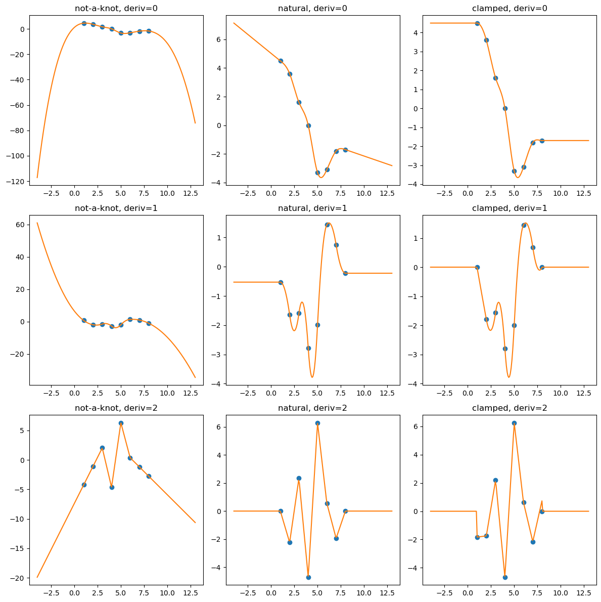

#### Manually implement the asymptotics

``` python
import numpy as np
import matplotlib.pyplot as plt
from scipy.optimize import brentq

def f(x, a):
    return a*x - 1/np.tan(x)

a = 3
x0 = brentq(f, 1e-16, np.pi/2, args=(a,))   # here we shift the left edge
                                            # by a machine epsilon to avoid
                                            # a division by zero at x=0
xx = np.linspace(0.2, np.pi/2, 101)
plt.plot(xx, a*xx, '--')
plt.plot(xx, 1/np.tan(xx), '--')
plt.plot(x0, a*x0, 'o', ms=12)
plt.text(0.1, 0.9, fr'$x_0 = {x0:.3f}$',
               transform=plt.gca().transAxes, fontsize=16)
plt.show()
```

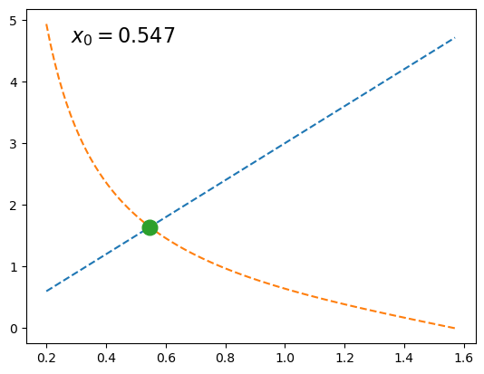

``` python
import numpy as np
import matplotlib.pyplot as plt
from scipy.interpolate import BPoly

def f(x, a):
    return a*x - 1/np.tan(x)

xleft, xright = 0.2, np.pi/2
x = np.linspace(xleft, xright, 11)

fig, ax = plt.subplots(1, 2, figsize=(12, 4))

for j, a in enumerate([3, 93]):
    y = f(x, a)
    dydx = a + 1./np.sin(x)**2    # d(ax - 1/tan(x)) / dx
    dxdy = 1 / dydx               # dx/dy = 1 / (dy/dx)

    xdx = np.c_[x, dxdy]
    spl = BPoly.from_derivatives(y, xdx)   # inverse interpolation

    yy = np.linspace(f(xleft, a), f(xright, a), 51)
    ax[j].plot(yy, spl(yy), '--')
    ax[j].plot(y, x, 'o')
    ax[j].set_xlabel(r'$y$')
    ax[j].set_ylabel(r'$x$')
    ax[j].set_title(rf'$a = {a}$')

    ax[j].plot(0, spl(0), 'o', ms=12)
    ax[j].text(0.1, 0.85, fr'$x_0 = {spl(0):.3f}$',
               transform=ax[j].transAxes, fontsize=18)
    ax[j].grid(True)
plt.tight_layout()
plt.show()
```

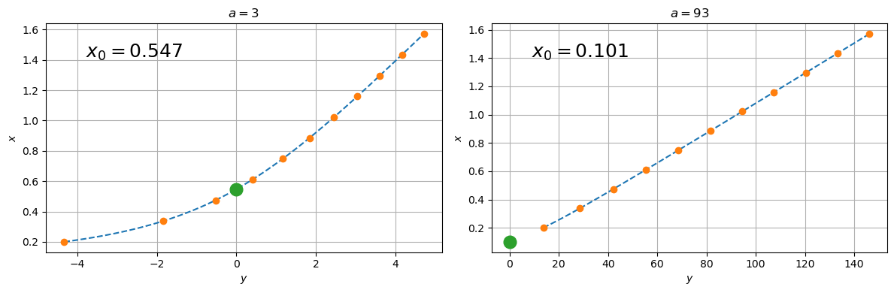

``` python
class RootWithAsymptotics:
    def __init__(self, a):
        # construct the interpolant
        xleft, xright = 0.2, np.pi/2
        x = np.linspace(xleft, xright, 11)

        y = f(x, a)
        dydx = a + 1./np.sin(x)**2    # d(ax - 1/tan(x)) / dx
        dxdy = 1 / dydx               # dx/dy = 1 / (dy/dx)

        # inverse interpolation
        self.spl = BPoly.from_derivatives(y, np.c_[x, dxdy])
        self.a = a

    def root(self):
        out = self.spl(0)
        asympt = 1./np.sqrt(self.a)
        return np.where(spl.x.min() < asympt, out, asympt)
```

``` python
r = RootWithAsymptotics(93)

r.root()
```

    array(0.10369517)

#### Extrapolation in D \> 1

``` python
import numpy as np
import matplotlib.pyplot as plt
from scipy.interpolate import CloughTocher2DInterpolator as CT

def my_CT(xy, z):
    """CT interpolator + nearest-neighbor extrapolation.

    Parameters
    ----------
    xy : ndarray, shape (npoints, ndim)
        Coordinates of data points
    z : ndarray, shape (npoints)
        Values at data points

    Returns
    -------
    func : callable
        A callable object which mirrors the CT behavior,
        with an additional neareast-neighbor extrapolation
        outside of the data range.
    """
    x = xy[:, 0]
    y = xy[:, 1]
    f = CT(xy, z)

    # this inner function will be returned to a user
    def new_f(xx, yy):
        # evaluate the CT interpolator. Out-of-bounds values are nan.
        zz = f(xx, yy)
        nans = np.isnan(zz)

        if nans.any():
            # for each nan point, find its nearest neighbor
            inds = np.argmin(
                (x[:, None] - xx[nans])**2 +
                (y[:, None] - yy[nans])**2
                , axis=0)
            # ... and use its value
            zz[nans] = z[inds]
        return zz

    return new_f

# Now illustrate the difference between the original ``CT`` interpolant
# and ``my_CT`` on a small example:

x = np.array([1, 1, 1, 2, 2, 2, 4, 4, 4])
y = np.array([1, 2, 3, 1, 2, 3, 1, 2, 3])
z = np.array([0, 7, 8, 3, 4, 7, 1, 3, 4])

xy = np.c_[x, y]
lut = CT(xy, z)
lut2 = my_CT(xy, z)

X = np.linspace(min(x) - 0.5, max(x) + 0.5, 71)
Y = np.linspace(min(y) - 0.5, max(y) + 0.5, 71)
X, Y = np.meshgrid(X, Y)

fig = plt.figure()
ax = fig.add_subplot(projection='3d')

ax.plot_wireframe(X, Y, lut(X, Y), label='CT')
ax.plot_wireframe(X, Y, lut2(X, Y), color='m',
                  cstride=10, rstride=10, alpha=0.7, label='CT + n.n.')

ax.scatter(x, y, z,  'o', color='k', s=48, label='data')
ax.legend()
plt.tight_layout()
```

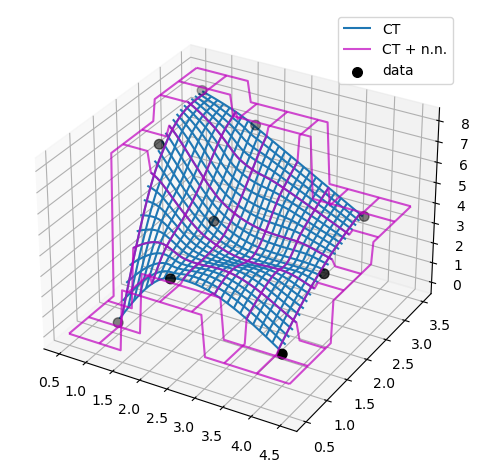

## Fourier transforms

### Fast Fourier transforms

#### 1-D discrete Fourier transforms

``` python
from scipy.fft import fft, ifft

import numpy as np

x = np.array([1.0, 2.0, 1.0, -1.0, 1.5])

y = fft(x)

y
```

    array([ 4.5       -0.j        ,  2.08155948-1.65109876j,
           -1.83155948+1.60822041j, -1.83155948-1.60822041j,
            2.08155948+1.65109876j])

``` python
yinv = ifft(y)

yinv
```

    array([ 1. +0.j,  2. +0.j,  1. +0.j, -1. +0.j,  1.5+0.j])

``` python
np.sum(x)
```

    4.5

``` python
from scipy.fft import fft, fftfreq

import numpy as np

# Number of sample points

N = 600

# sample spacing

T = 1.0 / 800.0

x = np.linspace(0.0, N*T, N, endpoint=False)

y = np.sin(50.0 * 2.0*np.pi*x) + 0.5*np.sin(80.0 * 2.0*np.pi*x)

yf = fft(y)

xf = fftfreq(N, T)[:N//2]

import matplotlib.pyplot as plt

plt.plot(xf, 2.0/N * np.abs(yf[0:N//2]))

plt.grid()

plt.show()
```

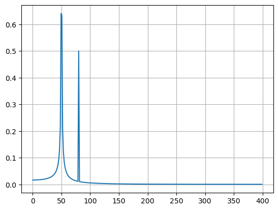

``` python
from scipy.fft import fft, fftfreq

import numpy as np

# Number of sample points

N = 600

# sample spacing

T = 1.0 / 800.0

x = np.linspace(0.0, N*T, N, endpoint=False)

y = np.sin(50.0 * 2.0*np.pi*x) + 0.5*np.sin(80.0 * 2.0*np.pi*x)

yf = fft(y)

from scipy.signal.windows import blackman

w = blackman(N)

ywf = fft(y*w)

xf = fftfreq(N, T)[:N//2]

import matplotlib.pyplot as plt

plt.semilogy(xf[1:N//2], 2.0/N * np.abs(yf[1:N//2]), '-b')

plt.semilogy(xf[1:N//2], 2.0/N * np.abs(ywf[1:N//2]), '-r')

plt.legend(['FFT', 'FFT w. window'])

plt.grid()
from scipy.fft import fftshift

x = np.arange(8)

fftshift(x)
plt.show()
```

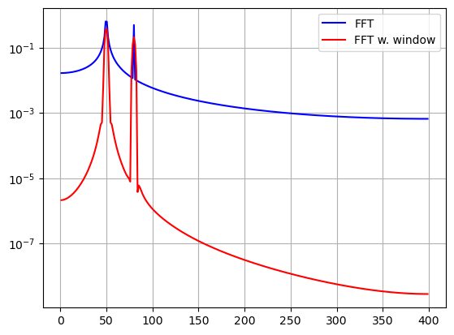

``` python
from scipy.fft import fftfreq

freq = fftfreq(8, 0.125)

freq
```

    array([ 0.,  1.,  2.,  3., -4., -3., -2., -1.])

``` python
from scipy.fft import fftshift

x = np.arange(8)

fftshift(x)

from scipy.fft import fft, fftfreq, fftshift

import numpy as np

# number of signal points

N = 400

# sample spacing

T = 1.0 / 800.0

x = np.linspace(0.0, N*T, N, endpoint=False)

y = np.exp(50.0 * 1.j * 2.0*np.pi*x) + 0.5*np.exp(-80.0 * 1.j * 2.0*np.pi*x)

yf = fft(y)

xf = fftfreq(N, T)

xf = fftshift(xf)

yplot = fftshift(yf)

import matplotlib.pyplot as plt

plt.plot(xf, 1.0/N * np.abs(yplot))

plt.grid()

plt.show()
```

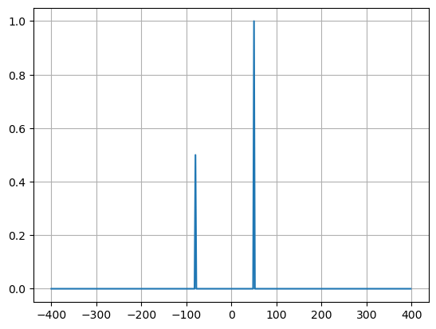

``` python
from scipy.fft import fft, rfft, irfft

x = np.array([1.0, 2.0, 1.0, -1.0, 1.5, 1.0])

fft(x)
```

    array([ 5.5 -0.j        ,  2.25-0.4330127j , -2.75-1.29903811j,
            1.5 -0.j        , -2.75+1.29903811j,  2.25+0.4330127j ])

``` python
yr = rfft(x)

yr
```

    array([ 5.5 +0.j        ,  2.25-0.4330127j , -2.75-1.29903811j,
            1.5 +0.j        ])

``` python
irfft(yr)
```

    array([ 1. ,  2. ,  1. , -1. ,  1.5,  1. ])

``` python
x = np.array([1.0, 2.0, 1.0, -1.0, 1.5])

fft(x)
```

    array([ 4.5       -0.j        ,  2.08155948-1.65109876j,
           -1.83155948+1.60822041j, -1.83155948-1.60822041j,
            2.08155948+1.65109876j])

``` python
yr = rfft(x)

yr
```

    array([ 4.5       +0.j        ,  2.08155948-1.65109876j,
           -1.83155948+1.60822041j])

``` python
irfft(yr)
```

    array([ 1.70788987,  2.40843925, -0.37366961,  0.75734049])

``` python
irfft(yr, n=len(x))
```

    array([ 1. ,  2. ,  1. , -1. ,  1.5])

#### 2- and N-D discrete Fourier transforms

``` python
from scipy.fft import ifftn

import matplotlib.pyplot as plt

import matplotlib.cm as cm

import numpy as np

N = 30

f, ((ax1, ax2, ax3), (ax4, ax5, ax6)) = plt.subplots(2, 3, sharex='col', sharey='row')

xf = np.zeros((N,N))

xf[0, 5] = 1

xf[0, N-5] = 1

Z = ifftn(xf)

ax1.imshow(xf, cmap=cm.Reds)

ax4.imshow(np.real(Z), cmap=cm.gray)

xf = np.zeros((N, N))

xf[5, 0] = 1

xf[N-5, 0] = 1

Z = ifftn(xf)

ax2.imshow(xf, cmap=cm.Reds)

ax5.imshow(np.real(Z), cmap=cm.gray)

xf = np.zeros((N, N))

xf[5, 10] = 1

xf[N-5, N-10] = 1

Z = ifftn(xf)

ax3.imshow(xf, cmap=cm.Reds)

ax6.imshow(np.real(Z), cmap=cm.gray)

plt.show()
```

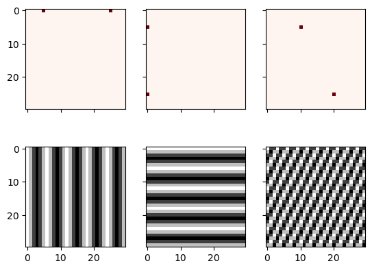

### Discrete Cosine Transforms

#### DCT and IDCT

``` python
from scipy.fft import dct, idct

x = np.array([1.0, 2.0, 1.0, -1.0, 1.5])
```

``` python
dct(dct(x, type=2, norm='ortho'), type=3, norm='ortho')
```

    array([ 1. ,  2. ,  1. , -1. ,  1.5])

``` python
dct(dct(x, type=2), type=3)
```

    array([ 10.,  20.,  10., -10.,  15.])

``` python
# Normalized inverse: no scaling factor

idct(dct(x, type=2), type=2)
```

    array([ 1. ,  2. ,  1. , -1. ,  1.5])

``` python
dct(dct(x, type=1, norm='ortho'), type=1, norm='ortho')
```

    array([ 1. ,  2. ,  1. , -1. ,  1.5])

``` python
# Unnormalized round-trip via DCT-I: scaling factor 2*(N-1) = 8

dct(dct(x, type=1), type=1)
```

    array([ 8., 16.,  8., -8., 12.])

``` python
# Normalized inverse: no scaling factor

idct(dct(x, type=1), type=1)
```

    array([ 1. ,  2. ,  1. , -1. ,  1.5])

``` python
dct(dct(x, type=4, norm='ortho'), type=4, norm='ortho')
```

    array([ 1. ,  2. ,  1. , -1. ,  1.5])

``` python
# Unnormalized round-trip via DCT-IV: scaling factor 2*N = 10

dct(dct(x, type=4), type=4)
```

    array([ 10.,  20.,  10., -10.,  15.])

``` python
# Normalized inverse: no scaling factor

idct(dct(x, type=4), type=4)
```

    array([ 1. ,  2. ,  1. , -1. ,  1.5])

``` python
from scipy.fft import dct, idct

import matplotlib.pyplot as plt

N = 100

t = np.linspace(0,20,N, endpoint=False)

x = np.exp(-t/3)*np.cos(2*t)

y = dct(x, norm='ortho')

window = np.zeros(N)

window[:20] = 1

yr = idct(y*window, norm='ortho')

sum(abs(x-yr)**2) / sum(abs(x)**2)
```

    0.0009872817275276098

``` python
plt.plot(t, x, '-bx')

plt.plot(t, yr, 'ro')

window = np.zeros(N)

window[:15] = 1

yr = idct(y*window, norm='ortho')

sum(abs(x-yr)**2) / sum(abs(x)**2)

plt.plot(t, yr, 'g+')

plt.legend(['x', '$x_{20}$', '$x_{15}$'])

plt.grid()

plt.show()
```

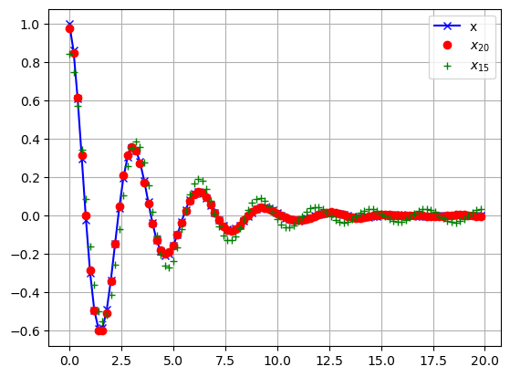

### Discrete Sine Transforms

#### DST and IDST

``` python
from scipy.fft import dst, idst

x = np.array([1.0, 2.0, 1.0, -1.0, 1.5])
```

``` python
dst(dst(x, type=2, norm='ortho'), type=3, norm='ortho')
```

    array([ 1. ,  2. ,  1. , -1. ,  1.5])

``` python
dst(dst(x, type=2), type=3)
```

    array([ 10.,  20.,  10., -10.,  15.])

``` python
idst(dst(x, type=2), type=2)
```

    array([ 1. ,  2. ,  1. , -1. ,  1.5])

``` python
dst(dst(x, type=1, norm='ortho'), type=1, norm='ortho')
```

    array([ 1. ,  2. ,  1. , -1. ,  1.5])

``` python
# scaling factor 2*(N+1) = 12

dst(dst(x, type=1), type=1)
```

    array([ 12.,  24.,  12., -12.,  18.])

``` python
# no scaling factor

idst(dst(x, type=1), type=1)
```

    array([ 1. ,  2. ,  1. , -1. ,  1.5])

``` python
dst(dst(x, type=4, norm='ortho'), type=4, norm='ortho')
```

    array([ 1. ,  2. ,  1. , -1. ,  1.5])

``` python
# scaling factor 2*N = 10

dst(dst(x, type=4), type=4)
```

    array([ 10.,  20.,  10., -10.,  15.])

``` python
# no scaling factor

idst(dst(x, type=4), type=4)
```

    array([ 1. ,  2. ,  1. , -1. ,  1.5])

## Signal Processing

### B-splines

``` python
import numpy as np

from scipy import signal, datasets

import matplotlib.pyplot as plt
```

``` python
image = datasets.face(gray=True).astype(np.float32)

derfilt = np.array([1.0, -2, 1.0], dtype=np.float32)

ck = signal.cspline2d(image, 8.0)

deriv = (signal.sepfir2d(ck, derfilt, [1]) +

         signal.sepfir2d(ck, [1], derfilt))
```

``` python
plt.figure()

plt.imshow(image)

plt.gray()

plt.title('Original image')

plt.show()
```

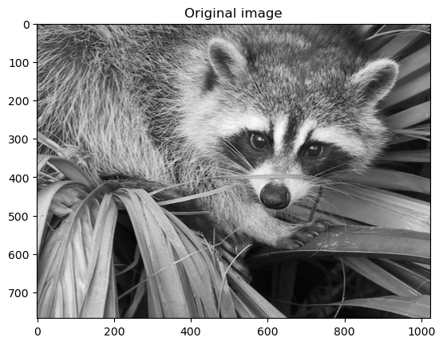

``` python
plt.figure()

plt.imshow(deriv)

plt.gray()

plt.title('Output of spline edge filter')

plt.show()
```

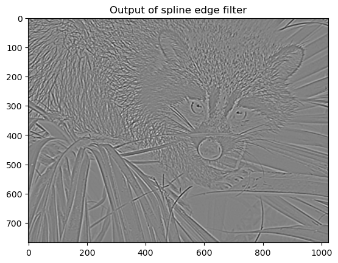

### Filtering

``` python
x = np.array([1.0, 2.0, 3.0])

h = np.array([0.0, 1.0, 0.0, 0.0, 0.0])

signal.convolve(x, h)
```

    array([0., 1., 2., 3., 0., 0., 0.])

``` python
signal.convolve(x, h, 'same')
```

    array([2., 3., 0.])

``` python
x = np.array([[1., 1., 0., 0.], [1., 1., 0., 0.], [0., 0., 0., 0.], [0., 0., 0., 0.]])

h = np.array([[1., 0., 0., 0.], [0., 0., 0., 0.], [0., 0., 1., 0.], [0., 0., 0., 0.]])

signal.convolve(x, h)
```

    array([[1., 1., 0., 0., 0., 0., 0.],
           [1., 1., 0., 0., 0., 0., 0.],
           [0., 0., 1., 1., 0., 0., 0.],
           [0., 0., 1., 1., 0., 0., 0.],
           [0., 0., 0., 0., 0., 0., 0.],
           [0., 0., 0., 0., 0., 0., 0.],
           [0., 0., 0., 0., 0., 0., 0.]])

``` python
import numpy as np

from scipy import signal, datasets

import matplotlib.pyplot as plt
```

``` python
image = datasets.face(gray=True)

w = np.zeros((50, 50))

w[0][0] = 1.0

w[49][25] = 1.0

image_new = signal.fftconvolve(image, w)
```

``` python
plt.figure()

plt.imshow(image)

plt.gray()

plt.title('Original image')

plt.show()
```


``` python
plt.figure()

plt.imshow(image_new)

plt.gray()

plt.title('Filtered image')

plt.show()
```

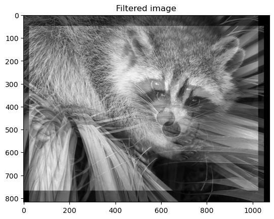

``` python
import numpy as np

from scipy import signal, datasets

import matplotlib.pyplot as plt
```

``` python
image = np.asarray(datasets.ascent(), np.float64)

w = signal.windows.gaussian(51, 10.0)

image_new = signal.sepfir2d(image, w, w)
```

``` python
plt.figure()

plt.imshow(image)

plt.gray()

plt.title('Original image')

plt.show()
```

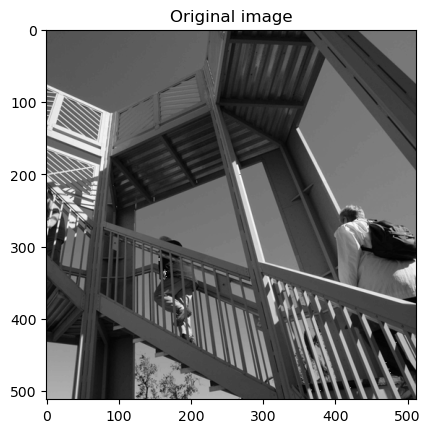

``` python
plt.figure()

plt.imshow(image_new)

plt.gray()

plt.title('Filtered image')

plt.show()
```

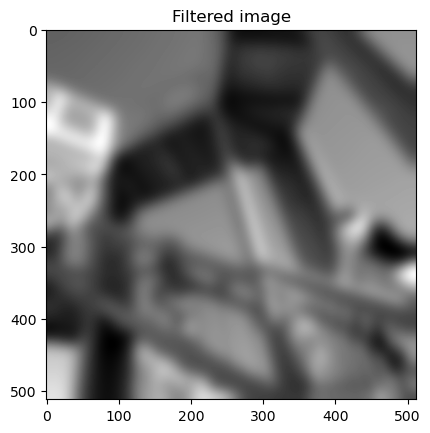

``` python
import numpy as np

from scipy import signal
```

``` python
x = np.array([1., 0., 0., 0.])

b = np.array([1.0/2, 1.0/4])

a = np.array([1.0, -1.0/3])

signal.lfilter(b, a, x)
```

    array([0.5       , 0.41666667, 0.13888889, 0.0462963 ])

``` python
zi = signal.lfiltic(b, a, y=[2.])

signal.lfilter(b, a, x, zi=zi)
```

    (array([1.16666667, 0.63888889, 0.21296296, 0.07098765]), array([0.02366255]))

``` python
b = np.array([1.0/2, 1.0/4])

a = np.array([1.0, -1.0/3])

signal.tf2zpk(b, a)
```

    (array([-0.5]), array([0.33333333]), 0.5)

#### Filter Design - FIR

``` python
import numpy as np

import scipy.signal as signal

import matplotlib.pyplot as plt

b1 = signal.firwin(40, 0.5)

b2 = signal.firwin(41, [0.3, 0.8])

w1, h1 = signal.freqz(b1)

w2, h2 = signal.freqz(b2)

plt.title('Digital filter frequency response')

plt.plot(w1, 20*np.log10(np.abs(h1)), 'b')

plt.plot(w2, 20*np.log10(np.abs(h2)), 'r')

plt.ylabel('Amplitude Response (dB)')

plt.xlabel('Frequency (rad/sample)')

plt.grid()

plt.show()
```

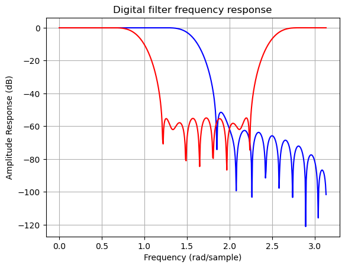

``` python
import numpy as np

import scipy.signal as signal

import matplotlib.pyplot as plt

b = signal.firwin2(150, [0.0, 0.3, 0.6, 1.0], [1.0, 2.0, 0.5, 0.0])

w, h = signal.freqz(b)

plt.title('Digital filter frequency response')

plt.plot(w, np.abs(h))

plt.title('Digital filter frequency response')

plt.ylabel('Amplitude Response')

plt.xlabel('Frequency (rad/sample)')

plt.grid()

plt.show()
```

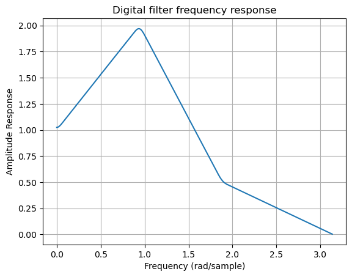

#### IIR Filter

``` python
import numpy as np

import scipy.signal as signal

import matplotlib.pyplot as plt

b, a = signal.iirfilter(4, Wn=0.2, rp=5, rs=60, btype='lowpass', ftype='ellip')

w, h = signal.freqz(b, a)

plt.title('Digital filter frequency response')

plt.plot(w, 20*np.log10(np.abs(h)))

plt.title('Digital filter frequency response')

plt.ylabel('Amplitude Response [dB]')

plt.xlabel('Frequency (rad/sample)')

plt.grid()

plt.show()
```

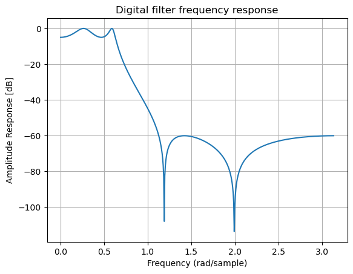

``` python
import numpy as np

import scipy.signal as signal

import matplotlib.pyplot as plt

b, a = signal.iirdesign(wp=100, ws=200, gpass=2.0, gstop=40., analog=True)

w, h = signal.freqs(b, a)

plt.title('Analog filter frequency response')

plt.plot(w, 20*np.log10(np.abs(h)))

plt.ylabel('Amplitude Response [dB]')

plt.xlabel('Frequency')

plt.grid()

plt.show()
```

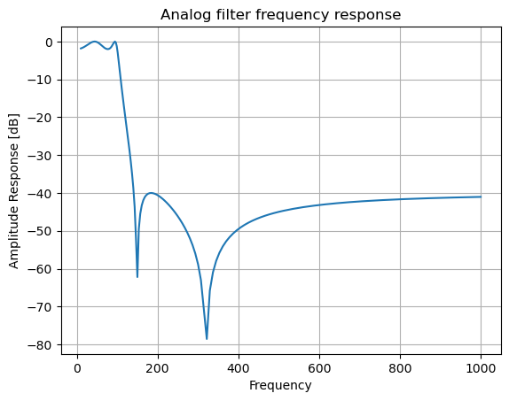

``` python
z, p, k = signal.tf2zpk(b, a)

plt.plot(np.real(z), np.imag(z), 'ob', markerfacecolor='none')

plt.plot(np.real(p), np.imag(p), 'xr')

plt.legend(['Zeros', 'Poles'], loc=2)

plt.title('Pole / Zero Plot')

plt.xlabel('Real')

plt.ylabel('Imaginary')

plt.grid()

plt.show()
```

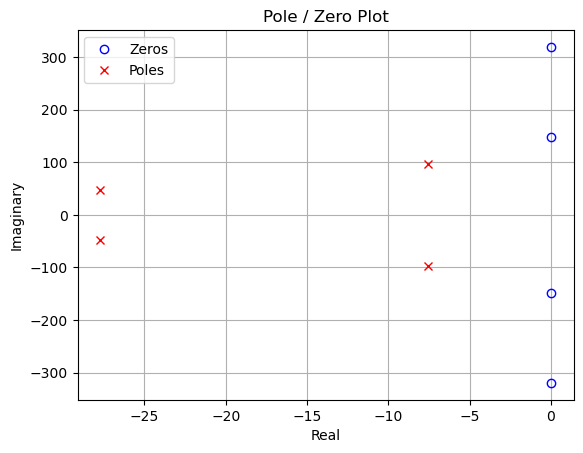

### Spectral Analysis

``` python
import numpy as np

import scipy.signal as signal

import matplotlib.pyplot as plt

fs = 10e3

N = 1e5

amp = 2*np.sqrt(2)

freq = 1270.0

noise_power = 0.001 * fs / 2

time = np.arange(N) / fs

x = amp*np.sin(2*np.pi*freq*time)

x += np.random.normal(scale=np.sqrt(noise_power), size=time.shape)

f, Pper_spec = signal.periodogram(x, fs, 'flattop', scaling='spectrum')

plt.semilogy(f, Pper_spec)

plt.xlabel('frequency [Hz]')

plt.ylabel('PSD')

plt.grid()

plt.show()
```

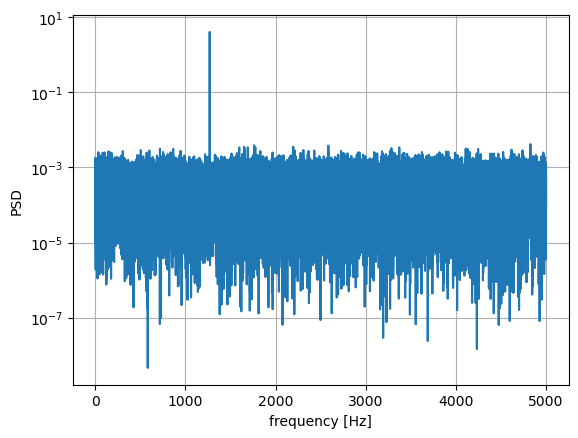

``` python
import numpy as np

import scipy.signal as signal

import matplotlib.pyplot as plt

fs = 10e3

N = 1e5

amp = 2*np.sqrt(2)

freq = 1270.0

noise_power = 0.001 * fs / 2

time = np.arange(N) / fs

x = amp*np.sin(2*np.pi*freq*time)

x += np.random.normal(scale=np.sqrt(noise_power), size=time.shape)

f, Pwelch_spec = signal.welch(x, fs, scaling='spectrum')

plt.semilogy(f, Pwelch_spec)

plt.xlabel('frequency [Hz]')

plt.ylabel('PSD')

plt.grid()

plt.show()
```

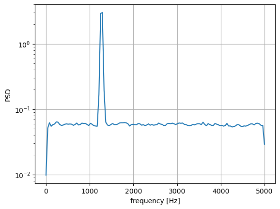

### Detrend

``` python
import numpy as np

import scipy.signal as signal

import matplotlib.pyplot as plt
```

``` python
t = np.linspace(-10, 10, 20)

y = 1 + t + 0.01*t**2

yconst = signal.detrend(y, type='constant')

ylin = signal.detrend(y, type='linear')
```

``` python
plt.plot(t, y, '-rx')

plt.plot(t, yconst, '-bo')

plt.plot(t, ylin, '-k+')

plt.grid()

plt.legend(['signal', 'const. detrend', 'linear detrend'])

plt.show()
```

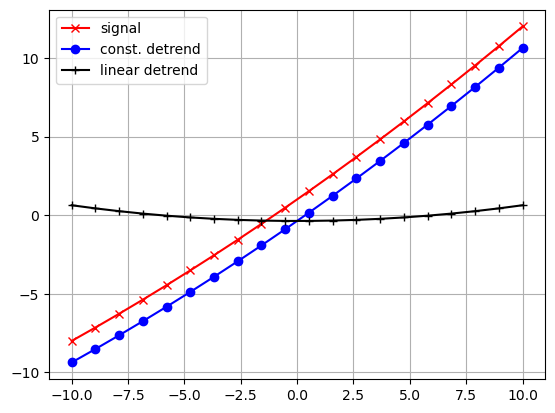

## Multidimensional image processing

### Properties shared by all functions

``` python
from scipy.ndimage import correlate

import numpy as np

correlate(np.arange(10), [1, 2.5])
```

    array([ 0,  2,  6,  9, 13, 16, 20, 23, 27, 30])

``` python
correlate(np.arange(10), [1, 2.5], output=np.float64)
```

    array([ 0. ,  2.5,  6. ,  9.5, 13. , 16.5, 20. , 23.5, 27. , 30.5])

### Filter functions

``` python
footprint = np.array([[0, 1, 0], [1, 1, 1], [0, 1, 0]])

footprint
```

    array([[0, 1, 0],
           [1, 1, 1],
           [0, 1, 0]])

``` python
from scipy.ndimage import correlate1d

a = [0, 0, 0, 1, 0, 0, 0]

correlate1d(a, [1, 1, 1])
```

    array([0, 0, 1, 1, 1, 0, 0])

``` python
a = [0, 0, 0, 1, 0, 0, 0]

correlate1d(a, [1, 1, 1], origin = -1)
```

    array([0, 1, 1, 1, 0, 0, 0])

``` python
a = [0, 0, 1, 1, 1, 0, 0]

correlate1d(a, [-1, 1])               # backward difference
```

    array([ 0,  0,  1,  0,  0, -1,  0])

``` python
correlate1d(a, [-1, 1], origin = -1)  # forward difference
```

    array([ 0,  1,  0,  0, -1,  0,  0])

``` python
correlate1d(a, [0, -1, 1])
```

    array([ 0,  1,  0,  0, -1,  0,  0])

| mode       | description                          | example                   |
|------------|--------------------------------------|---------------------------|
| “nearest”  | use the value at the boundary        | \[1 2 3\]-\>\[1 1 2 3 3\] |
| “wrap”     | periodically replicate the array     | \[1 2 3\]-\>\[3 1 2 3 1\] |
| “reflect”  | reflect the array at the boundary    | \[1 2 3\]-\>\[1 1 2 3 3\] |
| “mirror”   | mirror the array at the boundary     | \[1 2 3\]-\>\[2 1 2 3 2\] |
| “constant” | use a constant value, default is 0.0 | \[1 2 3\]-\>\[0 1 2 3 0\] |

The following synonyms are also supported for consistency with the interpolation routines:

| mode            | description                |
|-----------------|----------------------------|
| “grid-constant” | equivalent to “constant”\* |
| “grid-mirror”   | equivalent to “reflect”    |
| “grid-wrap”     | equivalent to “wrap”       |

### Derivatives

``` python
def d2(input, axis, output, mode, cval):
    return correlate1d(input, [1, -2, 1], axis, output, mode, cval, 0)

a = np.zeros((5, 5))

a[2, 2] = 1

from scipy.ndimage import generic_laplace

generic_laplace(a, d2)
```

    array([[ 0.,  0.,  0.,  0.,  0.],
           [ 0.,  0.,  1.,  0.,  0.],
           [ 0.,  1., -4.,  1.,  0.],
           [ 0.,  0.,  1.,  0.,  0.],
           [ 0.,  0.,  0.,  0.,  0.]])

``` python
def d2(input, axis, output, mode, cval, weights):

    return correlate1d(input, weights, axis, output, mode, cval, 0,)


a = np.zeros((5, 5))

a[2, 2] = 1

generic_laplace(a, d2, extra_arguments = ([1, -2, 1],))
```

    array([[ 0.,  0.,  0.,  0.,  0.],
           [ 0.,  0.,  1.,  0.,  0.],
           [ 0.,  1., -4.,  1.,  0.],
           [ 0.,  0.,  1.,  0.,  0.],
           [ 0.,  0.,  0.,  0.,  0.]])

``` python
generic_laplace(a, d2, extra_keywords = {'weights': [1, -2, 1]})
```

    array([[ 0.,  0.,  0.,  0.,  0.],
           [ 0.,  0.,  1.,  0.,  0.],
           [ 0.,  1., -4.,  1.,  0.],
           [ 0.,  0.,  1.,  0.,  0.],
           [ 0.,  0.,  0.,  0.,  0.]])

``` python
a = np.zeros((5, 5))

a[2, 2] = 1

from scipy.ndimage import sobel, generic_gradient_magnitude

generic_gradient_magnitude(a, sobel)
```

    array([[0.        , 0.        , 0.        , 0.        , 0.        ],
           [0.        , 1.41421356, 2.        , 1.41421356, 0.        ],
           [0.        , 2.        , 0.        , 2.        , 0.        ],
           [0.        , 1.41421356, 2.        , 1.41421356, 0.        ],
           [0.        , 0.        , 0.        , 0.        , 0.        ]])

``` python
a = np.arange(12).reshape(3,4)

correlate1d(a, [1, 2, 3])
```

    array([[ 3,  8, 14, 17],
           [27, 32, 38, 41],
           [51, 56, 62, 65]])

``` python
def fnc(iline, oline):
    oline[...] = iline[:-2] + 2 * iline[1:-1] + 3 * iline[2:]

from scipy.ndimage import generic_filter1d

generic_filter1d(a, fnc, 3)
```

    array([[ 3,  8, 14, 17],
           [27, 32, 38, 41],
           [51, 56, 62, 65]])

``` python
def fnc(iline, oline, a, b):

    oline[...] = iline[:-2] + a * iline[1:-1] + b * iline[2:]


generic_filter1d(a, fnc, 3, extra_arguments = (2, 3))
```

    array([[ 3,  8, 14, 17],
           [27, 32, 38, 41],
           [51, 56, 62, 65]])

``` python
generic_filter1d(a, fnc, 3, extra_keywords = {'a':2, 'b':3})
```

    array([[ 3,  8, 14, 17],
           [27, 32, 38, 41],
           [51, 56, 62, 65]])

``` python
a = np.arange(12).reshape(3,4)

correlate(a, [[1, 0], [0, 3]])
```

    array([[ 0,  3,  7, 11],
           [12, 15, 19, 23],
           [28, 31, 35, 39]])

``` python
def fnc(buffer):

    return (buffer * np.array([1, 3])).sum()


from scipy.ndimage import generic_filter

generic_filter(a, fnc, footprint = [[1, 0], [0, 1]])
```

    array([[ 0,  3,  7, 11],
           [12, 15, 19, 23],
           [28, 31, 35, 39]])

``` python
def fnc(buffer, weights):

    weights = np.asarray(weights)

    return (buffer * weights).sum()


generic_filter(a, fnc, footprint = [[1, 0], [0, 1]], extra_arguments = ([1, 3],))
```

    array([[ 0,  3,  7, 11],
           [12, 15, 19, 23],
           [28, 31, 35, 39]])

``` python
generic_filter(a, fnc, footprint = [[1, 0], [0, 1]], extra_keywords= {'weights': [1, 3]})
```

    array([[ 0,  3,  7, 11],
           [12, 15, 19, 23],
           [28, 31, 35, 39]])

``` python
a = np.arange(12).reshape(3,4)

class fnc_class:
    def __init__(self, shape):
        # store the shape:
        self.shape = shape
        # initialize the coordinates:
        self.coordinates = [0] * len(shape)

    def filter(self, buffer):
        result = (buffer * np.array([1, 3])).sum()
        print(self.coordinates)
        # calculate the next coordinates:
        axes = list(range(len(self.shape)))
        axes.reverse()
        for jj in axes:
            if self.coordinates[jj] < self.shape[jj] - 1:
                self.coordinates[jj] += 1
                break
            else:
                self.coordinates[jj] = 0
        return result

fnc = fnc_class(shape = (3,4))

generic_filter(a, fnc.filter, footprint = [[1, 0], [0, 1]])
```

    [0, 0]
    [0, 1]
    [0, 2]
    [0, 3]
    [1, 0]
    [1, 1]
    [1, 2]
    [1, 3]
    [2, 0]
    [2, 1]
    [2, 2]
    [2, 3]

    array([[ 0,  3,  7, 11],
           [12, 15, 19, 23],
           [28, 31, 35, 39]])

``` python
a = np.arange(12).reshape(3,4)

class fnc1d_class:
    def __init__(self, shape, axis = -1):
        # store the filter axis:
        self.axis = axis
        # store the shape:
        self.shape = shape
        # initialize the coordinates:
        self.coordinates = [0] * len(shape)

    def filter(self, iline, oline):
        oline[...] = iline[:-2] + 2 * iline[1:-1] + 3 * iline[2:]
        print(self.coordinates)
        # calculate the next coordinates:
        axes = list(range(len(self.shape)))
        # skip the filter axis:
        del axes[self.axis]
        axes.reverse()
        for jj in axes:
            if self.coordinates[jj] < self.shape[jj] - 1:
                self.coordinates[jj] += 1
                break
            else:
                self.coordinates[jj] = 0

fnc = fnc1d_class(shape = (3,4))

generic_filter1d(a, fnc.filter, 3)
```

    [0, 0]
    [1, 0]
    [2, 0]

    array([[ 3,  8, 14, 17],
           [27, 32, 38, 41],
           [51, 56, 62, 65]])

### Interpolation functions

``` python
a = np.arange(12).reshape(4,3).astype(np.float64)

def shift_func(output_coordinates):

    return (output_coordinates[0] - 0.5, output_coordinates[1] - 0.5)


from scipy.ndimage import geometric_transform

geometric_transform(a, shift_func)
```

    array([[0.    , 0.    , 0.    ],
           [0.    , 1.3625, 2.7375],
           [0.    , 4.8125, 6.1875],
           [0.    , 8.2625, 9.6375]])

``` python
def shift_func(output_coordinates, s0, s1):

    return (output_coordinates[0] - s0, output_coordinates[1] - s1)


geometric_transform(a, shift_func, extra_arguments = (0.5, 0.5))
```

    array([[0.    , 0.    , 0.    ],
           [0.    , 1.3625, 2.7375],
           [0.    , 4.8125, 6.1875],
           [0.    , 8.2625, 9.6375]])

``` python
geometric_transform(a, shift_func, extra_keywords = {'s0': 0.5, 's1': 0.5})
```

    array([[0.    , 0.    , 0.    ],
           [0.    , 1.3625, 2.7375],
           [0.    , 4.8125, 6.1875],
           [0.    , 8.2625, 9.6375]])

``` python
a = np.arange(12).reshape(4,3).astype(np.float64)

a
```

    array([[ 0.,  1.,  2.],
           [ 3.,  4.,  5.],
           [ 6.,  7.,  8.],
           [ 9., 10., 11.]])

``` python
from scipy.ndimage import map_coordinates

map_coordinates(a, [[0.5, 2], [0.5, 1]])
```

    array([1.3625, 7.    ])

### Binary morphology

``` python
from scipy.ndimage import generate_binary_structure

generate_binary_structure(2, 1)
```

    array([[False,  True, False],
           [ True,  True,  True],
           [False,  True, False]])

``` python
generate_binary_structure(2, 2)
```

    array([[ True,  True,  True],
           [ True,  True,  True],
           [ True,  True,  True]])

``` python
struct = np.array([[0, 1, 0], [1, 1, 1], [0, 1, 0]])

a = np.array([[1,0,0,0,0], [1,1,0,1,0], [0,0,1,1,0], [0,0,0,0,0]])

a
```

    array([[1, 0, 0, 0, 0],
           [1, 1, 0, 1, 0],
           [0, 0, 1, 1, 0],
           [0, 0, 0, 0, 0]])

``` python
from scipy.ndimage import binary_dilation

binary_dilation(np.zeros(a.shape), struct, -1, a, border_value=1)
```

    array([[ True, False, False, False, False],
           [ True,  True, False, False, False],
           [False, False, False, False, False],
           [False, False, False, False, False]])

``` python
struct = generate_binary_structure(2, 1)

struct
```

    array([[False,  True, False],
           [ True,  True,  True],
           [False,  True, False]])

``` python
from scipy.ndimage import iterate_structure

iterate_structure(struct, 2)
```

    array([[False, False,  True, False, False],
           [False,  True,  True,  True, False],
           [ True,  True,  True,  True,  True],
           [False,  True,  True,  True, False],
           [False, False,  True, False, False]])

### Segmentation and labeling

``` python
a = np.array([[1,2,2,1,1,0],

              [0,2,3,1,2,0],

              [1,1,1,3,3,2],

              [1,1,1,1,2,1]])

np.where(a > 1, 1, 0)
```

    array([[0, 1, 1, 0, 0, 0],
           [0, 1, 1, 0, 1, 0],
           [0, 0, 0, 1, 1, 1],
           [0, 0, 0, 0, 1, 0]])

``` python
a = np.array([[0,1,1,0,0,0],[0,1,1,0,1,0],[0,0,0,1,1,1],[0,0,0,0,1,0]])

s = [[0, 1, 0], [1,1,1], [0,1,0]]

from scipy.ndimage import label

label(a, s)
```

    (array([[0, 1, 1, 0, 0, 0],
            [0, 1, 1, 0, 2, 0],
            [0, 0, 0, 2, 2, 2],
            [0, 0, 0, 0, 2, 0]], dtype=int32),
     2)

``` python
a = np.array([[0,1,1,0,0,0],[0,1,1,0,1,0],[0,0,0,1,1,1],[0,0,0,0,1,0]])

s = [[1,1,1], [1,1,1], [1,1,1]]

label(a, s)[0]
```

    array([[0, 1, 1, 0, 0, 0],
           [0, 1, 1, 0, 1, 0],
           [0, 0, 0, 1, 1, 1],
           [0, 0, 0, 0, 1, 0]], dtype=int32)

``` python
l, n = label([1, 0, 1, 0, 1])

l
```

    array([1, 0, 2, 0, 3], dtype=int32)

``` python
l = np.where(l != 2, l, 0)

l
```

    array([1, 0, 0, 0, 3], dtype=int32)

``` python
label(l)[0]
```

    array([1, 0, 0, 0, 2], dtype=int32)

``` python
input = np.array([[0, 0, 0, 0, 0, 0, 0],
                  [0, 1, 1, 1, 1, 1, 0],
                  [0, 1, 0, 0, 0, 1, 0],
                  [0, 1, 0, 0, 0, 1, 0],
                  [0, 1, 0, 0, 0, 1, 0],
                  [0, 1, 1, 1, 1, 1, 0],
                  [0, 0, 0, 0, 0, 0, 0]], np.uint8)
markers = np.array([[1, 0, 0, 0, 0, 0, 0],
                    [0, 0, 0, 0, 0, 0, 0],
                    [0, 0, 0, 0, 0, 0, 0],
                    [0, 0, 0, 2, 0, 0, 0],
                    [0, 0, 0, 0, 0, 0, 0],
                    [0, 0, 0, 0, 0, 0, 0],
                    [0, 0, 0, 0, 0, 0, 0]], np.int8)

from scipy.ndimage import watershed_ift

watershed_ift(input, markers)
```

    array([[1, 1, 1, 1, 1, 1, 1],
           [1, 1, 2, 2, 2, 1, 1],
           [1, 2, 2, 2, 2, 2, 1],
           [1, 2, 2, 2, 2, 2, 1],
           [1, 2, 2, 2, 2, 2, 1],
           [1, 1, 2, 2, 2, 1, 1],
           [1, 1, 1, 1, 1, 1, 1]], dtype=int8)

``` python
markers = np.array([[0, 0, 0, 0, 0, 0, 0],
                    [0, 0, 0, 0, 0, 0, 0],
                    [0, 0, 0, 0, 0, 0, 0],
                    [0, 0, 0, 2, 0, 0, 0],
                    [0, 0, 0, 0, 0, 0, 0],
                    [0, 0, 0, 0, 0, 0, 0],
                    [0, 0, 0, 0, 0, 0, 1]], np.int8)

watershed_ift(input, markers)
```

    array([[1, 1, 1, 1, 1, 1, 1],
           [1, 1, 1, 1, 1, 1, 1],
           [1, 1, 2, 2, 2, 1, 1],
           [1, 1, 2, 2, 2, 1, 1],
           [1, 1, 2, 2, 2, 1, 1],
           [1, 1, 1, 1, 1, 1, 1],
           [1, 1, 1, 1, 1, 1, 1]], dtype=int8)

``` python
markers = np.array([[0, 0, 0, 0, 0, 0, 0],
                    [0, 0, 0, 0, 0, 0, 0],
                    [0, 0, 0, 0, 0, 0, 0],
                    [0, 0, 0, 2, 0, 0, 0],
                    [0, 0, 0, 0, 0, 0, 0],
                    [0, 0, 0, 0, 0, 0, 0],
                    [0, 0, 0, 0, 0, 0, -1]], np.int8)

watershed_ift(input, markers)
```

    array([[-1, -1, -1, -1, -1, -1, -1],
           [-1, -1,  2,  2,  2, -1, -1],
           [-1,  2,  2,  2,  2,  2, -1],
           [-1,  2,  2,  2,  2,  2, -1],
           [-1,  2,  2,  2,  2,  2, -1],
           [-1, -1,  2,  2,  2, -1, -1],
           [-1, -1, -1, -1, -1, -1, -1]], dtype=int8)

``` python
watershed_ift(input, markers,

              structure = [[1,1,1], [1,1,1], [1,1,1]])
```

    array([[-1, -1, -1, -1, -1, -1, -1],
           [-1,  2,  2,  2,  2,  2, -1],
           [-1,  2,  2,  2,  2,  2, -1],
           [-1,  2,  2,  2,  2,  2, -1],
           [-1,  2,  2,  2,  2,  2, -1],
           [-1,  2,  2,  2,  2,  2, -1],
           [-1, -1, -1, -1, -1, -1, -1]], dtype=int8)

### Object measurements

``` python
a = np.array([[0,1,1,0,0,0],[0,1,1,0,1,0],[0,0,0,1,1,1],[0,0,0,0,1,0]])

l, n = label(a)

from scipy.ndimage import find_objects

f = find_objects(l)

a[f[0]]
```

    array([[1, 1],
           [1, 1]])

``` python
a[f[1]]
```

    array([[0, 1, 0],
           [1, 1, 1],
           [0, 1, 0]])

``` python
from scipy.ndimage import find_objects

find_objects([1, 0, 3, 4], max_label = 3)
```

    [(slice(0, 1, None),), None, (slice(2, 3, None),)]

``` python
image = np.arange(4 * 6).reshape(4, 6)

mask = np.array([[0,1,1,0,0,0],[0,1,1,0,1,0],[0,0,0,1,1,1],[0,0,0,0,1,0]])

labels = label(mask)[0]

slices = find_objects(labels)
```

``` python
np.where(labels[slices[1]] == 2, image[slices[1]], 0).sum()
```

    80

``` python
from scipy.ndimage import sum as ndi_sum

ndi_sum(image, labels, 2)
```

    80

``` python
ndi_sum(image[slices[1]], labels[slices[1]], 2)
```

    80

``` python
ndi_sum(image, labels, [0, 2])
```

    array([178.,  80.])

Back to top
