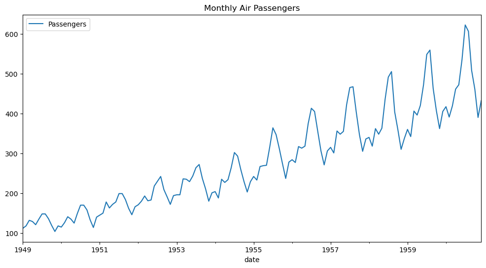
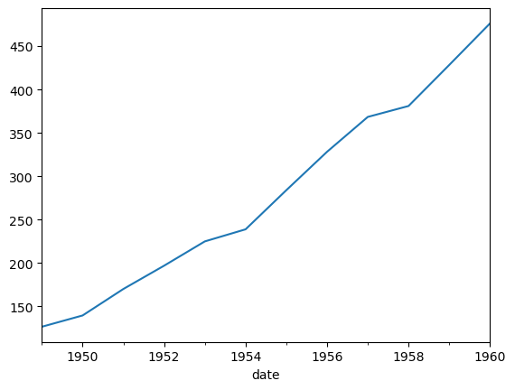
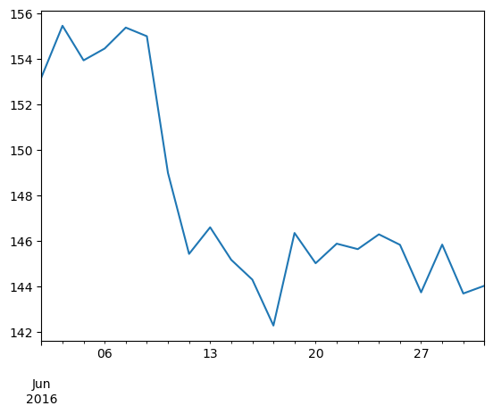

# Pandas

Pandas

Author

Benedict Thekkel

## Add Column

``` python
import pandas as pd

# Create an empty DataFrame
empty_df = pd.DataFrame()
```

## Edit Column name

``` python
df_plot.rename(columns={'y': 'final'}, inplace=True)
```

## Drop Column

``` python
cv_df.drop('cutoff', axis=1, inplace=True)
```

## Plots

``` python
(
    wide_df[['y']].plot(title='Production')
)
```

## Long form to Wide form

``` python
def long_form(df_plot):
    return df_plot.melt('ds', var_name='unique_id', value_name='y')
```

## Wide form to long form

``` python
#|eval: false
wide_df = result.pivot(index='_time', columns='sensor', values='_value')
# Reset the index to make 'id' a regular column
wide_df.reset_index(inplace=True)

wide_df.columns
```

## Aggregate

> to do

------------------------------------------------------------------------

## Stats

``` python
import seaborn as sns
import pandas as pd
import numpy as np
import matplotlib.pyplot as plt
```

``` python
# Load the dataset
flights = (sns.load_dataset("flights"))
flights
```

|     | year | month | passengers |
|-----|------|-------|------------|
| 0   | 1949 | Jan   | 112        |
| 1   | 1949 | Feb   | 118        |
| 2   | 1949 | Mar   | 132        |
| 3   | 1949 | Apr   | 129        |
| 4   | 1949 | May   | 121        |
| ... | ...  | ...   | ...        |
| 139 | 1960 | Aug   | 606        |
| 140 | 1960 | Sep   | 508        |
| 141 | 1960 | Oct   | 461        |
| 142 | 1960 | Nov   | 390        |
| 143 | 1960 | Dec   | 432        |

144 rows × 3 columns

``` python
flights.head(), flights.tail()
```

    (   year month  passengers
     0  1949   Jan         112
     1  1949   Feb         118
     2  1949   Mar         132
     3  1949   Apr         129
     4  1949   May         121,
          year month  passengers
     139  1960   Aug         606
     140  1960   Sep         508
     141  1960   Oct         461
     142  1960   Nov         390
     143  1960   Dec         432)

``` python
flights.info()
```

    <class 'pandas.core.frame.DataFrame'>
    RangeIndex: 144 entries, 0 to 143
    Data columns (total 3 columns):
     #   Column      Non-Null Count  Dtype   
    ---  ------      --------------  -----   
     0   year        144 non-null    int64   
     1   month       144 non-null    category
     2   passengers  144 non-null    int64   
    dtypes: category(1), int64(2)
    memory usage: 2.9 KB

``` python
flights.describe()
```

|       | year        | passengers |
|-------|-------------|------------|
| count | 144.000000  | 144.000000 |
| mean  | 1954.500000 | 280.298611 |
| std   | 3.464102    | 119.966317 |
| min   | 1949.000000 | 104.000000 |
| 25%   | 1951.750000 | 180.000000 |
| 50%   | 1954.500000 | 265.500000 |
| 75%   | 1957.250000 | 360.500000 |
| max   | 1960.000000 | 622.000000 |

``` python
flights.describe(include = "category")
```

|        | month |
|--------|-------|
| count  | 144   |
| unique | 12    |
| top    | Jan   |
| freq   | 12    |

``` python
flights.year.head(), flights['year'].head(), flights[['year', 'passengers']].head()
```

    (0    1949
     1    1949
     2    1949
     3    1949
     4    1949
     Name: year, dtype: int64,
     0    1949
     1    1949
     2    1949
     3    1949
     4    1949
     Name: year, dtype: int64,
        year  passengers
     0  1949         112
     1  1949         118
     2  1949         132
     3  1949         129
     4  1949         121)

``` python
flights.iloc[1]
```

    year          1949
    month          Feb
    passengers     118
    Name: 1, dtype: object

``` python
flights.loc[1, 'year']
```

    1949

``` python
# Convert month names to datetime format with the given year
flights['date'] = flights.apply(lambda row: pd.to_datetime(f"{row['year']}-{row['month']}-01"), axis=1)
flights.set_index('date', inplace=True)

# Drop redundant columns and rename the passengers column for clarity
flights.drop(['year', 'month'], axis=1, inplace=True)
flights.rename(columns={'passengers': 'Passengers'}, inplace=True)

# Plot the data
flights.plot(title="Monthly Air Passengers", figsize=(12,6))
plt.show()
```



``` python
df = flights
df.head()
```

|            | Passengers |
|------------|------------|
| date       |            |
| 1949-01-01 | 112        |
| 1949-02-01 | 118        |
| 1949-03-01 | 132        |
| 1949-04-01 | 129        |
| 1949-05-01 | 121        |

``` python
df.columns
```

    Index(['Passengers'], dtype='object')

``` python
df.index
```

    DatetimeIndex(['1949-01-01', '1949-02-01', '1949-03-01', '1949-04-01',
                   '1949-05-01', '1949-06-01', '1949-07-01', '1949-08-01',
                   '1949-09-01', '1949-10-01',
                   ...
                   '1960-03-01', '1960-04-01', '1960-05-01', '1960-06-01',
                   '1960-07-01', '1960-08-01', '1960-09-01', '1960-10-01',
                   '1960-11-01', '1960-12-01'],
                  dtype='datetime64[ns]', name='date', length=144, freq=None)

``` python
df["1960-08-01":"1960-12-01"]
```

|            | Passengers |
|------------|------------|
| date       |            |
| 1960-08-01 | 606        |
| 1960-09-01 | 508        |
| 1960-10-01 | 461        |
| 1960-11-01 | 390        |
| 1960-12-01 | 432        |

``` python
df.Passengers.resample('Y').mean()
```

    date
    1949-12-31    126.666667
    1950-12-31    139.666667
    1951-12-31    170.166667
    1952-12-31    197.000000
    1953-12-31    225.000000
    1954-12-31    238.916667
    1955-12-31    284.000000
    1956-12-31    328.250000
    1957-12-31    368.416667
    1958-12-31    381.000000
    1959-12-31    428.333333
    1960-12-31    476.166667
    Freq: A-DEC, Name: Passengers, dtype: float64

``` python
df.Passengers.resample('Y').mean().plot()
```



``` python
df = pd.read_csv("Data/aapl_no_dates.csv")
df.head()
```

|     | Open   | High   | Low    | Close  | Volume   |
|-----|--------|--------|--------|--------|----------|
| 0   | 153.17 | 153.33 | 152.22 | 153.18 | 16404088 |
| 1   | 153.58 | 155.45 | 152.89 | 155.45 | 27770715 |
| 2   | 154.34 | 154.45 | 153.46 | 153.93 | 25331662 |
| 3   | 153.90 | 155.81 | 153.78 | 154.45 | 26624926 |
| 4   | 155.02 | 155.98 | 154.48 | 155.37 | 21069647 |

## Business Days

``` python
rng = pd.date_range(start="6/1/2016",end="6/30/2016",freq='B')
rng
```

    DatetimeIndex(['2016-06-01', '2016-06-02', '2016-06-03', '2016-06-06',
                   '2016-06-07', '2016-06-08', '2016-06-09', '2016-06-10',
                   '2016-06-13', '2016-06-14', '2016-06-15', '2016-06-16',
                   '2016-06-17', '2016-06-20', '2016-06-21', '2016-06-22',
                   '2016-06-23', '2016-06-24', '2016-06-27', '2016-06-28',
                   '2016-06-29', '2016-06-30'],
                  dtype='datetime64[ns]', freq='B')

``` python
df.set_index(rng, inplace=True)
df.head()
```

|            | Open   | High   | Low    | Close  | Volume   |
|------------|--------|--------|--------|--------|----------|
| 2016-06-01 | 153.17 | 153.33 | 152.22 | 153.18 | 16404088 |
| 2016-06-02 | 153.58 | 155.45 | 152.89 | 155.45 | 27770715 |
| 2016-06-03 | 154.34 | 154.45 | 153.46 | 153.93 | 25331662 |
| 2016-06-06 | 153.90 | 155.81 | 153.78 | 154.45 | 26624926 |
| 2016-06-07 | 155.02 | 155.98 | 154.48 | 155.37 | 21069647 |

``` python
daily_index = pd.date_range(start="6/1/2016",end="6/30/2016",freq='D')
daily_index
```

    DatetimeIndex(['2016-06-01', '2016-06-02', '2016-06-03', '2016-06-04',
                   '2016-06-05', '2016-06-06', '2016-06-07', '2016-06-08',
                   '2016-06-09', '2016-06-10', '2016-06-11', '2016-06-12',
                   '2016-06-13', '2016-06-14', '2016-06-15', '2016-06-16',
                   '2016-06-17', '2016-06-18', '2016-06-19', '2016-06-20',
                   '2016-06-21', '2016-06-22', '2016-06-23', '2016-06-24',
                   '2016-06-25', '2016-06-26', '2016-06-27', '2016-06-28',
                   '2016-06-29', '2016-06-30'],
                  dtype='datetime64[ns]', freq='D')

``` python
daily_index.difference(df.index)
```

    DatetimeIndex(['2016-06-04', '2016-06-05', '2016-06-11', '2016-06-12',
                   '2016-06-18', '2016-06-19', '2016-06-25', '2016-06-26'],
                  dtype='datetime64[ns]', freq=None)

### Benefits of having DatetimeIndex

``` python
df.Close.plot()
```



``` python
df["2016-06-01":"2016-06-10"].Close.mean()
```

    152.72125

``` python
df.index
```

    DatetimeIndex(['2016-06-01', '2016-06-02', '2016-06-03', '2016-06-06',
                   '2016-06-07', '2016-06-08', '2016-06-09', '2016-06-10',
                   '2016-06-13', '2016-06-14', '2016-06-15', '2016-06-16',
                   '2016-06-17', '2016-06-20', '2016-06-21', '2016-06-22',
                   '2016-06-23', '2016-06-24', '2016-06-27', '2016-06-28',
                   '2016-06-29', '2016-06-30'],
                  dtype='datetime64[ns]', freq='B')

``` python
df.asfreq('D',method='pad').head()
```

|            | Open   | High   | Low    | Close  | Volume   |
|------------|--------|--------|--------|--------|----------|
| 2016-06-01 | 153.17 | 153.33 | 152.22 | 153.18 | 16404088 |
| 2016-06-02 | 153.58 | 155.45 | 152.89 | 155.45 | 27770715 |
| 2016-06-03 | 154.34 | 154.45 | 153.46 | 153.93 | 25331662 |
| 2016-06-04 | 154.34 | 154.45 | 153.46 | 153.93 | 25331662 |
| 2016-06-05 | 154.34 | 154.45 | 153.46 | 153.93 | 25331662 |

``` python
df.asfreq('W',method='pad')
```

|            | Open   | High   | Low    | Close  | Volume   |
|------------|--------|--------|--------|--------|----------|
| 2016-06-05 | 154.34 | 154.45 | 153.46 | 153.93 | 25331662 |
| 2016-06-12 | 145.74 | 146.09 | 142.51 | 145.42 | 72307330 |
| 2016-06-19 | 143.66 | 146.74 | 143.66 | 146.34 | 32541404 |
| 2016-06-26 | 147.17 | 148.28 | 145.38 | 145.82 | 25692361 |

### Generating DatetimeIndex with periods argument

``` python
rng = pd.date_range('1/1/2011', periods=72, freq='H')
rng
```

    DatetimeIndex(['2011-01-01 00:00:00', '2011-01-01 01:00:00',
                   '2011-01-01 02:00:00', '2011-01-01 03:00:00',
                   '2011-01-01 04:00:00', '2011-01-01 05:00:00',
                   '2011-01-01 06:00:00', '2011-01-01 07:00:00',
                   '2011-01-01 08:00:00', '2011-01-01 09:00:00',
                   '2011-01-01 10:00:00', '2011-01-01 11:00:00',
                   '2011-01-01 12:00:00', '2011-01-01 13:00:00',
                   '2011-01-01 14:00:00', '2011-01-01 15:00:00',
                   '2011-01-01 16:00:00', '2011-01-01 17:00:00',
                   '2011-01-01 18:00:00', '2011-01-01 19:00:00',
                   '2011-01-01 20:00:00', '2011-01-01 21:00:00',
                   '2011-01-01 22:00:00', '2011-01-01 23:00:00',
                   '2011-01-02 00:00:00', '2011-01-02 01:00:00',
                   '2011-01-02 02:00:00', '2011-01-02 03:00:00',
                   '2011-01-02 04:00:00', '2011-01-02 05:00:00',
                   '2011-01-02 06:00:00', '2011-01-02 07:00:00',
                   '2011-01-02 08:00:00', '2011-01-02 09:00:00',
                   '2011-01-02 10:00:00', '2011-01-02 11:00:00',
                   '2011-01-02 12:00:00', '2011-01-02 13:00:00',
                   '2011-01-02 14:00:00', '2011-01-02 15:00:00',
                   '2011-01-02 16:00:00', '2011-01-02 17:00:00',
                   '2011-01-02 18:00:00', '2011-01-02 19:00:00',
                   '2011-01-02 20:00:00', '2011-01-02 21:00:00',
                   '2011-01-02 22:00:00', '2011-01-02 23:00:00',
                   '2011-01-03 00:00:00', '2011-01-03 01:00:00',
                   '2011-01-03 02:00:00', '2011-01-03 03:00:00',
                   '2011-01-03 04:00:00', '2011-01-03 05:00:00',
                   '2011-01-03 06:00:00', '2011-01-03 07:00:00',
                   '2011-01-03 08:00:00', '2011-01-03 09:00:00',
                   '2011-01-03 10:00:00', '2011-01-03 11:00:00',
                   '2011-01-03 12:00:00', '2011-01-03 13:00:00',
                   '2011-01-03 14:00:00', '2011-01-03 15:00:00',
                   '2011-01-03 16:00:00', '2011-01-03 17:00:00',
                   '2011-01-03 18:00:00', '2011-01-03 19:00:00',
                   '2011-01-03 20:00:00', '2011-01-03 21:00:00',
                   '2011-01-03 22:00:00', '2011-01-03 23:00:00'],
                  dtype='datetime64[ns]', freq='H')

``` python
import numpy as np
ts = pd.Series(np.random.randint(0,10,len(rng)), index=rng)
ts.head(20)
```

    2011-01-01 00:00:00    4
    2011-01-01 01:00:00    4
    2011-01-01 02:00:00    1
    2011-01-01 03:00:00    8
    2011-01-01 04:00:00    0
    2011-01-01 05:00:00    5
    2011-01-01 06:00:00    7
    2011-01-01 07:00:00    6
    2011-01-01 08:00:00    9
    2011-01-01 09:00:00    4
    2011-01-01 10:00:00    3
    2011-01-01 11:00:00    6
    2011-01-01 12:00:00    5
    2011-01-01 13:00:00    8
    2011-01-01 14:00:00    1
    2011-01-01 15:00:00    8
    2011-01-01 16:00:00    8
    2011-01-01 17:00:00    2
    2011-01-01 18:00:00    0
    2011-01-01 19:00:00    0
    Freq: H, dtype: int64

### Holidays

``` python
rng = pd.date_range(start="7/1/2017", end="7/21/2017", freq='B')
rng
```

    DatetimeIndex(['2017-07-03', '2017-07-04', '2017-07-05', '2017-07-06',
                   '2017-07-07', '2017-07-10', '2017-07-11', '2017-07-12',
                   '2017-07-13', '2017-07-14', '2017-07-17', '2017-07-18',
                   '2017-07-19', '2017-07-20', '2017-07-21'],
                  dtype='datetime64[ns]', freq='B')

### Using CustomBusinessDay to generate US holidays calendar frequency

``` python
from pandas.tseries.holiday import USFederalHolidayCalendar
from pandas.tseries.offsets import CustomBusinessDay

us_cal = CustomBusinessDay(calendar=USFederalHolidayCalendar())

rng = pd.date_range(start="7/1/2017",end="7/23/2017", freq=us_cal)
rng
```

    DatetimeIndex(['2017-07-03', '2017-07-05', '2017-07-06', '2017-07-07',
                   '2017-07-10', '2017-07-11', '2017-07-12', '2017-07-13',
                   '2017-07-14', '2017-07-17', '2017-07-18', '2017-07-19',
                   '2017-07-20', '2017-07-21'],
                  dtype='datetime64[ns]', freq='C')

### AbstractHolidayCalendar

``` python
from pandas.tseries.holiday import AbstractHolidayCalendar, nearest_workday, Holiday
class myCalendar(AbstractHolidayCalendar):
    rules = [
        Holiday('My Birth Day', month=4, day=15, observance=nearest_workday),
    ]
    
my_bday = CustomBusinessDay(calendar=myCalendar())
pd.date_range('4/1/2017','4/30/2017',freq=my_bday)
```

    DatetimeIndex(['2017-04-03', '2017-04-04', '2017-04-05', '2017-04-06',
                   '2017-04-07', '2017-04-10', '2017-04-11', '2017-04-12',
                   '2017-04-13', '2017-04-17', '2017-04-18', '2017-04-19',
                   '2017-04-20', '2017-04-21', '2017-04-24', '2017-04-25',
                   '2017-04-26', '2017-04-27', '2017-04-28'],
                  dtype='datetime64[ns]', freq='C')

### CustomBusinessDay

``` python
egypt_weekdays = "Sun Mon Tue Wed Thu"

b = CustomBusinessDay(weekmask=egypt_weekdays)

pd.date_range(start="7/1/2017",periods=20,freq=b)
```

    DatetimeIndex(['2017-07-02', '2017-07-03', '2017-07-04', '2017-07-05',
                   '2017-07-06', '2017-07-09', '2017-07-10', '2017-07-11',
                   '2017-07-12', '2017-07-13', '2017-07-16', '2017-07-17',
                   '2017-07-18', '2017-07-19', '2017-07-20', '2017-07-23',
                   '2017-07-24', '2017-07-25', '2017-07-26', '2017-07-27'],
                  dtype='datetime64[ns]', freq='C')

``` python
b = CustomBusinessDay(holidays=['2017-07-04', '2017-07-10'], weekmask=egypt_weekdays)

pd.date_range(start="7/1/2017",periods=20,freq=b)
```

    DatetimeIndex(['2017-07-02', '2017-07-03', '2017-07-05', '2017-07-06',
                   '2017-07-09', '2017-07-11', '2017-07-12', '2017-07-13',
                   '2017-07-16', '2017-07-17', '2017-07-18', '2017-07-19',
                   '2017-07-20', '2017-07-23', '2017-07-24', '2017-07-25',
                   '2017-07-26', '2017-07-27', '2017-07-30', '2017-07-31'],
                  dtype='datetime64[ns]', freq='C')

### Maths

``` python
from datetime import datetime
dt = datetime(2017,7,9)
dt
```

    datetime.datetime(2017, 7, 9, 0, 0)

``` python
dt + 1*b
```

    Timestamp('2017-07-11 00:00:00')

## To datatime

``` python
import pandas as pd
dates = ['2017-01-05', 'Jan 5, 2017', '01/05/2017', '2017.01.05', '2017/01/05','20170105']
pd.to_datetime(dates)
```

    DatetimeIndex(['2017-01-05', '2017-01-05', '2017-01-05', '2017-01-05',
                   '2017-01-05', '2017-01-05'],
                  dtype='datetime64[ns]', freq=None)

``` python
dt = ['2017-01-05 2:30:00 PM', 'Jan 5, 2017 14:30:00', '01/05/2016', '2017.01.05', '2017/01/05','20170105']
pd.to_datetime(dt)
```

    DatetimeIndex(['2017-01-05 14:30:00', '2017-01-05 14:30:00',
                   '2016-01-05 00:00:00', '2017-01-05 00:00:00',
                   '2017-01-05 00:00:00', '2017-01-05 00:00:00'],
                  dtype='datetime64[ns]', freq=None)

### European style dates with day first

``` python
pd.to_datetime('30-12-2016', dayfirst=True)
```

    Timestamp('2016-12-30 00:00:00')

``` python
pd.to_datetime('5-1-2016', dayfirst=True)
```

    Timestamp('2016-01-05 00:00:00')

### Custom date time format

``` python
pd.to_datetime('2017$01$05', format='%Y$%m$%d')
```

    Timestamp('2017-01-05 00:00:00')

``` python
pd.to_datetime('2017#01#05', format='%Y#%m#%d')
```

    Timestamp('2017-01-05 00:00:00')

### Handling invalid dates

``` python
pd.to_datetime(['2017-01-05', 'Jan 6, 2017', 'abc'], errors='ignore')
```

    Index(['2017-01-05', 'Jan 6, 2017', 'abc'], dtype='object')

``` python
pd.to_datetime(['2017-01-05', 'Jan 6, 2017', 'abc'], errors='coerce')
```

    DatetimeIndex(['2017-01-05', '2017-01-06', 'NaT'], dtype='datetime64[ns]', freq=None)

## Epoch

``` python
current_epoch = 1501324478
pd.to_datetime(current_epoch, unit='s')
```

    Timestamp('2017-07-29 10:34:38')

``` python
pd.to_datetime(current_epoch*1000, unit='ms')
```

    Timestamp('2017-07-29 10:34:38')

``` python
t = pd.to_datetime([current_epoch], unit='s')
t
```

    DatetimeIndex(['2017-07-29 10:34:38'], dtype='datetime64[ns]', freq=None)

``` python
t.view('int64')
```

    array([1501324478000000000])

### Yearly Period

``` python
import pandas as pd
y = pd.Period('2016')
y
```

    Period('2016', 'A-DEC')

``` python
y.start_time
```

    Timestamp('2016-01-01 00:00:00')

``` python
y.end_time
```

    Timestamp('2016-12-31 23:59:59.999999999')

``` python
y.is_leap_year
```

    True

### Monthly Period

``` python
m = pd.Period('2017-12')
m
```

    Period('2017-12', 'M')

``` python
m.start_time
```

    Timestamp('2017-12-01 00:00:00')

``` python
m.end_time
```

    Timestamp('2017-12-31 23:59:59.999999999')

``` python
m+1
```

    Period('2018-01', 'M')

### Daily Period

``` python
d = pd.Period('2016-02-28', freq='D')
d
```

    Period('2016-02-28', 'D')

``` python
d.start_time
```

    Timestamp('2016-02-28 00:00:00')

``` python
d.end_time
```

    Timestamp('2016-02-28 23:59:59.999999999')

``` python
d+1
```

    Period('2016-02-29', 'D')

### Hourly Period

``` python
h = pd.Period('2017-08-15 23:00:00',freq='H')
h
```

    Period('2017-08-15 23:00', 'H')

``` python
h+1
```

    Period('2017-08-16 00:00', 'H')

``` python
h+pd.offsets.Hour(1)
```

    Period('2017-08-16 00:00', 'H')

### Quarterly Period

``` python
q1= pd.Period('2017Q1', freq='Q-JAN')
q1
```

    Period('2017Q1', 'Q-JAN')

``` python
q1.start_time
```

    Timestamp('2016-02-01 00:00:00')

``` python
q1.end_time
```

    Timestamp('2016-04-30 23:59:59.999999999')

``` python
q1.asfreq('M',how='start')
```

    Period('2016-02', 'M')

``` python
q1.asfreq('M',how='end')
```

    Period('2016-04', 'M')

### Weekly Period

``` python
w = pd.Period('2017-07-05',freq='W')
w
```

    Period('2017-07-03/2017-07-09', 'W-SUN')

``` python
w-1
```

    Period('2017-06-26/2017-07-02', 'W-SUN')

``` python
w2 = pd.Period('2017-08-15',freq='W')
w2
```

    Period('2017-08-14/2017-08-20', 'W-SUN')

``` python
w2-w
```

    <6 * Weeks: weekday=6>

### PeriodIndex and period_range

``` python
r = pd.period_range('2011', '2017', freq='q')
r
```

    PeriodIndex(['2011Q1', '2011Q2', '2011Q3', '2011Q4', '2012Q1', '2012Q2',
                 '2012Q3', '2012Q4', '2013Q1', '2013Q2', '2013Q3', '2013Q4',
                 '2014Q1', '2014Q2', '2014Q3', '2014Q4', '2015Q1', '2015Q2',
                 '2015Q3', '2015Q4', '2016Q1', '2016Q2', '2016Q3', '2016Q4',
                 '2017Q1'],
                dtype='period[Q-DEC]')

``` python
r[0].start_time
```

    Timestamp('2011-01-01 00:00:00')

``` python
r[0].end_time
```

    Timestamp('2011-03-31 23:59:59.999999999')

``` python
idx = pd.period_range('2011', '2017', freq='q-jan')
idx
```

    PeriodIndex(['2011Q4', '2012Q1', '2012Q2', '2012Q3', '2012Q4', '2013Q1',
                 '2013Q2', '2013Q3', '2013Q4', '2014Q1', '2014Q2', '2014Q3',
                 '2014Q4', '2015Q1', '2015Q2', '2015Q3', '2015Q4', '2016Q1',
                 '2016Q2', '2016Q3', '2016Q4', '2017Q1', '2017Q2', '2017Q3',
                 '2017Q4'],
                dtype='period[Q-JAN]')

``` python
r[0].start_time
```

    Timestamp('2011-01-01 00:00:00')

``` python
r[0].end_time
```

    Timestamp('2011-03-31 23:59:59.999999999')

``` python
r = pd.period_range(start='2016-01', periods=10, freq='M')
r
```

    PeriodIndex(['2016-01', '2016-02', '2016-03', '2016-04', '2016-05', '2016-06',
                 '2016-07', '2016-08', '2016-09', '2016-10'],
                dtype='period[M]')

``` python
import numpy as np
ps = pd.Series(np.random.randn(len(idx)), idx)
ps
```

    2011Q4   -0.412550
    2012Q1    0.701174
    2012Q2    0.385101
    2012Q3    0.989325
    2012Q4   -0.858848
    2013Q1   -0.137989
    2013Q2    0.410097
    2013Q3    1.391899
    2013Q4    1.414134
    2014Q1   -0.144215
    2014Q2   -0.305327
    2014Q3    0.025925
    2014Q4    0.269103
    2015Q1    1.953641
    2015Q2    1.455620
    2015Q3    0.403967
    2015Q4    1.119294
    2016Q1    0.650177
    2016Q2    1.216127
    2016Q3   -0.784484
    2016Q4   -2.146994
    2017Q1    0.410092
    2017Q2    1.031284
    2017Q3    0.681366
    2017Q4   -1.082856
    Freq: Q-JAN, dtype: float64

``` python
ps['2016']
```

    2016Q4   -2.146994
    2017Q1    0.410092
    2017Q2    1.031284
    2017Q3    0.681366
    2017Q4   -1.082856
    Freq: Q-JAN, dtype: float64

``` python
ps['2016':'2017']
```

    2016Q4   -2.146994
    2017Q1    0.410092
    2017Q2    1.031284
    2017Q3    0.681366
    2017Q4   -1.082856
    Freq: Q-JAN, dtype: float64

``` python
pst = ps.to_timestamp()
pst
```

    2010-11-01   -0.412550
    2011-02-01    0.701174
    2011-05-01    0.385101
    2011-08-01    0.989325
    2011-11-01   -0.858848
    2012-02-01   -0.137989
    2012-05-01    0.410097
    2012-08-01    1.391899
    2012-11-01    1.414134
    2013-02-01   -0.144215
    2013-05-01   -0.305327
    2013-08-01    0.025925
    2013-11-01    0.269103
    2014-02-01    1.953641
    2014-05-01    1.455620
    2014-08-01    0.403967
    2014-11-01    1.119294
    2015-02-01    0.650177
    2015-05-01    1.216127
    2015-08-01   -0.784484
    2015-11-01   -2.146994
    2016-02-01    0.410092
    2016-05-01    1.031284
    2016-08-01    0.681366
    2016-11-01   -1.082856
    Freq: QS-NOV, dtype: float64

``` python
pst.index
```

    DatetimeIndex(['2010-11-01', '2011-02-01', '2011-05-01', '2011-08-01',
                   '2011-11-01', '2012-02-01', '2012-05-01', '2012-08-01',
                   '2012-11-01', '2013-02-01', '2013-05-01', '2013-08-01',
                   '2013-11-01', '2014-02-01', '2014-05-01', '2014-08-01',
                   '2014-11-01', '2015-02-01', '2015-05-01', '2015-08-01',
                   '2015-11-01', '2016-02-01', '2016-05-01', '2016-08-01',
                   '2016-11-01'],
                  dtype='datetime64[ns]', freq='QS-NOV')

``` python
ps = pst.to_period()
ps
```

    2010Q4   -0.412550
    2011Q1    0.701174
    2011Q2    0.385101
    2011Q3    0.989325
    2011Q4   -0.858848
    2012Q1   -0.137989
    2012Q2    0.410097
    2012Q3    1.391899
    2012Q4    1.414134
    2013Q1   -0.144215
    2013Q2   -0.305327
    2013Q3    0.025925
    2013Q4    0.269103
    2014Q1    1.953641
    2014Q2    1.455620
    2014Q3    0.403967
    2014Q4    1.119294
    2015Q1    0.650177
    2015Q2    1.216127
    2015Q3   -0.784484
    2015Q4   -2.146994
    2016Q1    0.410092
    2016Q2    1.031284
    2016Q3    0.681366
    2016Q4   -1.082856
    Freq: Q-DEC, dtype: float64

``` python
ps.index
```

    PeriodIndex(['2010Q4', '2011Q1', '2011Q2', '2011Q3', '2011Q4', '2012Q1',
                 '2012Q2', '2012Q3', '2012Q4', '2013Q1', '2013Q2', '2013Q3',
                 '2013Q4', '2014Q1', '2014Q2', '2014Q3', '2014Q4', '2015Q1',
                 '2015Q2', '2015Q3', '2015Q4', '2016Q1', '2016Q2', '2016Q3',
                 '2016Q4'],
                dtype='period[Q-DEC]')

## Processing Wal Mart’s Financials

``` python
import pandas as pd
df = pd.read_csv("Data/wmt.csv")
df
```

|     | Line Item | 2017Q1 | 2017Q2 | 2017Q3 | 2017Q4 | 2018Q1 |
|-----|-----------|--------|--------|--------|--------|--------|
| 0   | Revenue   | 115904 | 120854 | 118179 | 130936 | 117542 |
| 1   | Expenses  | 86544  | 89485  | 87484  | 97743  | 87688  |
| 2   | Profit    | 29360  | 31369  | 30695  | 33193  | 29854  |

``` python
df.set_index("Line Item",inplace=True)
df = df.T
df
```

| Line Item | Revenue | Expenses | Profit |
|-----------|---------|----------|--------|
| 2017Q1    | 115904  | 86544    | 29360  |
| 2017Q2    | 120854  | 89485    | 31369  |
| 2017Q3    | 118179  | 87484    | 30695  |
| 2017Q4    | 130936  | 97743    | 33193  |
| 2018Q1    | 117542  | 87688    | 29854  |

``` python
df.index
```

    Index(['2017Q1', '2017Q2', '2017Q3', '2017Q4', '2018Q1'], dtype='object')

``` python
df.index = pd.PeriodIndex(df.index, freq="Q-JAN")
df
```

| Line Item | Revenue | Expenses | Profit |
|-----------|---------|----------|--------|
| 2017Q1    | 115904  | 86544    | 29360  |
| 2017Q2    | 120854  | 89485    | 31369  |
| 2017Q3    | 118179  | 87484    | 30695  |
| 2017Q4    | 130936  | 97743    | 33193  |
| 2018Q1    | 117542  | 87688    | 29854  |

``` python
df.index
```

    PeriodIndex(['2017Q1', '2017Q2', '2017Q3', '2017Q4', '2018Q1'], dtype='period[Q-JAN]')

``` python
df.index[0].start_time
```

    Timestamp('2016-02-01 00:00:00')

### Add start date end date columns to dataframe

``` python
df["Start Date"]=df.index.map(lambda x: x.start_time)
df
```

| Line Item | Revenue | Expenses | Profit | Start Date |
|-----------|---------|----------|--------|------------|
| 2017Q1    | 115904  | 86544    | 29360  | 2016-02-01 |
| 2017Q2    | 120854  | 89485    | 31369  | 2016-05-01 |
| 2017Q3    | 118179  | 87484    | 30695  | 2016-08-01 |
| 2017Q4    | 130936  | 97743    | 33193  | 2016-11-01 |
| 2018Q1    | 117542  | 87688    | 29854  | 2017-02-01 |

``` python
df["End Date"]=df.index.map(lambda x: x.end_time)
df
```

| Line Item | Revenue | Expenses | Profit | Start Date | End Date                      |
|-----------|---------|----------|--------|------------|-------------------------------|
| 2017Q1    | 115904  | 86544    | 29360  | 2016-02-01 | 2016-04-30 23:59:59.999999999 |
| 2017Q2    | 120854  | 89485    | 31369  | 2016-05-01 | 2016-07-31 23:59:59.999999999 |
| 2017Q3    | 118179  | 87484    | 30695  | 2016-08-01 | 2016-10-31 23:59:59.999999999 |
| 2017Q4    | 130936  | 97743    | 33193  | 2016-11-01 | 2017-01-31 23:59:59.999999999 |
| 2018Q1    | 117542  | 87688    | 29854  | 2017-02-01 | 2017-04-30 23:59:59.999999999 |

## Timezone Handling

``` python
import pandas as pd
df = pd.read_csv("Data/msft.csv", header=1,index_col='Date Time',parse_dates=True)
df
```

|                     | Price |
|---------------------|-------|
| Date Time           |       |
| 2017-08-17 09:00:00 | 72.38 |
| 2017-08-17 09:15:00 | 71.00 |
| 2017-08-17 09:30:00 | 71.67 |
| 2017-08-17 10:00:00 | 72.80 |
| 2017-08-17 10:30:00 | 73.00 |
| 2017-08-17 11:00:00 | 72.50 |

``` python
df.index
```

    DatetimeIndex(['2017-08-17 09:00:00', '2017-08-17 09:15:00',
                   '2017-08-17 09:30:00', '2017-08-17 10:00:00',
                   '2017-08-17 10:30:00', '2017-08-17 11:00:00'],
                  dtype='datetime64[ns]', name='Date Time', freq=None)

``` python
df.tz_localize(tz='US/Eastern')
df
```

|                     | Price |
|---------------------|-------|
| Date Time           |       |
| 2017-08-17 09:00:00 | 72.38 |
| 2017-08-17 09:15:00 | 71.00 |
| 2017-08-17 09:30:00 | 71.67 |
| 2017-08-17 10:00:00 | 72.80 |
| 2017-08-17 10:30:00 | 73.00 |
| 2017-08-17 11:00:00 | 72.50 |

``` python
df.index = df.index.tz_localize(tz='US/Eastern')
df.index
```

    DatetimeIndex(['2017-08-17 09:00:00-04:00', '2017-08-17 09:15:00-04:00',
                   '2017-08-17 09:30:00-04:00', '2017-08-17 10:00:00-04:00',
                   '2017-08-17 10:30:00-04:00', '2017-08-17 11:00:00-04:00'],
                  dtype='datetime64[ns, US/Eastern]', name='Date Time', freq=None)

### Convert to Berlin time using tz_convert

``` python
df = df.tz_convert('Europe/Berlin')
df
```

|                           | Price |
|---------------------------|-------|
| Date Time                 |       |
| 2017-08-17 15:00:00+02:00 | 72.38 |
| 2017-08-17 15:15:00+02:00 | 71.00 |
| 2017-08-17 15:30:00+02:00 | 71.67 |
| 2017-08-17 16:00:00+02:00 | 72.80 |
| 2017-08-17 16:30:00+02:00 | 73.00 |
| 2017-08-17 17:00:00+02:00 | 72.50 |

``` python
df.index
```

    DatetimeIndex(['2017-08-17 15:00:00+02:00', '2017-08-17 15:15:00+02:00',
                   '2017-08-17 15:30:00+02:00', '2017-08-17 16:00:00+02:00',
                   '2017-08-17 16:30:00+02:00', '2017-08-17 17:00:00+02:00'],
                  dtype='datetime64[ns, Europe/Berlin]', name='Date Time', freq=None)

``` python
from pytz import all_timezones
print (all_timezones)
```

    ['Africa/Abidjan', 'Africa/Accra', 'Africa/Addis_Ababa', 'Africa/Algiers', 'Africa/Asmara', 'Africa/Asmera', 'Africa/Bamako', 'Africa/Bangui', 'Africa/Banjul', 'Africa/Bissau', 'Africa/Blantyre', 'Africa/Brazzaville', 'Africa/Bujumbura', 'Africa/Cairo', 'Africa/Casablanca', 'Africa/Ceuta', 'Africa/Conakry', 'Africa/Dakar', 'Africa/Dar_es_Salaam', 'Africa/Djibouti', 'Africa/Douala', 'Africa/El_Aaiun', 'Africa/Freetown', 'Africa/Gaborone', 'Africa/Harare', 'Africa/Johannesburg', 'Africa/Juba', 'Africa/Kampala', 'Africa/Khartoum', 'Africa/Kigali', 'Africa/Kinshasa', 'Africa/Lagos', 'Africa/Libreville', 'Africa/Lome', 'Africa/Luanda', 'Africa/Lubumbashi', 'Africa/Lusaka', 'Africa/Malabo', 'Africa/Maputo', 'Africa/Maseru', 'Africa/Mbabane', 'Africa/Mogadishu', 'Africa/Monrovia', 'Africa/Nairobi', 'Africa/Ndjamena', 'Africa/Niamey', 'Africa/Nouakchott', 'Africa/Ouagadougou', 'Africa/Porto-Novo', 'Africa/Sao_Tome', 'Africa/Timbuktu', 'Africa/Tripoli', 'Africa/Tunis', 'Africa/Windhoek', 'America/Adak', 'America/Anchorage', 'America/Anguilla', 'America/Antigua', 'America/Araguaina', 'America/Argentina/Buenos_Aires', 'America/Argentina/Catamarca', 'America/Argentina/ComodRivadavia', 'America/Argentina/Cordoba', 'America/Argentina/Jujuy', 'America/Argentina/La_Rioja', 'America/Argentina/Mendoza', 'America/Argentina/Rio_Gallegos', 'America/Argentina/Salta', 'America/Argentina/San_Juan', 'America/Argentina/San_Luis', 'America/Argentina/Tucuman', 'America/Argentina/Ushuaia', 'America/Aruba', 'America/Asuncion', 'America/Atikokan', 'America/Atka', 'America/Bahia', 'America/Bahia_Banderas', 'America/Barbados', 'America/Belem', 'America/Belize', 'America/Blanc-Sablon', 'America/Boa_Vista', 'America/Bogota', 'America/Boise', 'America/Buenos_Aires', 'America/Cambridge_Bay', 'America/Campo_Grande', 'America/Cancun', 'America/Caracas', 'America/Catamarca', 'America/Cayenne', 'America/Cayman', 'America/Chicago', 'America/Chihuahua', 'America/Ciudad_Juarez', 'America/Coral_Harbour', 'America/Cordoba', 'America/Costa_Rica', 'America/Creston', 'America/Cuiaba', 'America/Curacao', 'America/Danmarkshavn', 'America/Dawson', 'America/Dawson_Creek', 'America/Denver', 'America/Detroit', 'America/Dominica', 'America/Edmonton', 'America/Eirunepe', 'America/El_Salvador', 'America/Ensenada', 'America/Fort_Nelson', 'America/Fort_Wayne', 'America/Fortaleza', 'America/Glace_Bay', 'America/Godthab', 'America/Goose_Bay', 'America/Grand_Turk', 'America/Grenada', 'America/Guadeloupe', 'America/Guatemala', 'America/Guayaquil', 'America/Guyana', 'America/Halifax', 'America/Havana', 'America/Hermosillo', 'America/Indiana/Indianapolis', 'America/Indiana/Knox', 'America/Indiana/Marengo', 'America/Indiana/Petersburg', 'America/Indiana/Tell_City', 'America/Indiana/Vevay', 'America/Indiana/Vincennes', 'America/Indiana/Winamac', 'America/Indianapolis', 'America/Inuvik', 'America/Iqaluit', 'America/Jamaica', 'America/Jujuy', 'America/Juneau', 'America/Kentucky/Louisville', 'America/Kentucky/Monticello', 'America/Knox_IN', 'America/Kralendijk', 'America/La_Paz', 'America/Lima', 'America/Los_Angeles', 'America/Louisville', 'America/Lower_Princes', 'America/Maceio', 'America/Managua', 'America/Manaus', 'America/Marigot', 'America/Martinique', 'America/Matamoros', 'America/Mazatlan', 'America/Mendoza', 'America/Menominee', 'America/Merida', 'America/Metlakatla', 'America/Mexico_City', 'America/Miquelon', 'America/Moncton', 'America/Monterrey', 'America/Montevideo', 'America/Montreal', 'America/Montserrat', 'America/Nassau', 'America/New_York', 'America/Nipigon', 'America/Nome', 'America/Noronha', 'America/North_Dakota/Beulah', 'America/North_Dakota/Center', 'America/North_Dakota/New_Salem', 'America/Nuuk', 'America/Ojinaga', 'America/Panama', 'America/Pangnirtung', 'America/Paramaribo', 'America/Phoenix', 'America/Port-au-Prince', 'America/Port_of_Spain', 'America/Porto_Acre', 'America/Porto_Velho', 'America/Puerto_Rico', 'America/Punta_Arenas', 'America/Rainy_River', 'America/Rankin_Inlet', 'America/Recife', 'America/Regina', 'America/Resolute', 'America/Rio_Branco', 'America/Rosario', 'America/Santa_Isabel', 'America/Santarem', 'America/Santiago', 'America/Santo_Domingo', 'America/Sao_Paulo', 'America/Scoresbysund', 'America/Shiprock', 'America/Sitka', 'America/St_Barthelemy', 'America/St_Johns', 'America/St_Kitts', 'America/St_Lucia', 'America/St_Thomas', 'America/St_Vincent', 'America/Swift_Current', 'America/Tegucigalpa', 'America/Thule', 'America/Thunder_Bay', 'America/Tijuana', 'America/Toronto', 'America/Tortola', 'America/Vancouver', 'America/Virgin', 'America/Whitehorse', 'America/Winnipeg', 'America/Yakutat', 'America/Yellowknife', 'Antarctica/Casey', 'Antarctica/Davis', 'Antarctica/DumontDUrville', 'Antarctica/Macquarie', 'Antarctica/Mawson', 'Antarctica/McMurdo', 'Antarctica/Palmer', 'Antarctica/Rothera', 'Antarctica/South_Pole', 'Antarctica/Syowa', 'Antarctica/Troll', 'Antarctica/Vostok', 'Arctic/Longyearbyen', 'Asia/Aden', 'Asia/Almaty', 'Asia/Amman', 'Asia/Anadyr', 'Asia/Aqtau', 'Asia/Aqtobe', 'Asia/Ashgabat', 'Asia/Ashkhabad', 'Asia/Atyrau', 'Asia/Baghdad', 'Asia/Bahrain', 'Asia/Baku', 'Asia/Bangkok', 'Asia/Barnaul', 'Asia/Beirut', 'Asia/Bishkek', 'Asia/Brunei', 'Asia/Calcutta', 'Asia/Chita', 'Asia/Choibalsan', 'Asia/Chongqing', 'Asia/Chungking', 'Asia/Colombo', 'Asia/Dacca', 'Asia/Damascus', 'Asia/Dhaka', 'Asia/Dili', 'Asia/Dubai', 'Asia/Dushanbe', 'Asia/Famagusta', 'Asia/Gaza', 'Asia/Harbin', 'Asia/Hebron', 'Asia/Ho_Chi_Minh', 'Asia/Hong_Kong', 'Asia/Hovd', 'Asia/Irkutsk', 'Asia/Istanbul', 'Asia/Jakarta', 'Asia/Jayapura', 'Asia/Jerusalem', 'Asia/Kabul', 'Asia/Kamchatka', 'Asia/Karachi', 'Asia/Kashgar', 'Asia/Kathmandu', 'Asia/Katmandu', 'Asia/Khandyga', 'Asia/Kolkata', 'Asia/Krasnoyarsk', 'Asia/Kuala_Lumpur', 'Asia/Kuching', 'Asia/Kuwait', 'Asia/Macao', 'Asia/Macau', 'Asia/Magadan', 'Asia/Makassar', 'Asia/Manila', 'Asia/Muscat', 'Asia/Nicosia', 'Asia/Novokuznetsk', 'Asia/Novosibirsk', 'Asia/Omsk', 'Asia/Oral', 'Asia/Phnom_Penh', 'Asia/Pontianak', 'Asia/Pyongyang', 'Asia/Qatar', 'Asia/Qostanay', 'Asia/Qyzylorda', 'Asia/Rangoon', 'Asia/Riyadh', 'Asia/Saigon', 'Asia/Sakhalin', 'Asia/Samarkand', 'Asia/Seoul', 'Asia/Shanghai', 'Asia/Singapore', 'Asia/Srednekolymsk', 'Asia/Taipei', 'Asia/Tashkent', 'Asia/Tbilisi', 'Asia/Tehran', 'Asia/Tel_Aviv', 'Asia/Thimbu', 'Asia/Thimphu', 'Asia/Tokyo', 'Asia/Tomsk', 'Asia/Ujung_Pandang', 'Asia/Ulaanbaatar', 'Asia/Ulan_Bator', 'Asia/Urumqi', 'Asia/Ust-Nera', 'Asia/Vientiane', 'Asia/Vladivostok', 'Asia/Yakutsk', 'Asia/Yangon', 'Asia/Yekaterinburg', 'Asia/Yerevan', 'Atlantic/Azores', 'Atlantic/Bermuda', 'Atlantic/Canary', 'Atlantic/Cape_Verde', 'Atlantic/Faeroe', 'Atlantic/Faroe', 'Atlantic/Jan_Mayen', 'Atlantic/Madeira', 'Atlantic/Reykjavik', 'Atlantic/South_Georgia', 'Atlantic/St_Helena', 'Atlantic/Stanley', 'Australia/ACT', 'Australia/Adelaide', 'Australia/Brisbane', 'Australia/Broken_Hill', 'Australia/Canberra', 'Australia/Currie', 'Australia/Darwin', 'Australia/Eucla', 'Australia/Hobart', 'Australia/LHI', 'Australia/Lindeman', 'Australia/Lord_Howe', 'Australia/Melbourne', 'Australia/NSW', 'Australia/North', 'Australia/Perth', 'Australia/Queensland', 'Australia/South', 'Australia/Sydney', 'Australia/Tasmania', 'Australia/Victoria', 'Australia/West', 'Australia/Yancowinna', 'Brazil/Acre', 'Brazil/DeNoronha', 'Brazil/East', 'Brazil/West', 'CET', 'CST6CDT', 'Canada/Atlantic', 'Canada/Central', 'Canada/Eastern', 'Canada/Mountain', 'Canada/Newfoundland', 'Canada/Pacific', 'Canada/Saskatchewan', 'Canada/Yukon', 'Chile/Continental', 'Chile/EasterIsland', 'Cuba', 'EET', 'EST', 'EST5EDT', 'Egypt', 'Eire', 'Etc/GMT', 'Etc/GMT+0', 'Etc/GMT+1', 'Etc/GMT+10', 'Etc/GMT+11', 'Etc/GMT+12', 'Etc/GMT+2', 'Etc/GMT+3', 'Etc/GMT+4', 'Etc/GMT+5', 'Etc/GMT+6', 'Etc/GMT+7', 'Etc/GMT+8', 'Etc/GMT+9', 'Etc/GMT-0', 'Etc/GMT-1', 'Etc/GMT-10', 'Etc/GMT-11', 'Etc/GMT-12', 'Etc/GMT-13', 'Etc/GMT-14', 'Etc/GMT-2', 'Etc/GMT-3', 'Etc/GMT-4', 'Etc/GMT-5', 'Etc/GMT-6', 'Etc/GMT-7', 'Etc/GMT-8', 'Etc/GMT-9', 'Etc/GMT0', 'Etc/Greenwich', 'Etc/UCT', 'Etc/UTC', 'Etc/Universal', 'Etc/Zulu', 'Europe/Amsterdam', 'Europe/Andorra', 'Europe/Astrakhan', 'Europe/Athens', 'Europe/Belfast', 'Europe/Belgrade', 'Europe/Berlin', 'Europe/Bratislava', 'Europe/Brussels', 'Europe/Bucharest', 'Europe/Budapest', 'Europe/Busingen', 'Europe/Chisinau', 'Europe/Copenhagen', 'Europe/Dublin', 'Europe/Gibraltar', 'Europe/Guernsey', 'Europe/Helsinki', 'Europe/Isle_of_Man', 'Europe/Istanbul', 'Europe/Jersey', 'Europe/Kaliningrad', 'Europe/Kiev', 'Europe/Kirov', 'Europe/Kyiv', 'Europe/Lisbon', 'Europe/Ljubljana', 'Europe/London', 'Europe/Luxembourg', 'Europe/Madrid', 'Europe/Malta', 'Europe/Mariehamn', 'Europe/Minsk', 'Europe/Monaco', 'Europe/Moscow', 'Europe/Nicosia', 'Europe/Oslo', 'Europe/Paris', 'Europe/Podgorica', 'Europe/Prague', 'Europe/Riga', 'Europe/Rome', 'Europe/Samara', 'Europe/San_Marino', 'Europe/Sarajevo', 'Europe/Saratov', 'Europe/Simferopol', 'Europe/Skopje', 'Europe/Sofia', 'Europe/Stockholm', 'Europe/Tallinn', 'Europe/Tirane', 'Europe/Tiraspol', 'Europe/Ulyanovsk', 'Europe/Uzhgorod', 'Europe/Vaduz', 'Europe/Vatican', 'Europe/Vienna', 'Europe/Vilnius', 'Europe/Volgograd', 'Europe/Warsaw', 'Europe/Zagreb', 'Europe/Zaporozhye', 'Europe/Zurich', 'GB', 'GB-Eire', 'GMT', 'GMT+0', 'GMT-0', 'GMT0', 'Greenwich', 'HST', 'Hongkong', 'Iceland', 'Indian/Antananarivo', 'Indian/Chagos', 'Indian/Christmas', 'Indian/Cocos', 'Indian/Comoro', 'Indian/Kerguelen', 'Indian/Mahe', 'Indian/Maldives', 'Indian/Mauritius', 'Indian/Mayotte', 'Indian/Reunion', 'Iran', 'Israel', 'Jamaica', 'Japan', 'Kwajalein', 'Libya', 'MET', 'MST', 'MST7MDT', 'Mexico/BajaNorte', 'Mexico/BajaSur', 'Mexico/General', 'NZ', 'NZ-CHAT', 'Navajo', 'PRC', 'PST8PDT', 'Pacific/Apia', 'Pacific/Auckland', 'Pacific/Bougainville', 'Pacific/Chatham', 'Pacific/Chuuk', 'Pacific/Easter', 'Pacific/Efate', 'Pacific/Enderbury', 'Pacific/Fakaofo', 'Pacific/Fiji', 'Pacific/Funafuti', 'Pacific/Galapagos', 'Pacific/Gambier', 'Pacific/Guadalcanal', 'Pacific/Guam', 'Pacific/Honolulu', 'Pacific/Johnston', 'Pacific/Kanton', 'Pacific/Kiritimati', 'Pacific/Kosrae', 'Pacific/Kwajalein', 'Pacific/Majuro', 'Pacific/Marquesas', 'Pacific/Midway', 'Pacific/Nauru', 'Pacific/Niue', 'Pacific/Norfolk', 'Pacific/Noumea', 'Pacific/Pago_Pago', 'Pacific/Palau', 'Pacific/Pitcairn', 'Pacific/Pohnpei', 'Pacific/Ponape', 'Pacific/Port_Moresby', 'Pacific/Rarotonga', 'Pacific/Saipan', 'Pacific/Samoa', 'Pacific/Tahiti', 'Pacific/Tarawa', 'Pacific/Tongatapu', 'Pacific/Truk', 'Pacific/Wake', 'Pacific/Wallis', 'Pacific/Yap', 'Poland', 'Portugal', 'ROC', 'ROK', 'Singapore', 'Turkey', 'UCT', 'US/Alaska', 'US/Aleutian', 'US/Arizona', 'US/Central', 'US/East-Indiana', 'US/Eastern', 'US/Hawaii', 'US/Indiana-Starke', 'US/Michigan', 'US/Mountain', 'US/Pacific', 'US/Samoa', 'UTC', 'Universal', 'W-SU', 'WET', 'Zulu']

### Convert to Mumbai time

``` python
df.index = df.index.tz_convert('Asia/Calcutta') # tz database doesn't have any Mumbai timezone but calcutta and mumbai are both in same timezone so we will use that
df
```

|                           | Price |
|---------------------------|-------|
| Date Time                 |       |
| 2017-08-17 18:30:00+05:30 | 72.38 |
| 2017-08-17 18:45:00+05:30 | 71.00 |
| 2017-08-17 19:00:00+05:30 | 71.67 |
| 2017-08-17 19:30:00+05:30 | 72.80 |
| 2017-08-17 20:00:00+05:30 | 73.00 |
| 2017-08-17 20:30:00+05:30 | 72.50 |

### Using timezones in date_range

#### (1) timezone using pytz

``` python
london = pd.date_range('3/6/2012 00:09:00', periods=10, freq='H',tz='Europe/London')
london
```

    DatetimeIndex(['2012-03-06 00:09:00+00:00', '2012-03-06 01:09:00+00:00',
                   '2012-03-06 02:09:00+00:00', '2012-03-06 03:09:00+00:00',
                   '2012-03-06 04:09:00+00:00', '2012-03-06 05:09:00+00:00',
                   '2012-03-06 06:09:00+00:00', '2012-03-06 07:09:00+00:00',
                   '2012-03-06 08:09:00+00:00', '2012-03-06 09:09:00+00:00'],
                  dtype='datetime64[ns, Europe/London]', freq='H')

#### (2) timezone using dateutil

``` python
td = pd.date_range('3/6/2012 00:00', periods=10, freq='H',tz='dateutil/Europe/London')
td
```

    DatetimeIndex(['2012-03-06 00:00:00+00:00', '2012-03-06 01:00:00+00:00',
                   '2012-03-06 02:00:00+00:00', '2012-03-06 03:00:00+00:00',
                   '2012-03-06 04:00:00+00:00', '2012-03-06 05:00:00+00:00',
                   '2012-03-06 06:00:00+00:00', '2012-03-06 07:00:00+00:00',
                   '2012-03-06 08:00:00+00:00', '2012-03-06 09:00:00+00:00'],
                  dtype='datetime64[ns, tzfile('/usr/share/zoneinfo/Europe/London')]', freq='H')

### Airthmetic between different timezones

``` python
rng = pd.date_range(start="2017-08-22 09:00:00",periods=10, freq='30min')
s = pd.Series(range(10),index=rng)
s
```

    2017-08-22 09:00:00    0
    2017-08-22 09:30:00    1
    2017-08-22 10:00:00    2
    2017-08-22 10:30:00    3
    2017-08-22 11:00:00    4
    2017-08-22 11:30:00    5
    2017-08-22 12:00:00    6
    2017-08-22 12:30:00    7
    2017-08-22 13:00:00    8
    2017-08-22 13:30:00    9
    Freq: 30T, dtype: int64

``` python
b = s.tz_localize(tz="Europe/Berlin")
b
```

    2017-08-22 09:00:00+02:00    0
    2017-08-22 09:30:00+02:00    1
    2017-08-22 10:00:00+02:00    2
    2017-08-22 10:30:00+02:00    3
    2017-08-22 11:00:00+02:00    4
    2017-08-22 11:30:00+02:00    5
    2017-08-22 12:00:00+02:00    6
    2017-08-22 12:30:00+02:00    7
    2017-08-22 13:00:00+02:00    8
    2017-08-22 13:30:00+02:00    9
    dtype: int64

``` python
b.index
```

    DatetimeIndex(['2017-08-22 09:00:00+02:00', '2017-08-22 09:30:00+02:00',
                   '2017-08-22 10:00:00+02:00', '2017-08-22 10:30:00+02:00',
                   '2017-08-22 11:00:00+02:00', '2017-08-22 11:30:00+02:00',
                   '2017-08-22 12:00:00+02:00', '2017-08-22 12:30:00+02:00',
                   '2017-08-22 13:00:00+02:00', '2017-08-22 13:30:00+02:00'],
                  dtype='datetime64[ns, Europe/Berlin]', freq=None)

``` python
m = s.tz_localize(tz="Asia/Calcutta")
m.index
```

    DatetimeIndex(['2017-08-22 09:00:00+05:30', '2017-08-22 09:30:00+05:30',
                   '2017-08-22 10:00:00+05:30', '2017-08-22 10:30:00+05:30',
                   '2017-08-22 11:00:00+05:30', '2017-08-22 11:30:00+05:30',
                   '2017-08-22 12:00:00+05:30', '2017-08-22 12:30:00+05:30',
                   '2017-08-22 13:00:00+05:30', '2017-08-22 13:30:00+05:30'],
                  dtype='datetime64[ns, Asia/Calcutta]', freq=None)

``` python
m
```

    2017-08-22 09:00:00+05:30    0
    2017-08-22 09:30:00+05:30    1
    2017-08-22 10:00:00+05:30    2
    2017-08-22 10:30:00+05:30    3
    2017-08-22 11:00:00+05:30    4
    2017-08-22 11:30:00+05:30    5
    2017-08-22 12:00:00+05:30    6
    2017-08-22 12:30:00+05:30    7
    2017-08-22 13:00:00+05:30    8
    2017-08-22 13:30:00+05:30    9
    dtype: int64

``` python
b + m
```

    2017-08-22 03:30:00+00:00     NaN
    2017-08-22 04:00:00+00:00     NaN
    2017-08-22 04:30:00+00:00     NaN
    2017-08-22 05:00:00+00:00     NaN
    2017-08-22 05:30:00+00:00     NaN
    2017-08-22 06:00:00+00:00     NaN
    2017-08-22 06:30:00+00:00     NaN
    2017-08-22 07:00:00+00:00     7.0
    2017-08-22 07:30:00+00:00     9.0
    2017-08-22 08:00:00+00:00    11.0
    2017-08-22 08:30:00+00:00     NaN
    2017-08-22 09:00:00+00:00     NaN
    2017-08-22 09:30:00+00:00     NaN
    2017-08-22 10:00:00+00:00     NaN
    2017-08-22 10:30:00+00:00     NaN
    2017-08-22 11:00:00+00:00     NaN
    2017-08-22 11:30:00+00:00     NaN
    dtype: float64

## Shifting and Lagging

``` python
import pandas as pd
df = pd.read_csv("Data/fb.csv",parse_dates=['Date'],index_col='Date')
df
```

|            | Price  |
|------------|--------|
| Date       |        |
| 2017-08-15 | 171.00 |
| 2017-08-16 | 170.00 |
| 2017-08-17 | 166.91 |
| 2017-08-18 | 167.41 |
| 2017-08-21 | 167.78 |
| 2017-08-22 | 169.64 |
| 2017-08-23 | 168.71 |
| 2017-08-24 | 167.74 |
| 2017-08-25 | 166.32 |
| 2017-08-28 | 167.24 |

``` python
df.shift(1)
```

|            | Price  |
|------------|--------|
| Date       |        |
| 2017-08-15 | NaN    |
| 2017-08-16 | 171.00 |
| 2017-08-17 | 170.00 |
| 2017-08-18 | 166.91 |
| 2017-08-21 | 167.41 |
| 2017-08-22 | 167.78 |
| 2017-08-23 | 169.64 |
| 2017-08-24 | 168.71 |
| 2017-08-25 | 167.74 |
| 2017-08-28 | 166.32 |

``` python
df.shift(-1)
```

|            | Price  |
|------------|--------|
| Date       |        |
| 2017-08-15 | 170.00 |
| 2017-08-16 | 166.91 |
| 2017-08-17 | 167.41 |
| 2017-08-18 | 167.78 |
| 2017-08-21 | 169.64 |
| 2017-08-22 | 168.71 |
| 2017-08-23 | 167.74 |
| 2017-08-24 | 166.32 |
| 2017-08-25 | 167.24 |
| 2017-08-28 | NaN    |

``` python
df['Prev Day Price'] = df['Price'].shift(1)
df
```

|            | Price  | Prev Day Price |
|------------|--------|----------------|
| Date       |        |                |
| 2017-08-15 | 171.00 | NaN            |
| 2017-08-16 | 170.00 | 171.00         |
| 2017-08-17 | 166.91 | 170.00         |
| 2017-08-18 | 167.41 | 166.91         |
| 2017-08-21 | 167.78 | 167.41         |
| 2017-08-22 | 169.64 | 167.78         |
| 2017-08-23 | 168.71 | 169.64         |
| 2017-08-24 | 167.74 | 168.71         |
| 2017-08-25 | 166.32 | 167.74         |
| 2017-08-28 | 167.24 | 166.32         |

``` python
df['Price Change'] = df['Price'] - df['Prev Day Price']
df
```

|            | Price  | Prev Day Price | Price Change |
|------------|--------|----------------|--------------|
| Date       |        |                |              |
| 2017-08-15 | 171.00 | NaN            | NaN          |
| 2017-08-16 | 170.00 | 171.00         | -1.00        |
| 2017-08-17 | 166.91 | 170.00         | -3.09        |
| 2017-08-18 | 167.41 | 166.91         | 0.50         |
| 2017-08-21 | 167.78 | 167.41         | 0.37         |
| 2017-08-22 | 169.64 | 167.78         | 1.86         |
| 2017-08-23 | 168.71 | 169.64         | -0.93        |
| 2017-08-24 | 167.74 | 168.71         | -0.97        |
| 2017-08-25 | 166.32 | 167.74         | -1.42        |
| 2017-08-28 | 167.24 | 166.32         | 0.92         |

``` python
df['5 day return'] =  (df['Price'] - df['Price'].shift(5))*100/df['Price'].shift(5)
df
```

|            | Price  | Prev Day Price | Price Change | 5 day return |
|------------|--------|----------------|--------------|--------------|
| Date       |        |                |              |              |
| 2017-08-15 | 171.00 | NaN            | NaN          | NaN          |
| 2017-08-16 | 170.00 | 171.00         | -1.00        | NaN          |
| 2017-08-17 | 166.91 | 170.00         | -3.09        | NaN          |
| 2017-08-18 | 167.41 | 166.91         | 0.50         | NaN          |
| 2017-08-21 | 167.78 | 167.41         | 0.37         | NaN          |
| 2017-08-22 | 169.64 | 167.78         | 1.86         | -0.795322    |
| 2017-08-23 | 168.71 | 169.64         | -0.93        | -0.758824    |
| 2017-08-24 | 167.74 | 168.71         | -0.97        | 0.497274     |
| 2017-08-25 | 166.32 | 167.74         | -1.42        | -0.651096    |
| 2017-08-28 | 167.24 | 166.32         | 0.92         | -0.321850    |

``` python
df = df[['Price']]
df
```

|            | Price  |
|------------|--------|
| Date       |        |
| 2017-08-15 | 171.00 |
| 2017-08-16 | 170.00 |
| 2017-08-17 | 166.91 |
| 2017-08-18 | 167.41 |
| 2017-08-21 | 167.78 |
| 2017-08-22 | 169.64 |
| 2017-08-23 | 168.71 |
| 2017-08-24 | 167.74 |
| 2017-08-25 | 166.32 |
| 2017-08-28 | 167.24 |

### tshift

``` python
df.index
```

    DatetimeIndex(['2017-08-15', '2017-08-16', '2017-08-17', '2017-08-18',
                   '2017-08-21', '2017-08-22', '2017-08-23', '2017-08-24',
                   '2017-08-25', '2017-08-28'],
                  dtype='datetime64[ns]', name='Date', freq=None)

``` python
df.index = pd.date_range(start='2017-08-15',periods=10, freq='B')
df
```

|            | Price  |
|------------|--------|
| 2017-08-15 | 171.00 |
| 2017-08-16 | 170.00 |
| 2017-08-17 | 166.91 |
| 2017-08-18 | 167.41 |
| 2017-08-21 | 167.78 |
| 2017-08-22 | 169.64 |
| 2017-08-23 | 168.71 |
| 2017-08-24 | 167.74 |
| 2017-08-25 | 166.32 |
| 2017-08-28 | 167.24 |

``` python
df.index
```

    DatetimeIndex(['2017-08-15', '2017-08-16', '2017-08-17', '2017-08-18',
                   '2017-08-21', '2017-08-22', '2017-08-23', '2017-08-24',
                   '2017-08-25', '2017-08-28'],
                  dtype='datetime64[ns]', freq='B')

Back to top
