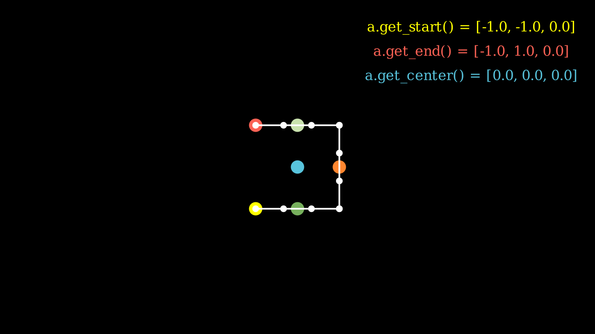
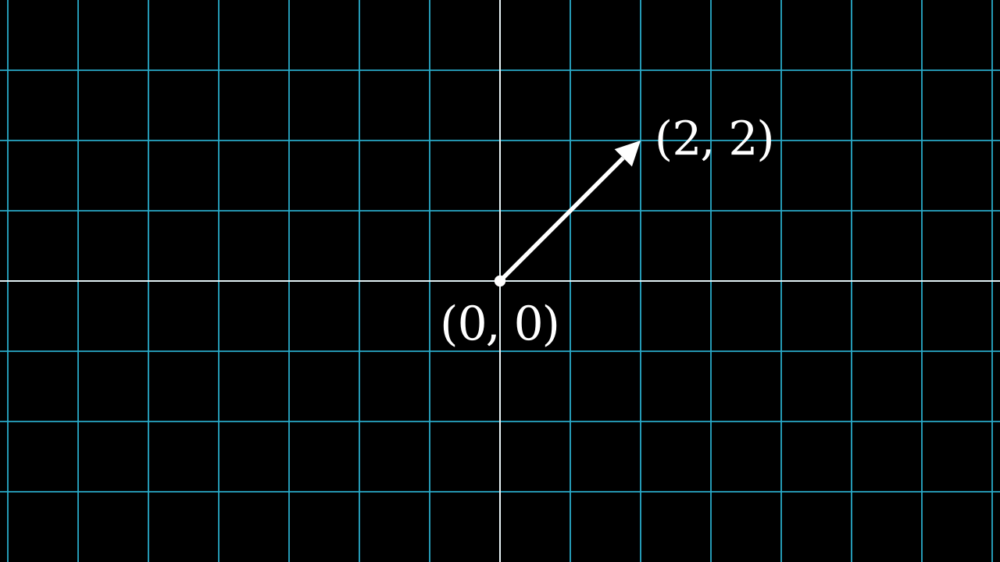

# Manim

[Manim](https://docs.manim.community/en/stable/examples.html)

Author

Benedict Thekkel

    pip install manim

``` python
pip list | grep manim
```

    manim                     0.18.1
    Note: you may need to restart the kernel to use updated packages.

## Quickstart

``` python
from manim import *
```

``` python
%%manim -qm -v WARNING SquareToCircle
class SquareToCircle(Scene):
   def construct(self):
      square = Square()
      circle = Circle()
</video>
      circle.set_fill(PINK, opacity=0.5)
      self.play(Create(square))
      self.play(Transform(square, circle))
      self.wait()
```

```
Manim Community v0.18.1
```

                                                                                                                            

Your browser does not support the `video` element.

## Animating a circle

``` python
%%manim -qm -v WARNING CreateCircle
class CreateCircle(Scene):
    def construct(self):
        circle = Circle()  # create a circle
        circle.set_fill(PINK, opacity=0.5)  # set the color and transparency
        self.play(Create(circle))  # show the circle on screen
```

```
Manim Community v0.18.1
```

                                                                                                                            

Your browser does not support the `video` element.

## Positioning `Mobject`s

``` python
%%manim -qm -v WARNING SquareAndCircle
class SquareAndCircle(Scene):
    def construct(self):
        circle = Circle()  # create a circle
        circle.set_fill(PINK, opacity=0.5)  # set the color and transparency

        square = Square()  # create a square
        square.set_fill(BLUE, opacity=0.5)  # set the color and transparency

        square.next_to(circle, RIGHT, buff=0.5)  # set the position
        self.play(Create(circle), Create(square))  # show the shapes on screen
```

```
Manim Community v0.18.1
```

                                                                                                                            

Your browser does not support the `video` element.

## Using .animate syntax to animate methodsm2

``` python
%%manim -qm -v WARNING AnimatedSquareToCircle
class AnimatedSquareToCircle(Scene):
    def construct(self):
        circle = Circle()  # create a circle
        square = Square()  # create a square

        self.play(Create(square))  # show the square on screen
        self.play(square.animate.rotate(PI / 4))  # rotate the square
        self.play(Transform(square, circle))  # transform the square into a circle
        self.play(
            square.animate.set_fill(PINK, opacity=0.5)
        )  # color the circle on screen
```

```
Manim Community v0.18.1
```

                                                                                                                            

Your browser does not support the `video` element.

``` python
%%manim -qm -v WARNING DifferentRotations
class DifferentRotations(Scene):
    def construct(self):
        left_square = Square(color=BLUE, fill_opacity=0.7).shift(2 * LEFT)
        right_square = Square(color=GREEN, fill_opacity=0.7).shift(2 * RIGHT)
        self.play(
            left_square.animate.rotate(PI), Rotate(right_square, angle=PI), run_time=2
        )
        self.wait()
```

```
Manim Community v0.18.1
```

                                                                                                                            

Your browser does not support the `video` element.

## `Transform` vs `ReplacementTransform`

The difference between Transform and ReplacementTransform is that Transform(mob1, mob2) transforms the points (as well as other attributes like color) of mob1 into the points/attributes of mob2.

ReplacementTransform(mob1, mob2) on the other hand literally replaces mob1 on the scene with mob2.

The use of ReplacementTransform or Transform is mostly up to personal preference. They can be used to accomplish the same effect, as shown below.

``` python
%%manim -qm -v WARNING TwoTransforms
class TwoTransforms(Scene):
    def transform(self):
        a = Circle()
        b = Square()
        c = Triangle()
        self.play(Transform(a, b))
        self.play(Transform(a, c))
        self.play(FadeOut(a))

    def replacement_transform(self):
        a = Circle()
        b = Square()
        c = Triangle()
        self.play(ReplacementTransform(a, b))
        self.play(ReplacementTransform(b, c))
        self.play(FadeOut(c))

    def construct(self):
        self.transform()
        self.wait(0.5)  # wait for 0.5 seconds
        self.replacement_transform()
```

```
Manim Community v0.18.1
```

                                                                                                                            

Your browser does not support the `video` element.

``` python
from IPython.display import Video

Video("media/jupyter/AnimatedSquareToCircle@2024-05-01@18-04-50.mp4")
```

Your browser does not support the `video` element.

## Advanced

### Shapes

``` python
%%manim -qm -v WARNING Shapes
class Shapes(Scene):
    def construct(self):
        circle = Circle()
        square = Square()
        triangle = Triangle()

        circle.shift(LEFT)
        square.shift(UP)
        triangle.shift(RIGHT)

        self.add(circle, square, triangle)
        # self.wait(1)
```

```
Manim Community v0.18.1
```


### MobjectPlacement

``` python
%%manim -qm -v WARNING MobjectPlacement
class MobjectPlacement(Scene):
    def construct(self):
        circle = Circle()
        square = Square()
        triangle = Triangle()

        # place the circle two units left from the origin
        circle.move_to(LEFT * 2)
        # place the square to the left of the circle
        square.next_to(circle, LEFT)
        # align the left border of the triangle to the left border of the circle
        triangle.align_to(circle, LEFT)

        self.add(circle, square, triangle)
        self.wait(1)
```

```
Manim Community v0.18.1
```

Your browser does not support the `video` element.

### MobjectStyling

``` python
%%manim -qm -v WARNING MobjectStyling
class MobjectStyling(Scene):
    def construct(self):
        circle = Circle().shift(LEFT)
        square = Square().shift(UP)
        triangle = Triangle().shift(RIGHT)

        circle.set_stroke(color=GREEN, width=20)
        square.set_fill(YELLOW, opacity=1.0)
        triangle.set_fill(PINK, opacity=0.5)

        self.add(circle, square, triangle)
        self.wait(1)
```

```
Manim Community v0.18.1
```

Your browser does not support the `video` element.

### Animations

``` python
%%manim -qm -v WARNING SomeAnimations
class SomeAnimations(Scene):
    def construct(self):
        square = Square().set_fill(RED, opacity=1.0)
        self.add(square)
        # some animations display mobjects, ...
        self.play(FadeIn(square))

        # ... some move or rotate mobjects around...
        self.play(Rotate(square, PI/4))
        
        self.play(square.animate.set_fill(WHITE).shift(UP).rotate(PI / 3), run_time=2)
        
        # some animations remove mobjects from the screen
        self.play(FadeOut(square))
        

        self.wait(1)
```

```
Manim Community v0.18.1
```

                                                                                                                            

Your browser does not support the `video` element.

``` python
%%manim -qm -v WARNING MobjectExample
class MobjectExample(Scene):
    def construct(self):
        p1 = [-1,-1, 0]
        p2 = [ 1,-1, 0]
        p3 = [ 1, 1, 0]
        p4 = [-1, 1, 0]
        a  = Line(p1,p2).append_points(Line(p2,p3).points).append_points(Line(p3,p4).points)
        point_start  = a.get_start()
        point_end    = a.get_end()
        point_center = a.get_center()
        self.add(Text(f"a.get_start() = {np.round(point_start,2).tolist()}", font_size=24).to_edge(UR).set_color(YELLOW))
        self.add(Text(f"a.get_end() = {np.round(point_end,2).tolist()}", font_size=24).next_to(self.mobjects[-1],DOWN).set_color(RED))
        self.add(Text(f"a.get_center() = {np.round(point_center,2).tolist()}", font_size=24).next_to(self.mobjects[-1],DOWN).set_color(BLUE))

        self.add(Dot(a.get_start()).set_color(YELLOW).scale(2))
        self.add(Dot(a.get_end()).set_color(RED).scale(2))
        self.add(Dot(a.get_top()).set_color(GREEN_A).scale(2))
        self.add(Dot(a.get_bottom()).set_color(GREEN_D).scale(2))
        self.add(Dot(a.get_center()).set_color(BLUE).scale(2))
        self.add(Dot(a.point_from_proportion(0.5)).set_color(ORANGE).scale(2))
        self.add(*[Dot(x) for x in a.points])
        self.add(a)
```

```
Manim Community v0.18.1
```



## Example

``` python
%%manim -qm -v WARNING BraceAnnotation
class BraceAnnotation(Scene):
    def construct(self):
        dot = Dot([-2, -1, 0])
        dot2 = Dot([2, 1, 0])
        line = Line(dot.get_center(), dot2.get_center()).set_color(ORANGE)
        b1 = Brace(line)
        b1text = b1.get_text(f"Horizontal distance")
        b2 = Brace(line, direction=line.copy().rotate(PI / 2).get_unit_vector())
        b2text = b2.get_tex(f"x-x_1")
        self.add(line, dot, dot2, b1, b2, b1text, b2text)
```

```
Manim Community v0.18.1
```

```
[05/01/24 19:15:57] ERROR    LaTeX compilation error: LaTeX Error: File `standalone.cls'    tex_file_writing.py:314
                             not found.                                                                            
                                                                                                                   
```

```
                    ERROR    Context of error:                                              tex_file_writing.py:348
                             -> \documentclass[preview]{standalone}                                                
                             \usepackage[english]{babel}                                                           
                             \usepackage{amsmath}                                                                  
                             \usepackage{amssymb}                                                                  
                                                                                                                   
```

```
                    ERROR    LaTeX compilation error: Emergency stop.                       tex_file_writing.py:314
                                                                                                                   
```

```
                    ERROR    Context of error:                                              tex_file_writing.py:348
                             -> \documentclass[preview]{standalone}                                                
                             \usepackage[english]{babel}                                                           
                             \usepackage{amsmath}                                                                  
                             \usepackage{amssymb}                                                                  
                                                                                                                   
```

    ---------------------------------------------------------------------------
    ValueError                                Traceback (most recent call last)
    Cell In[15], line 1
    ----> 1 get_ipython().run_cell_magic('manim', '-qm -v WARNING BraceAnnotation', '\nclass BraceAnnotation(Scene):\n    def construct(self):\n        dot = Dot([-2, -1, 0])\n        dot2 = Dot([2, 1, 0])\n        line = Line(dot.get_center(), dot2.get_center()).set_color(ORANGE)\n        b1 = Brace(line)\n        b1text = b1.get_text(f"Horizontal distance")\n        b2 = Brace(line, direction=line.copy().rotate(PI / 2).get_unit_vector())\n        b2text = b2.get_tex(f"x-x_1")\n        self.add(line, dot, dot2, b1, b2, b1text, b2text)\n')

    File ~/mambaforge/envs/pfast/lib/python3.12/site-packages/IPython/core/interactiveshell.py:2541, in InteractiveShell.run_cell_magic(self, magic_name, line, cell)
       2539 with self.builtin_trap:
       2540     args = (magic_arg_s, cell)
    -> 2541     result = fn(*args, **kwargs)
       2543 # The code below prevents the output from being displayed
       2544 # when using magics with decorator @output_can_be_silenced
       2545 # when the last Python token in the expression is a ';'.
       2546 if getattr(fn, magic.MAGIC_OUTPUT_CAN_BE_SILENCED, False):

    File ~/mambaforge/envs/pfast/lib/python3.12/site-packages/manim/utils/ipython_magic.py:143, in ManimMagic.manim(self, line, cell, local_ns)
        141     SceneClass = local_ns[config["scene_names"][0]]
        142     scene = SceneClass(renderer=renderer)
    --> 143     scene.render()
        144 finally:
        145     # Shader cache becomes invalid as the context is destroyed
        146     shader_program_cache.clear()

    File ~/mambaforge/envs/pfast/lib/python3.12/site-packages/manim/scene/scene.py:229, in Scene.render(self, preview)
        227 self.setup()
        228 try:
    --> 229     self.construct()
        230 except EndSceneEarlyException:
        231     pass

    File <string>:8, in construct(self)

    File ~/mambaforge/envs/pfast/lib/python3.12/site-packages/manim/mobject/svg/brace.py:139, in Brace.get_text(self, *text, **kwargs)
        138 def get_text(self, *text, **kwargs):
    --> 139     text_mob = Tex(*text)
        140     self.put_at_tip(text_mob, **kwargs)
        141     return text_mob

    File ~/mambaforge/envs/pfast/lib/python3.12/site-packages/manim/mobject/text/tex_mobject.py:443, in Tex.__init__(self, arg_separator, tex_environment, *tex_strings, **kwargs)
        440 def __init__(
        441     self, *tex_strings, arg_separator="", tex_environment="center", **kwargs
        442 ):
    --> 443     super().__init__(
        444         *tex_strings,
        445         arg_separator=arg_separator,
        446         tex_environment=tex_environment,
        447         **kwargs,
        448     )

    File ~/mambaforge/envs/pfast/lib/python3.12/site-packages/manim/mobject/text/tex_mobject.py:293, in MathTex.__init__(self, arg_separator, substrings_to_isolate, tex_to_color_map, tex_environment, *tex_strings, **kwargs)
        280     if self.brace_notation_split_occurred:
        281         logger.error(
        282             dedent(
        283                 """\
       (...)
        291             ),
        292         )
    --> 293     raise compilation_error
        294 self.set_color_by_tex_to_color_map(self.tex_to_color_map)
        296 if self.organize_left_to_right:

    File ~/mambaforge/envs/pfast/lib/python3.12/site-packages/manim/mobject/text/tex_mobject.py:272, in MathTex.__init__(self, arg_separator, substrings_to_isolate, tex_to_color_map, tex_environment, *tex_strings, **kwargs)
        270 self.tex_strings = self._break_up_tex_strings(tex_strings)
        271 try:
    --> 272     super().__init__(
        273         self.arg_separator.join(self.tex_strings),
        274         tex_environment=self.tex_environment,
        275         tex_template=self.tex_template,
        276         **kwargs,
        277     )
        278     self._break_up_by_substrings()
        279 except ValueError as compilation_error:

    File ~/mambaforge/envs/pfast/lib/python3.12/site-packages/manim/mobject/text/tex_mobject.py:81, in SingleStringMathTex.__init__(self, tex_string, stroke_width, should_center, height, organize_left_to_right, tex_environment, tex_template, font_size, **kwargs)
         79 assert isinstance(tex_string, str)
         80 self.tex_string = tex_string
    ---> 81 file_name = tex_to_svg_file(
         82     self._get_modified_expression(tex_string),
         83     environment=self.tex_environment,
         84     tex_template=self.tex_template,
         85 )
         86 super().__init__(
         87     file_name=file_name,
         88     should_center=should_center,
       (...)
         95     **kwargs,
         96 )
         97 self.init_colors()

    File ~/mambaforge/envs/pfast/lib/python3.12/site-packages/manim/utils/tex_file_writing.py:63, in tex_to_svg_file(expression, environment, tex_template)
         60 if svg_file.exists():
         61     return svg_file
    ---> 63 dvi_file = compile_tex(
         64     tex_file,
         65     tex_template.tex_compiler,
         66     tex_template.output_format,
         67 )
         68 svg_file = convert_to_svg(dvi_file, tex_template.output_format)
         69 if not config["no_latex_cleanup"]:

    File ~/mambaforge/envs/pfast/lib/python3.12/site-packages/manim/utils/tex_file_writing.py:213, in compile_tex(tex_file, tex_compiler, output_format)
        211         log_file = tex_file.with_suffix(".log")
        212         print_all_tex_errors(log_file, tex_compiler, tex_file)
    --> 213         raise ValueError(
        214             f"{tex_compiler} error converting to"
        215             f" {output_format[1:]}. See log output above or"
        216             f" the log file: {log_file}",
        217         )
        218 return result

    ValueError: latex error converting to dvi. See log output above or the log file: media/Tex/1c22c507eca0dfce.log

``` python
%%manim -qm -v WARNING VectorArrow
class VectorArrow(Scene):
    def construct(self):
        dot = Dot(ORIGIN)
        arrow = Arrow(ORIGIN, [2, 2, 0], buff=0)
        numberplane = NumberPlane()
        origin_text = Text('(0, 0)').next_to(dot, DOWN)
        tip_text = Text('(2, 2)').next_to(arrow.get_end(), RIGHT)
        self.add(numberplane, dot, arrow, origin_text, tip_text)
```

```
Manim Community v0.18.1
```



``` python
%%manim -qm -v WARNING PointMovingOnShapes
class PointMovingOnShapes(Scene):
    def construct(self):
        circle = Circle(radius=1, color=BLUE)
        dot = Dot()
        dot2 = dot.copy().shift(RIGHT)
        self.add(dot)

        line = Line([3, 0, 0], [5, 0, 0])
        self.add(line)

        self.play(GrowFromCenter(circle))
        self.play(Transform(dot, dot2))
        self.play(MoveAlongPath(dot, circle), run_time=2, rate_func=linear)
        self.play(Rotating(dot, about_point=[2, 0, 0]), run_time=1.5)
        self.wait()
```

```
Manim Community v0.18.1
```

                                                                                                                            

Your browser does not support the `video` element.

``` python
%%manim -qm -v WARNING MovingAngle
class MovingAngle(Scene):
    def construct(self):
        rotation_center = LEFT

        theta_tracker = ValueTracker(110)
        line1 = Line(LEFT, RIGHT)
        line_moving = Line(LEFT, RIGHT)
        line_ref = line_moving.copy()
        line_moving.rotate(
            theta_tracker.get_value() * DEGREES, about_point=rotation_center
        )
        a = Angle(line1, line_moving, radius=0.5, other_angle=False)
        tex = MathTex(r"\theta").move_to(
            Angle(
                line1, line_moving, radius=0.5 + 3 * SMALL_BUFF, other_angle=False
            ).point_from_proportion(0.5)
        )

        self.add(line1, line_moving, a, tex)
        self.wait()

        line_moving.add_updater(
            lambda x: x.become(line_ref.copy()).rotate(
                theta_tracker.get_value() * DEGREES, about_point=rotation_center
            )
        )

        a.add_updater(
            lambda x: x.become(Angle(line1, line_moving, radius=0.5, other_angle=False))
        )
        tex.add_updater(
            lambda x: x.move_to(
                Angle(
                    line1, line_moving, radius=0.5 + 3 * SMALL_BUFF, other_angle=False
                ).point_from_proportion(0.5)
            )
        )

        self.play(theta_tracker.animate.set_value(40))
        self.play(theta_tracker.animate.increment_value(140))
        self.play(tex.animate.set_color(RED), run_time=0.5)
        self.play(theta_tracker.animate.set_value(350))
```

```
Manim Community v0.18.1
```

```
[05/01/24 19:16:10] ERROR    LaTeX compilation error: LaTeX Error: File `standalone.cls'    tex_file_writing.py:314
                             not found.                                                                            
                                                                                                                   
```

```
                    ERROR    Context of error:                                              tex_file_writing.py:348
                             -> \documentclass[preview]{standalone}                                                
                             \usepackage[english]{babel}                                                           
                             \usepackage{amsmath}                                                                  
                             \usepackage{amssymb}                                                                  
                                                                                                                   
```

```
                    ERROR    LaTeX compilation error: Emergency stop.                       tex_file_writing.py:314
                                                                                                                   
```

```
                    ERROR    Context of error:                                              tex_file_writing.py:348
                             -> \documentclass[preview]{standalone}                                                
                             \usepackage[english]{babel}                                                           
                             \usepackage{amsmath}                                                                  
                             \usepackage{amssymb}                                                                  
                                                                                                                   
```

    ---------------------------------------------------------------------------
    ValueError                                Traceback (most recent call last)
    Cell In[18], line 1
    ----> 1 get_ipython().run_cell_magic('manim', '-qm -v WARNING MovingAngle', '\nclass MovingAngle(Scene):\n    def construct(self):\n        rotation_center = LEFT\n\n        theta_tracker = ValueTracker(110)\n        line1 = Line(LEFT, RIGHT)\n        line_moving = Line(LEFT, RIGHT)\n        line_ref = line_moving.copy()\n        line_moving.rotate(\n            theta_tracker.get_value() * DEGREES, about_point=rotation_center\n        )\n        a = Angle(line1, line_moving, radius=0.5, other_angle=False)\n        tex = MathTex(r"\\theta").move_to(\n            Angle(\n                line1, line_moving, radius=0.5 + 3 * SMALL_BUFF, other_angle=False\n            ).point_from_proportion(0.5)\n        )\n\n        self.add(line1, line_moving, a, tex)\n        self.wait()\n\n        line_moving.add_updater(\n            lambda x: x.become(line_ref.copy()).rotate(\n                theta_tracker.get_value() * DEGREES, about_point=rotation_center\n            )\n        )\n\n        a.add_updater(\n            lambda x: x.become(Angle(line1, line_moving, radius=0.5, other_angle=False))\n        )\n        tex.add_updater(\n            lambda x: x.move_to(\n                Angle(\n                    line1, line_moving, radius=0.5 + 3 * SMALL_BUFF, other_angle=False\n                ).point_from_proportion(0.5)\n            )\n        )\n\n        self.play(theta_tracker.animate.set_value(40))\n        self.play(theta_tracker.animate.increment_value(140))\n        self.play(tex.animate.set_color(RED), run_time=0.5)\n        self.play(theta_tracker.animate.set_value(350))\n')

    File ~/mambaforge/envs/pfast/lib/python3.12/site-packages/IPython/core/interactiveshell.py:2541, in InteractiveShell.run_cell_magic(self, magic_name, line, cell)
       2539 with self.builtin_trap:
       2540     args = (magic_arg_s, cell)
    -> 2541     result = fn(*args, **kwargs)
       2543 # The code below prevents the output from being displayed
       2544 # when using magics with decorator @output_can_be_silenced
       2545 # when the last Python token in the expression is a ';'.
       2546 if getattr(fn, magic.MAGIC_OUTPUT_CAN_BE_SILENCED, False):

    File ~/mambaforge/envs/pfast/lib/python3.12/site-packages/manim/utils/ipython_magic.py:143, in ManimMagic.manim(self, line, cell, local_ns)
        141     SceneClass = local_ns[config["scene_names"][0]]
        142     scene = SceneClass(renderer=renderer)
    --> 143     scene.render()
        144 finally:
        145     # Shader cache becomes invalid as the context is destroyed
        146     shader_program_cache.clear()

    File ~/mambaforge/envs/pfast/lib/python3.12/site-packages/manim/scene/scene.py:229, in Scene.render(self, preview)
        227 self.setup()
        228 try:
    --> 229     self.construct()
        230 except EndSceneEarlyException:
        231     pass

    File <string>:14, in construct(self)

    File ~/mambaforge/envs/pfast/lib/python3.12/site-packages/manim/mobject/text/tex_mobject.py:293, in MathTex.__init__(self, arg_separator, substrings_to_isolate, tex_to_color_map, tex_environment, *tex_strings, **kwargs)
        280     if self.brace_notation_split_occurred:
        281         logger.error(
        282             dedent(
        283                 """\
       (...)
        291             ),
        292         )
    --> 293     raise compilation_error
        294 self.set_color_by_tex_to_color_map(self.tex_to_color_map)
        296 if self.organize_left_to_right:

    File ~/mambaforge/envs/pfast/lib/python3.12/site-packages/manim/mobject/text/tex_mobject.py:272, in MathTex.__init__(self, arg_separator, substrings_to_isolate, tex_to_color_map, tex_environment, *tex_strings, **kwargs)
        270 self.tex_strings = self._break_up_tex_strings(tex_strings)
        271 try:
    --> 272     super().__init__(
        273         self.arg_separator.join(self.tex_strings),
        274         tex_environment=self.tex_environment,
        275         tex_template=self.tex_template,
        276         **kwargs,
        277     )
        278     self._break_up_by_substrings()
        279 except ValueError as compilation_error:

    File ~/mambaforge/envs/pfast/lib/python3.12/site-packages/manim/mobject/text/tex_mobject.py:81, in SingleStringMathTex.__init__(self, tex_string, stroke_width, should_center, height, organize_left_to_right, tex_environment, tex_template, font_size, **kwargs)
         79 assert isinstance(tex_string, str)
         80 self.tex_string = tex_string
    ---> 81 file_name = tex_to_svg_file(
         82     self._get_modified_expression(tex_string),
         83     environment=self.tex_environment,
         84     tex_template=self.tex_template,
         85 )
         86 super().__init__(
         87     file_name=file_name,
         88     should_center=should_center,
       (...)
         95     **kwargs,
         96 )
         97 self.init_colors()

    File ~/mambaforge/envs/pfast/lib/python3.12/site-packages/manim/utils/tex_file_writing.py:63, in tex_to_svg_file(expression, environment, tex_template)
         60 if svg_file.exists():
         61     return svg_file
    ---> 63 dvi_file = compile_tex(
         64     tex_file,
         65     tex_template.tex_compiler,
         66     tex_template.output_format,
         67 )
         68 svg_file = convert_to_svg(dvi_file, tex_template.output_format)
         69 if not config["no_latex_cleanup"]:

    File ~/mambaforge/envs/pfast/lib/python3.12/site-packages/manim/utils/tex_file_writing.py:213, in compile_tex(tex_file, tex_compiler, output_format)
        211         log_file = tex_file.with_suffix(".log")
        212         print_all_tex_errors(log_file, tex_compiler, tex_file)
    --> 213         raise ValueError(
        214             f"{tex_compiler} error converting to"
        215             f" {output_format[1:]}. See log output above or"
        216             f" the log file: {log_file}",
        217         )
        218 return result

    ValueError: latex error converting to dvi. See log output above or the log file: media/Tex/0cec1e994feab60e.log

``` python
%%manim -qm -v WARNING MovingDots
class MovingDots(Scene):
    def construct(self):
        d1,d2=Dot(color=BLUE),Dot(color=GREEN)
        dg=VGroup(d1,d2).arrange(RIGHT,buff=1)
        l1=Line(d1.get_center(),d2.get_center()).set_color(RED)
        x=ValueTracker(0)
        y=ValueTracker(0)
        d1.add_updater(lambda z: z.set_x(x.get_value()))
        d2.add_updater(lambda z: z.set_y(y.get_value()))
        l1.add_updater(lambda z: z.become(Line(d1.get_center(),d2.get_center())))
        self.add(d1,d2,l1)
        self.play(x.animate.set_value(5))
        self.play(y.animate.set_value(4))
        self.wait()
```

```
Manim Community v0.18.1
```

                                                                                                                            

Your browser does not support the `video` element.

``` python
%%manim -qm -v WARNING MovingGroupToDestination
class MovingGroupToDestination(Scene):
    def construct(self):
        group = VGroup(Dot(LEFT), Dot(ORIGIN), Dot(RIGHT, color=RED), Dot(2 * RIGHT)).scale(1.4)
        dest = Dot([4, 3, 0], color=YELLOW)
        self.add(group, dest)
        self.play(group.animate.shift(dest.get_center() - group[2].get_center()))
        self.wait(0.5)
```

```
Manim Community v0.18.1
```

                                                                                                                            

Your browser does not support the `video` element.

``` python
%%manim -qm -v WARNING SinAndCosFunctionPlot
class SinAndCosFunctionPlot(Scene):
    def construct(self):
        axes = Axes(
            x_range=[-10, 10.3, 1],
            y_range=[-1.5, 1.5, 1],
            x_length=10,
            axis_config={"color": GREEN},
            x_axis_config={
                "numbers_to_include": np.arange(-10, 10.01, 2),
                "numbers_with_elongated_ticks": np.arange(-10, 10.01, 2),
            },
            tips=False,
        )
        axes_labels = axes.get_axis_labels()
        sin_graph = axes.plot(lambda x: np.sin(x), color=BLUE)
        cos_graph = axes.plot(lambda x: np.cos(x), color=RED)

        sin_label = axes.get_graph_label(
            sin_graph, "\\sin(x)", x_val=-10, direction=UP / 2
        )
        cos_label = axes.get_graph_label(cos_graph, label="\\cos(x)")

        vert_line = axes.get_vertical_line(
            axes.i2gp(TAU, cos_graph), color=YELLOW, line_func=Line
        )
        line_label = axes.get_graph_label(
            cos_graph, "x=2\pi", x_val=TAU, direction=UR, color=WHITE
        )

        plot = VGroup(axes, sin_graph, cos_graph, vert_line)
        labels = VGroup(axes_labels, sin_label, cos_label, line_label)
        self.add(plot, labels)
```

    <string>:28: SyntaxWarning: invalid escape sequence '\p'

```
Manim Community v0.18.1
```

```
[05/01/24 19:16:12] ERROR    LaTeX compilation error: LaTeX Error: File `standalone.cls'    tex_file_writing.py:314
                             not found.                                                                            
                                                                                                                   
```

```
                    ERROR    Context of error:                                              tex_file_writing.py:348
                             -> \documentclass[preview]{standalone}                                                
                             \usepackage[english]{babel}                                                           
                             \usepackage{amsmath}                                                                  
                             \usepackage{amssymb}                                                                  
                                                                                                                   
```

```
                    ERROR    LaTeX compilation error: Emergency stop.                       tex_file_writing.py:314
                                                                                                                   
```

```
                    ERROR    Context of error:                                              tex_file_writing.py:348
                             -> \documentclass[preview]{standalone}                                                
                             \usepackage[english]{babel}                                                           
                             \usepackage{amsmath}                                                                  
                             \usepackage{amssymb}                                                                  
                                                                                                                   
```

    ---------------------------------------------------------------------------
    ValueError                                Traceback (most recent call last)
    Cell In[21], line 1
    ----> 1 get_ipython().run_cell_magic('manim', '-qm -v WARNING SinAndCosFunctionPlot', '\nclass SinAndCosFunctionPlot(Scene):\n    def construct(self):\n        axes = Axes(\n            x_range=[-10, 10.3, 1],\n            y_range=[-1.5, 1.5, 1],\n            x_length=10,\n            axis_config={"color": GREEN},\n            x_axis_config={\n                "numbers_to_include": np.arange(-10, 10.01, 2),\n                "numbers_with_elongated_ticks": np.arange(-10, 10.01, 2),\n            },\n            tips=False,\n        )\n        axes_labels = axes.get_axis_labels()\n        sin_graph = axes.plot(lambda x: np.sin(x), color=BLUE)\n        cos_graph = axes.plot(lambda x: np.cos(x), color=RED)\n\n        sin_label = axes.get_graph_label(\n            sin_graph, "\\\\sin(x)", x_val=-10, direction=UP / 2\n        )\n        cos_label = axes.get_graph_label(cos_graph, label="\\\\cos(x)")\n\n        vert_line = axes.get_vertical_line(\n            axes.i2gp(TAU, cos_graph), color=YELLOW, line_func=Line\n        )\n        line_label = axes.get_graph_label(\n            cos_graph, "x=2\\pi", x_val=TAU, direction=UR, color=WHITE\n        )\n\n        plot = VGroup(axes, sin_graph, cos_graph, vert_line)\n        labels = VGroup(axes_labels, sin_label, cos_label, line_label)\n        self.add(plot, labels)\n')

    File ~/mambaforge/envs/pfast/lib/python3.12/site-packages/IPython/core/interactiveshell.py:2541, in InteractiveShell.run_cell_magic(self, magic_name, line, cell)
       2539 with self.builtin_trap:
       2540     args = (magic_arg_s, cell)
    -> 2541     result = fn(*args, **kwargs)
       2543 # The code below prevents the output from being displayed
       2544 # when using magics with decorator @output_can_be_silenced
       2545 # when the last Python token in the expression is a ';'.
       2546 if getattr(fn, magic.MAGIC_OUTPUT_CAN_BE_SILENCED, False):

    File ~/mambaforge/envs/pfast/lib/python3.12/site-packages/manim/utils/ipython_magic.py:143, in ManimMagic.manim(self, line, cell, local_ns)
        141     SceneClass = local_ns[config["scene_names"][0]]
        142     scene = SceneClass(renderer=renderer)
    --> 143     scene.render()
        144 finally:
        145     # Shader cache becomes invalid as the context is destroyed
        146     shader_program_cache.clear()

    File ~/mambaforge/envs/pfast/lib/python3.12/site-packages/manim/scene/scene.py:229, in Scene.render(self, preview)
        227 self.setup()
        228 try:
    --> 229     self.construct()
        230 except EndSceneEarlyException:
        231     pass

    File <string>:4, in construct(self)

    File ~/mambaforge/envs/pfast/lib/python3.12/site-packages/manim/mobject/graphing/coordinate_systems.py:1896, in Axes.__init__(self, x_range, y_range, x_length, y_length, axis_config, x_axis_config, y_axis_config, tips, **kwargs)
       1893 else:
       1894     self.y_axis_config["exclude_origin_tick"] = False
    -> 1896 self.x_axis = self._create_axis(self.x_range, self.x_axis_config, self.x_length)
       1897 self.y_axis = self._create_axis(self.y_range, self.y_axis_config, self.y_length)
       1899 # Add as a separate group in case various other
       1900 # mobjects are added to self, as for example in
       1901 # NumberPlane below

    File ~/mambaforge/envs/pfast/lib/python3.12/site-packages/manim/mobject/graphing/coordinate_systems.py:1971, in Axes._create_axis(self, range_terms, axis_config, length)
       1954 """Creates an axis and dynamically adjusts its position depending on where 0 is located on the line.
       1955 
       1956 Parameters
       (...)
       1968     Returns a number line based on ``range_terms``.
       1969 """
       1970 axis_config["length"] = length
    -> 1971 axis = NumberLine(range_terms, **axis_config)
       1973 # without the call to _origin_shift, graph does not exist when min > 0 or max < 0
       1974 # shifts the axis so that 0 is centered
       1975 axis.shift(-axis.number_to_point(self._origin_shift([axis.x_min, axis.x_max])))

    File ~/mambaforge/envs/pfast/lib/python3.12/site-packages/manim/mobject/graphing/number_line.py:261, in NumberLine.__init__(self, x_range, length, unit_size, include_ticks, tick_size, numbers_with_elongated_ticks, longer_tick_multiple, exclude_origin_tick, rotation, stroke_width, include_tip, tip_width, tip_height, tip_shape, include_numbers, font_size, label_direction, label_constructor, scaling, line_to_number_buff, decimal_number_config, numbers_to_exclude, numbers_to_include, **kwargs)
        246     self.add_labels(
        247         dict(
        248             zip(
       (...)
        257         ),
        258     )
        260 else:
    --> 261     self.add_numbers(
        262         x_values=self.numbers_to_include,
        263         excluding=self.numbers_to_exclude,
        264         font_size=self.font_size,
        265     )

    File ~/mambaforge/envs/pfast/lib/python3.12/site-packages/manim/mobject/graphing/number_line.py:533, in NumberLine.add_numbers(self, x_values, excluding, font_size, label_constructor, **kwargs)
        530     if x in excluding:
        531         continue
        532     numbers.add(
    --> 533         self.get_number_mobject(
        534             x,
        535             font_size=font_size,
        536             label_constructor=label_constructor,
        537             **kwargs,
        538         )
        539     )
        540 self.add(numbers)
        541 self.numbers = numbers

    File ~/mambaforge/envs/pfast/lib/python3.12/site-packages/manim/mobject/graphing/number_line.py:471, in NumberLine.get_number_mobject(self, x, direction, buff, font_size, label_constructor, **number_config)
        468 if label_constructor is None:
        469     label_constructor = self.label_constructor
    --> 471 num_mob = DecimalNumber(
        472     x, font_size=font_size, mob_class=label_constructor, **number_config
        473 )
        475 num_mob.next_to(self.number_to_point(x), direction=direction, buff=buff)
        476 if x < 0 and self.label_direction[0] == 0:
        477     # Align without the minus sign

    File ~/mambaforge/envs/pfast/lib/python3.12/site-packages/manim/mobject/text/numbers.py:135, in DecimalNumber.__init__(self, number, num_decimal_places, mob_class, include_sign, group_with_commas, digit_buff_per_font_unit, show_ellipsis, unit, unit_buff_per_font_unit, include_background_rectangle, edge_to_fix, font_size, stroke_width, fill_opacity, **kwargs)
        117 self.initial_config = kwargs.copy()
        118 self.initial_config.update(
        119     {
        120         "num_decimal_places": num_decimal_places,
       (...)
        132     },
        133 )
    --> 135 self._set_submobjects_from_number(number)
        136 self.init_colors()

    File ~/mambaforge/envs/pfast/lib/python3.12/site-packages/manim/mobject/text/numbers.py:160, in DecimalNumber._set_submobjects_from_number(self, number)
        157 self.submobjects = []
        159 num_string = self._get_num_string(number)
    --> 160 self.add(*(map(self._string_to_mob, num_string)))
        162 # Add non-numerical bits
        163 if self.show_ellipsis:

    File ~/mambaforge/envs/pfast/lib/python3.12/site-packages/manim/mobject/text/numbers.py:225, in DecimalNumber._string_to_mob(self, string, mob_class, **kwargs)
        222     mob_class = self.mob_class
        224 if string not in string_to_mob_map:
    --> 225     string_to_mob_map[string] = mob_class(string, **kwargs)
        226 mob = string_to_mob_map[string].copy()
        227 mob.font_size = self._font_size

    File ~/mambaforge/envs/pfast/lib/python3.12/site-packages/manim/mobject/text/tex_mobject.py:293, in MathTex.__init__(self, arg_separator, substrings_to_isolate, tex_to_color_map, tex_environment, *tex_strings, **kwargs)
        280     if self.brace_notation_split_occurred:
        281         logger.error(
        282             dedent(
        283                 """\
       (...)
        291             ),
        292         )
    --> 293     raise compilation_error
        294 self.set_color_by_tex_to_color_map(self.tex_to_color_map)
        296 if self.organize_left_to_right:

    File ~/mambaforge/envs/pfast/lib/python3.12/site-packages/manim/mobject/text/tex_mobject.py:272, in MathTex.__init__(self, arg_separator, substrings_to_isolate, tex_to_color_map, tex_environment, *tex_strings, **kwargs)
        270 self.tex_strings = self._break_up_tex_strings(tex_strings)
        271 try:
    --> 272     super().__init__(
        273         self.arg_separator.join(self.tex_strings),
        274         tex_environment=self.tex_environment,
        275         tex_template=self.tex_template,
        276         **kwargs,
        277     )
        278     self._break_up_by_substrings()
        279 except ValueError as compilation_error:

    File ~/mambaforge/envs/pfast/lib/python3.12/site-packages/manim/mobject/text/tex_mobject.py:81, in SingleStringMathTex.__init__(self, tex_string, stroke_width, should_center, height, organize_left_to_right, tex_environment, tex_template, font_size, **kwargs)
         79 assert isinstance(tex_string, str)
         80 self.tex_string = tex_string
    ---> 81 file_name = tex_to_svg_file(
         82     self._get_modified_expression(tex_string),
         83     environment=self.tex_environment,
         84     tex_template=self.tex_template,
         85 )
         86 super().__init__(
         87     file_name=file_name,
         88     should_center=should_center,
       (...)
         95     **kwargs,
         96 )
         97 self.init_colors()

    File ~/mambaforge/envs/pfast/lib/python3.12/site-packages/manim/utils/tex_file_writing.py:63, in tex_to_svg_file(expression, environment, tex_template)
         60 if svg_file.exists():
         61     return svg_file
    ---> 63 dvi_file = compile_tex(
         64     tex_file,
         65     tex_template.tex_compiler,
         66     tex_template.output_format,
         67 )
         68 svg_file = convert_to_svg(dvi_file, tex_template.output_format)
         69 if not config["no_latex_cleanup"]:

    File ~/mambaforge/envs/pfast/lib/python3.12/site-packages/manim/utils/tex_file_writing.py:213, in compile_tex(tex_file, tex_compiler, output_format)
        211         log_file = tex_file.with_suffix(".log")
        212         print_all_tex_errors(log_file, tex_compiler, tex_file)
    --> 213         raise ValueError(
        214             f"{tex_compiler} error converting to"
        215             f" {output_format[1:]}. See log output above or"
        216             f" the log file: {log_file}",
        217         )
        218 return result

    ValueError: latex error converting to dvi. See log output above or the log file: media/Tex/ba96de15f98acfc8.log

``` python
%%manim -qm -v WARNING FollowingGraphCamera
class FollowingGraphCamera(MovingCameraScene):
    def construct(self):
        self.camera.frame.save_state()

        # create the axes and the curve
        ax = Axes(x_range=[-1, 10], y_range=[-1, 10])
        graph = ax.plot(lambda x: np.sin(x), color=BLUE, x_range=[0, 3 * PI])

        # create dots based on the graph
        moving_dot = Dot(ax.i2gp(graph.t_min, graph), color=ORANGE)
        dot_1 = Dot(ax.i2gp(graph.t_min, graph))
        dot_2 = Dot(ax.i2gp(graph.t_max, graph))

        self.add(ax, graph, dot_1, dot_2, moving_dot)
        self.play(self.camera.frame.animate.scale(0.5).move_to(moving_dot))

        def update_curve(mob):
            mob.move_to(moving_dot.get_center())

        self.camera.frame.add_updater(update_curve)
        self.play(MoveAlongPath(moving_dot, graph, rate_func=linear))
        self.camera.frame.remove_updater(update_curve)

        self.play(Restore(self.camera.frame))
```

```
Manim Community v0.18.1
```

                                                                                                                            

Your browser does not support the `video` element.

``` python
%%manim -qm -v WARNING ThreeDCameraRotation
class ThreeDCameraRotation(ThreeDScene):
    def construct(self):
        axes = ThreeDAxes()
        circle=Circle()
        self.set_camera_orientation(phi=75 * DEGREES, theta=30 * DEGREES)
        self.add(circle,axes)
        self.begin_ambient_camera_rotation(rate=0.1)
        self.wait()
        self.stop_ambient_camera_rotation()
        self.move_camera(phi=75 * DEGREES, theta=30 * DEGREES)
        self.wait()
```

```
Manim Community v0.18.1
```

                                                                                                                            

Your browser does not support the `video` element.

Back to top
