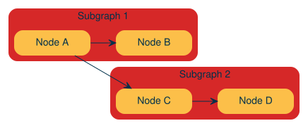
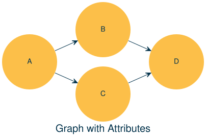
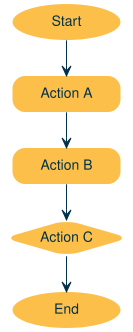
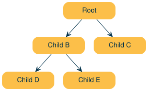
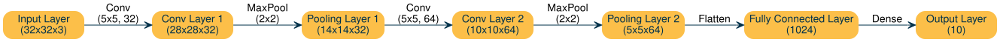
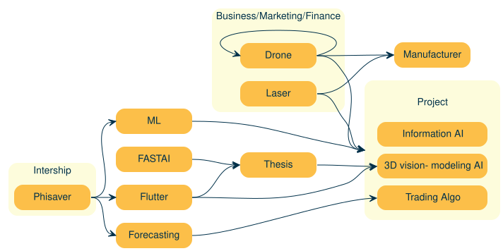

# Graphviz

c1

c2

Diagram building tool

Author

Benedict Thekkel

Published

June 18, 2024

``` python
from graphviz import Digraph

from nbdevAuto.functions import graph
```

## Customizing Nodes and Edges

``` python
dot = graph()

dot.node('A', 'Start', shape='ellipse', color='red')
dot.node('B', 'End', shape='box', color='blue')
dot.edge('A', 'B', 'Transition', color='green')

dot
```


### Creating Subgraphs

Code

``` python
dot = graph()

with dot.subgraph(name='cluster_0') as c:
    c.node('A', 'Node A')
    c.node('B', 'Node B')
    c.edge('A', 'B')
    c.attr(label='Subgraph 1')

with dot.subgraph(name='cluster_1') as c:
    c.node('C', 'Node C')
    c.node('D', 'Node D')
    c.edge('C', 'D')
    c.attr(label='Subgraph 2')

dot.edge('A', 'C')

dot
```



### Directed Acyclic Graph (DAG)

Code

``` python
dag = graph()

dag.node('1', 'Step 1')
dag.node('2', 'Step 2')
dag.node('3', 'Step 3')
dag.edge('1', '2')
dag.edge('2', '3')

dag
```


### Graph with Attributes:

Code

``` python
from graphviz import Digraph

dot = graph()

dot.attr('node', shape='circle')
dot.node('A')
dot.node('B')
dot.node('C')
dot.node('D')

dot.edge('A', 'B')
dot.edge('A', 'C')
dot.edge('B', 'D')
dot.edge('C', 'D')

dot.attr(label='Graph with Attributes', fontsize='20')
dot
```



## Flowchart

Code

``` python
flowchart = graph()
flowchart.graph_attr.update(style='rounded,filled',
                               rankdir='TB',
                           )
flowchart.node('Start', 'Start', shape='ellipse', style='filled', color='lightgrey')
flowchart.node('A', 'Action A', shape='box')
flowchart.node('B', 'Action B', shape='box')
flowchart.node('C', 'Action C', shape='diamond')
flowchart.node('End', 'End', shape='ellipse', style='filled', color='lightgrey')

flowchart.edge('Start', 'A')
flowchart.edge('A', 'B')
flowchart.edge('B', 'C')
flowchart.edge('C', 'End')

flowchart
```



## Tree Diagram

Code

``` python
from graphviz import Digraph

tree = graph()
tree.graph_attr.update(style='rounded,filled',
                               rankdir='TB',
                           )
tree.node('A', 'Root')
tree.node('B', 'Child B')
tree.node('C', 'Child C')
tree.node('D', 'Child D')
tree.node('E', 'Child E')

tree.edge('A', 'B')
tree.edge('A', 'C')
tree.edge('B', 'D')
tree.edge('B', 'E')

tree
```



## CNN

Code

``` python
dot = graph(comment='CNN Architecture')

# Define nodes
dot.node('I', 'Input Layer\n(32x32x3)')
dot.node('C1', 'Conv Layer 1\n(28x28x32)')
dot.node('P1', 'Pooling Layer 1\n(14x14x32)')
dot.node('C2', 'Conv Layer 2\n(10x10x64)')
dot.node('P2', 'Pooling Layer 2\n(5x5x64)')
dot.node('F', 'Fully Connected Layer\n(1024)')
dot.node('O', 'Output Layer\n(10)')

# Define edges
dot.edge('I', 'C1', label='Conv\n(5x5, 32)')
dot.edge('C1', 'P1', label='MaxPool\n(2x2)')
dot.edge('P1', 'C2', label='Conv\n(5x5, 64)')
dot.edge('C2', 'P2', label='MaxPool\n(2x2)')
dot.edge('P2', 'F', label='Flatten')
dot.edge('F', 'O', label='Dense')

# Render the graph
dot
```



## Advanced

Code

``` python
black = '#000000'

g = graph('A', filename='Data/plan', engine = 'dot')
    
with g.subgraph(name='clusterBusiness') as v:
    v.attr(label='Business/Marketing/Finance', shape = 'doublecircle', fillcolor=g.primary, fontcolor=g.fifth)
    v.attr('node', shape = 'box', fillcolor=g.secondary, fontcolor=g.fifth, penwidth = '0')
    v.node('Drone', 'Drone')
    v.node('Laser', 'Laser')

    
with g.subgraph(name='clusterIntern') as b:
    b.attr(label='Intership', shape = 'doublecircle', fillcolor=g.primary, fontcolor=g.fifth)
    b.attr('node', shape = 'box', fillcolor=g.secondary, fontcolor=g.fifth)
    b.node('phisaver', 'Phisaver')
    

g.node('Project',
        '''<<TABLE BORDER="0" CELLBORDER="0" CELLSPACING="10" CELLPADDING="10" STYLE = "rounded">
          <TR><TD PORT="f" BORDER="0" STYLE = "rounded" WIDTH="100" >Project</TD></TR>
          <TR><TD PORT="InfoAI" STYLE = "rounded" BGCOLOR="#fcbf49" >Information AI</TD></TR>
          <TR><TD PORT="3D" STYLE = "rounded" BGCOLOR="#fcbf49" >3D vision- modeling AI</TD></TR>
          <TR><TD PORT="stocks" STYLE = "rounded" BGCOLOR="#fcbf49" >Trading Algo</TD></TR>
        </TABLE>>''',
        fillcolor=g.primary,
        penwidth = '0')


g.edge('FASTAI:e', 'Thesis:w')
g.edge('Thesis:e', 'Project:3D:w')


g.edge('phisaver:e', 'Flutter:w')
g.edge('phisaver:e', 'Forecasting:w')
g.edge('phisaver:e', 'ML:w')

g.edge('Forecasting:e', 'Project:stocks:w')
g.edge('Flutter:e', 'Project:3D:w')
g.edge('Flutter:e', 'Thesis:w')

g.edge('ML:e', 'Project:w')


g.edge('Laser:e','Project:w')
g.edge('Laser:e', 'Manufacturer:w')

g.edge('Drone:e','Project:w')
g.edge('Drone:e', 'Drone:w')
g.edge('Drone:e', 'Manufacturer:w')


g.render(format='svg', cleanup=False)


g
```



Back to top
