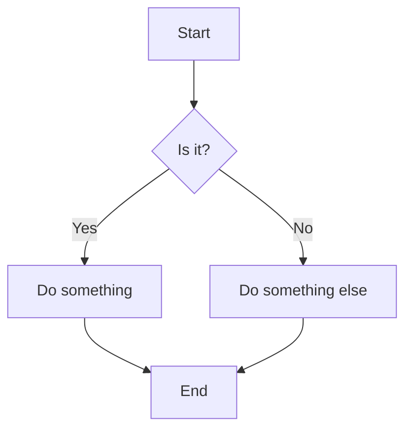
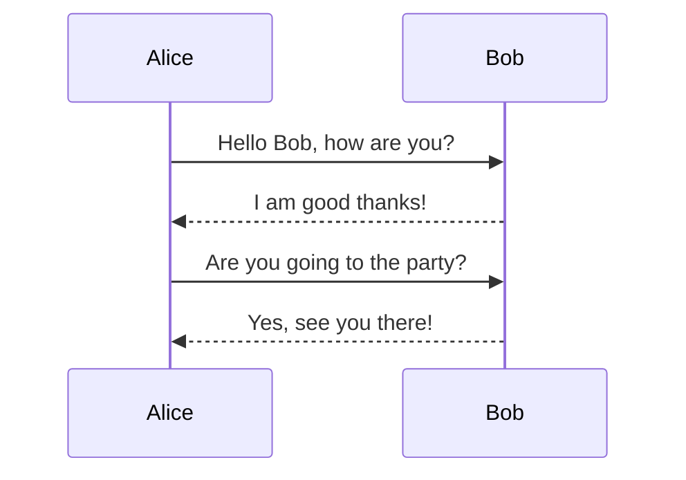
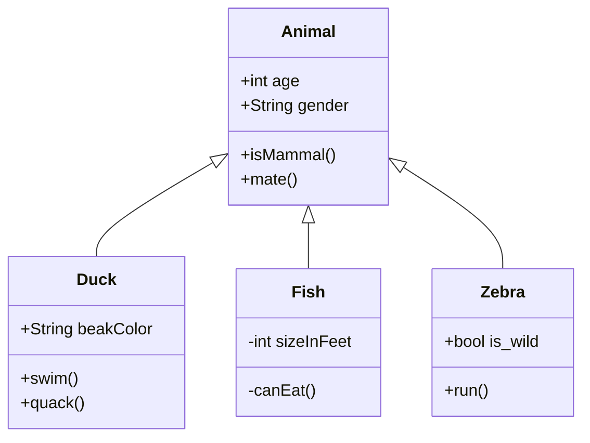
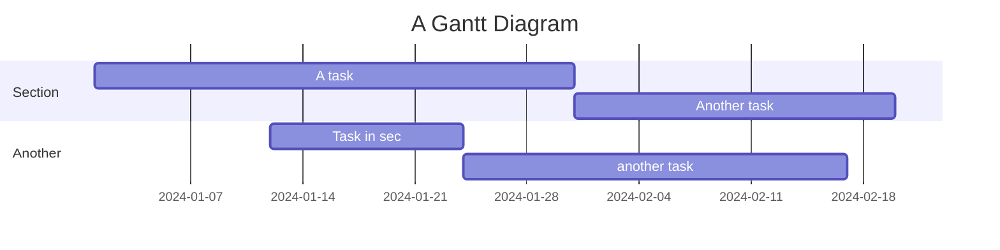

# Mermaid

Library for making Diagrams

Author

Benedict Thekkel

```` python
from IPython.display import display, Markdown

display(Markdown('''

'''))
````


#### 2. Sequence Diagram



#### 3. Class Diagram



#### 4. Gantt Chart



## Running Mermaid Diagrams

Code

``` python
from IPython.display import display, HTML

mermaid_code = """
graph TD
    A[Start] --> B{Is it?}
    B -->|Yes| C[Do something]
    B -->|No| D[Do something else]
    C --> E[End]
    D --> E[End]
"""

display(HTML(f"""
<div class="mermaid">
  {mermaid_code}
</div>
<script type="module">
  import mermaid from 'https://cdn.jsdelivr.net/npm/mermaid@9/dist/mermaid.esm.min.mjs';
  mermaid.initialize({{ startOnLoad: true }});
</script>
"""))
```

graph TD A\[Start\] --\> B{Is it?} B --\>\|Yes\| C\[Do something\] B --\>\|No\| D\[Do something else\] C --\> E\[End\] D --\> E\[End\]

Back to top
